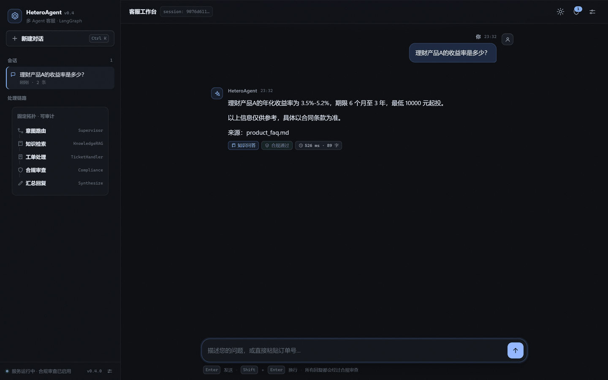
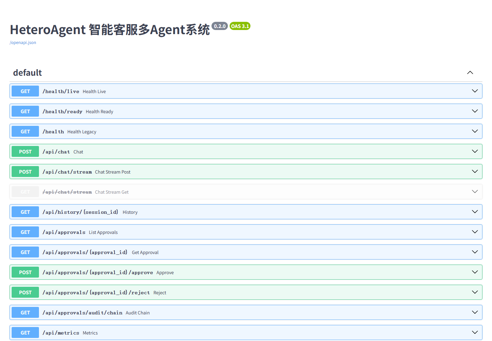
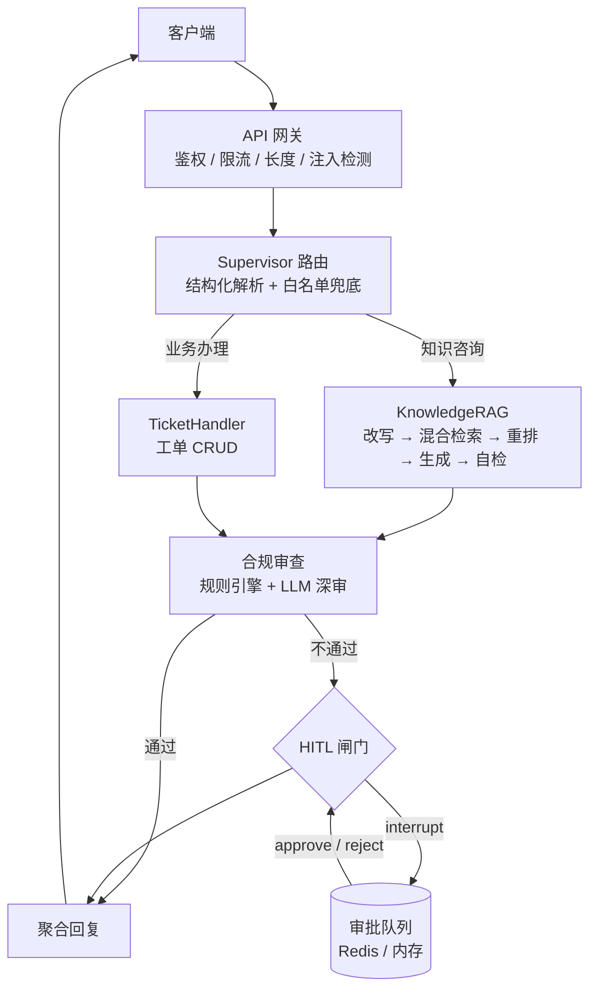

# HeteroAgent · 智能客服多 Agent 系统

基于 **LangGraph 1.x + FastAPI** 的 Supervisor 编排式客服系统：确定性路由 → 业务 Agent（RAG 问答 / 工单）→ **强制合规审查** → 聚合回复。内置提示注入前置拦截、PII 识别与脱敏、图内中断式人工审批（HITL）与哈希链审计。




<details>
<summary>API 文档截图（Swagger UI）</summary>



</details>

---

## 目录

- [能力概览](#能力概览)
- [架构](#架构)
- [快速开始](#快速开始)
- [API](#api)
- [配置](#配置)
- [项目结构](#项目结构)
- [质量保障](#质量保障)
- [设计取舍](#设计取舍)
- [路线图](#路线图)

---

## 能力概览

| 域 | 能力 |
| --- | --- |
| 编排 | LangGraph 固定拓扑（可预测/可审计），路由/工单由 Pydantic schema 约束，异常类型化重试 |
| 工具 | 官方 MCP SDK（`tooling/`）+ `create_agent` 工具循环，每次调用产生 `execute_tool` span |
| 检索 | FAISS 向量 + BM25（单字+双字混合分词）混合检索 + RRF 融合；分数归一化到 [0,1]；支持 Contextual Retrieval 入库 |
| 合规 | 规则引擎（违规用语 + PII）→ LLM 深审；**解析失败 fail-closed**；逐条结果分别脱敏 |
| 安全 | 注入检测前置（NFKC/零宽对抗归一化）、API Key 鉴权、滑动窗口限流、请求体与消息长度上限 |
| 人工 | 合规不通过 → 图内 `interrupt()` 暂停，审批后 `Command(resume=...)` 恢复；哈希链审计 |
| 记忆 | Redis 短期记忆（tiktoken 预算）+ 有界 LRU embedding 缓存；长期知识库去重与原子落盘 |
| 观测 | OpenTelemetry GenAI 语义约定（`gen_ai.*`）、P50/P95 指标、成本累计 |
| 评估 | 38 条 Golden Set（Recall@K / MRR / nDCG / Faithfulness / Coverage）+ 20 条合规标注集（漏放/误杀/脱敏）+ 30 条路由标注集；`python -m evaluation.run` 统一门禁（非 0 退出码） |

## 架构



请求链路上的关键约束：

1. **注入检测先于一切 LLM 调用**（命中即 400，不进入图）。
2. **合规审查不可跳过**：所有子 Agent 产出都必须经过合规节点。
3. **失败语义显式**：embedding 不可用直接抛错（`EmbeddingUnavailableError`），不生成伪向量；合规解析失败一律拦截。

## 快速开始

```bash
# 1. 安装依赖（Python 3.12）
pip install -r requirements.txt        # 运行时依赖（pyproject.toml 为区间真源）
pip install pytest pytest-asyncio ruff fakeredis   # 开发依赖

# 2. 配置
cp .env.example .env
#   填入 OPENAI_API_KEY / OPENAI_BASE_URL / MODEL_NAME

# 3. 启动
python -m uvicorn api.main:app --host 127.0.0.1 --port 8000
#   开发时可加 --reload；生产请用 Dockerfile（多阶段、非 root、无 reload）

# 4. 验证
curl http://127.0.0.1:8000/health/live      # {"status":"live"}
curl -X POST http://127.0.0.1:8000/api/chat ^
  -H "Content-Type: application/json" ^
  -d "{\"message\":\"理财产品A的收益率是多少？\",\"user_id\":\"u1\"}"
```

> 无 API Key 时服务仍可启动（`/health/live` 200），但 `/health/ready` 返回 503、`/api/chat` 明确报错——**不会**伪装成可用。

浏览器打开 <http://127.0.0.1:8000/> 使用聊天界面，<http://127.0.0.1:8000/docs> 查看 OpenAPI。

## API

| 方法 | 路径 | 说明 |
| --- | --- | --- |
| POST | `/api/chat` | 主聊天接口；合规不通过时返回 `approval_id` |
| POST | `/api/chat/stream` | SSE 流式：逐节点真实进度（`stage`）+ 最终回复 + 审批中断 |
| GET | `/api/chat/stream` | 兼容旧调用，已标记 deprecated |
| GET | `/api/history/{session_id}` | 会话历史 |
| GET | `/api/approvals` | 待审批列表 |
| GET | `/api/approvals/{id}` | 审批详情 |
| POST | `/api/approvals/{id}/approve` | 审批通过 → **恢复图执行**，返回清洗后的最终回复 |
| POST | `/api/approvals/{id}/reject` | 审批拒绝 |
| GET | `/api/approvals/audit/chain` | 审计链（含完整性校验结果） |
| GET | `/api/metrics` | Agent 指标（P50/P95/错误率）+ 工具调用日志 |
| POST | `/api/evaluations` | 运行 Golden Set 评估（鉴权 + 并发保护） |
| GET | `/health/live` · `/health/ready` | 存活 / 就绪探针 |
| GET/POST | `/api/tools` · `/api/tools/call` | 调试端点，需 `ENABLE_DEBUG_TOOL_ENDPOINTS=true` |

鉴权：配置 `API_KEYS` 或 `REQUIRE_AUTH=true` 后，请求需带 `X-API-Key`。

## 配置

全部环境变量收敛在 [`config.py`](config.py)（46 项），常用项：

| 变量 | 默认值 | 说明 |
| --- | --- | --- |
| `OPENAI_API_KEY` / `OPENAI_BASE_URL` | — / 官方地址 | 模型凭据，支持兼容网关 |
| `MODEL_NAME` | `gpt-5.1` | 主模型；`LIGHT_MODEL_NAME` 可指定轻模型 |
| `EMBEDDING_MODEL` / `EMBEDDING_DIM` | `text-embedding-3-small` / 1536 | 向量模型与维度 |
| `ALLOW_EMBEDDING_FALLBACK` | `false` | 关闭时 embedding 不可用即报错（禁止伪向量） |
| `RAG_CONFIDENCE_THRESHOLD` | `0.30` | 低于阈值转人工；分数已归一化到 [0,1] |
| `RERANK_ENABLED` / `RERANK_MODEL` | `false` / bge-reranker-v2-m3 | 可选交叉编码器重排 |
| `API_KEYS` / `REQUIRE_AUTH` | 空 / `false` | 接口鉴权 |
| `RATE_LIMIT_PER_MINUTE` | 60 | 每主体每分钟请求上限 |
| `APPROVAL_STORE` | `memory` | 审批存储：`redis` 支持多副本 |
| `CHECKPOINT_BACKEND` | `sqlite` | 图检查点：`sqlite` 支持重启后恢复 HITL |
| `OTEL_EXPORTER_OTLP_ENDPOINT` | 空 | 设置后导出 OTLP，否则仅进程内 span |

完整清单见 [`.env.example`](.env.example)。

## 项目结构

```
.
├── api/main.py              # 应用工厂：鉴权、限流、审批、SSE、健康检查
├── agents/
│   ├── supervisor.py        # 路由 + HITL 闸门 + 聚合 + 图构建
│   ├── knowledge_rag.py     # 改写 → 检索 → 重排 → 生成 → 自检
│   ├── ticket_handler.py    # 工单（解析失败不产生副作用）
│   ├── compliance_checker.py# 规则 + LLM 两阶段审查（fail-closed）
│   └── react_agent.py       # create_agent 工具调用工厂（P1）
├── security/
│   ├── injection.py         # 注入检测（归一化对抗绕过）
│   ├── approvals.py         # 审批存储 + 哈希链审计
│   └── limits.py            # 滑动窗口限流
├── memory/                  # FAISS + BM25 混合检索、Contextual Retrieval 入库；Redis 短期记忆
├── tracing/                 # OpenTelemetry GenAI 语义约定
├── evaluation/              # 评估器 + 38 条版本化数据集
├── tooling/                 # MCP 官方 SDK 工具服务（P1）
├── static/index.html        # 单文件聊天前端
├── tests/                   # 204 项离线测试
└── docs/                    # 升级方案、评估报告、截图
```

## 质量保障

```bash
python -m pytest -q          # 204 passed（全部离线，无需 API Key）
python -m ruff check .       # All checks passed
```

- 测试覆盖缺陷回归（G1–G14）、安全用例（注入变体、越权、限流）、HITL 中断/恢复、检索契约（分数归一化）、评估指标手算校验。
- CI 门禁建议：`ruff → pytest → 评估回归（阈值来自基线）`，见 [docs/UPGRADE-PLAN-v2.md](docs/UPGRADE-PLAN-v2.md) T-P2-05。

## 设计取舍

| 决策 | 理由 |
| --- | --- |
| 保留固定状态图而非自主 Agent 循环 | 金融客服优先可预测、可审计；重试交给框架的有界策略 |
| 合规 fail-closed | 解析失败时放行等于没有合规；宁可转人工 |
| 删除 hash 伪向量降级 | 静默降级会把"随机检索"伪装成可用 |
| 审批通过前清洗违规用语 | 人工放行不等于原文可外发 |
| 不引入向量库/图记忆（暂） | 当前瓶颈是数据正确性，不是存储 |

## 路线图

- [x] **P0** 正确性与安全加固（G1–G14，135 项测试）
- [x] **P1** LangChain 1.x / 图内 HITL + 检查点 / MCP 官方 SDK / GenAI 语义约定
- [ ] **P2** 检索质量（contextual retrieval、中文重排）、评估入 CI、AG-UI 流式、多副本
- [ ] **P3** 按需：A2A、多模态、语义缓存、模型分级路由

详细方案与验收标准：[docs/UPGRADE-PLAN-v2.md](docs/UPGRADE-PLAN-v2.md)；关键决策记录见 [docs/adr/](docs/adr/README.md)（固定拓扑、fail-closed、禁用伪向量、MCP 迁移、HITL、布局策略、工单双实现过渡）。

## 许可

MIT
