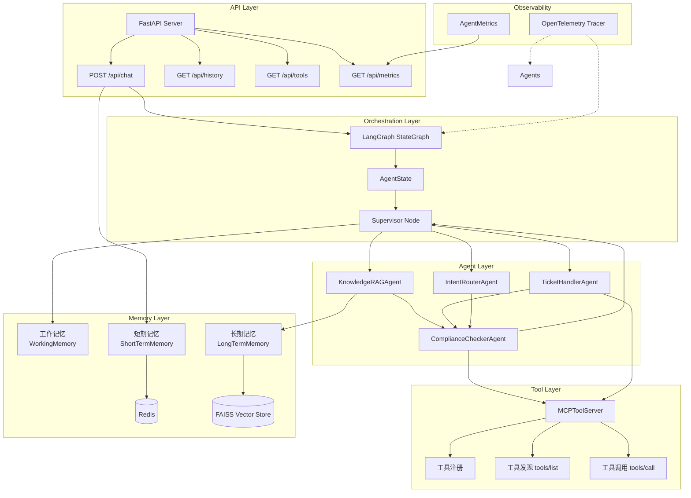
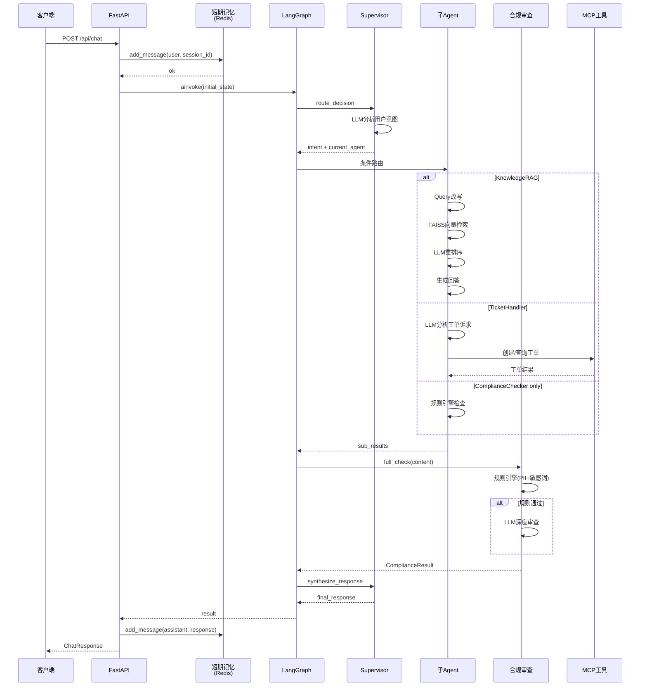
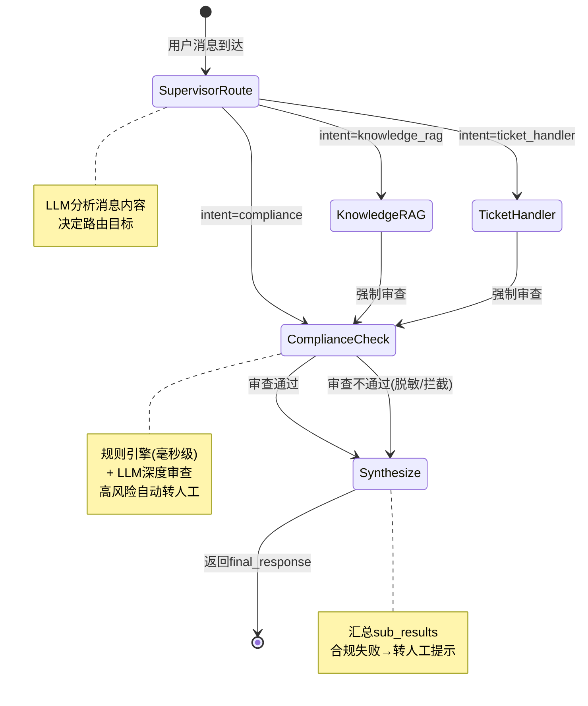
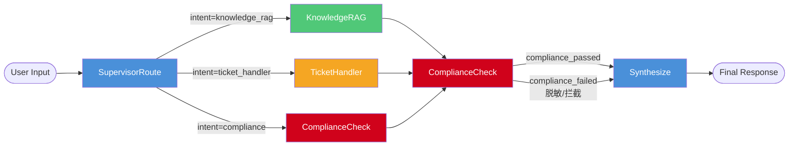
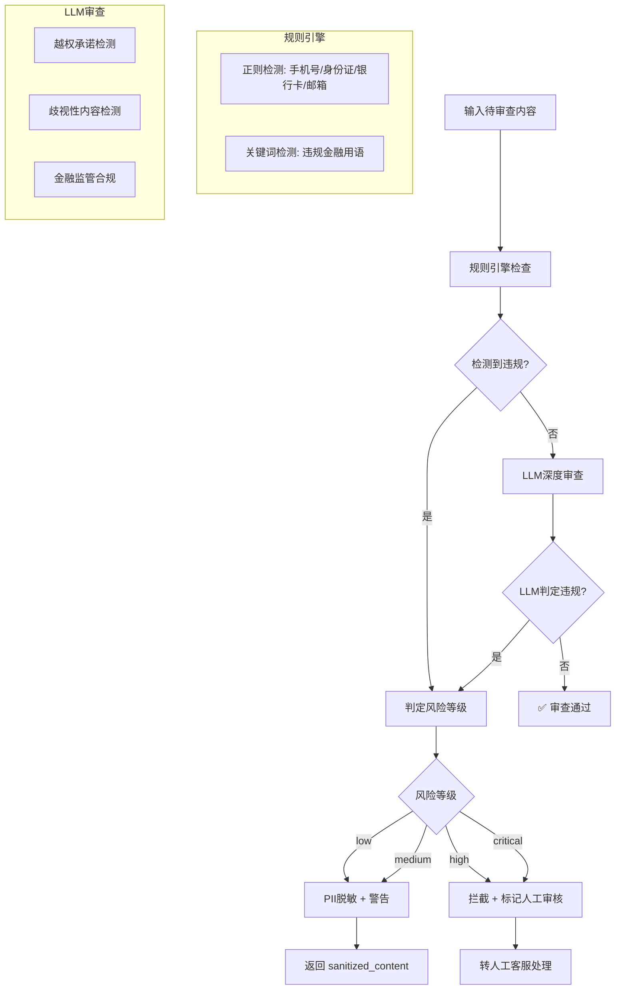
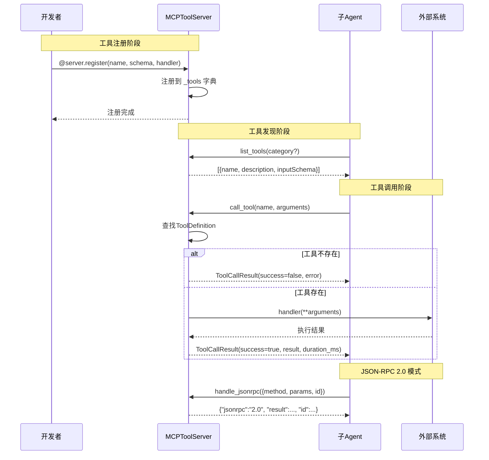
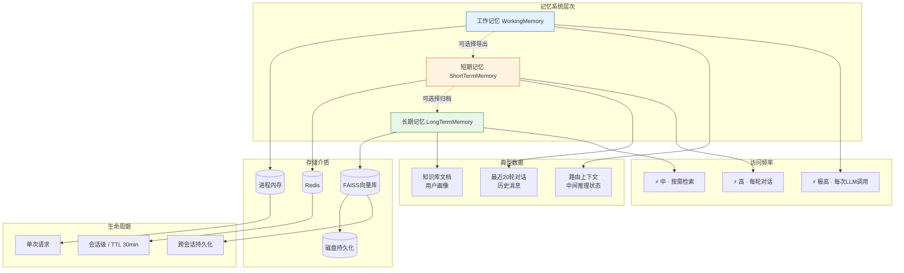

# 智能客服多Agent系统

基于 **LangGraph** + **FastAPI** 的 Supervisor 编排多 Agent 智能客服系统，支持意图路由、RAG 知识库问答、工单处理、合规审查，以及三层记忆系统和 MCP 工具协议。

> **2026-11 P0 升级说明（v0.2.0）**：本版完成正确性与安全加固，详见 [UPGRADE-PLAN-v2.md](UPGRADE-PLAN-v2.md)。
> - 安全：API Key 鉴权、每主体限流、请求体/消息长度上限、CORS 白名单；注入检测前移至 API 入口（任何 LLM 调用之前）。
> - 合规：LLM 解析失败改为 fail-closed；逐个子结果分别脱敏；PII 增加 Luhn / GB11643 校验（订单号不再误判为银行卡）。
> - 审批：改用 `/api/approvals/*`，审批单外置 + 哈希链审计，放行内容经 `sanitize_output` 清洗，不再回传被拦截原文。
> - 检索：删除 hash 伪向量降级；阈值改由 `RAG_CONFIDENCE_THRESHOLD` 配置并由真实分数分布校准。
> - 运维：`/health` 拆 `/health/live` 与 `/health/ready`；`GET /api/evaluate` 改为 `POST /api/evaluations`（鉴权 + 并发保护）。
> - 配置：统一收敛到根目录 `config.py`（46 项），`.env.example` 同步。

---

## 目录

- [系统架构](#系统架构)
- [项目结构](#项目结构)
- [核心流程](#核心流程)
- [模块详解](#模块详解)
  - [API 层](#1-api-层)
  - [编排层 — Supervisor](#2-编排层--supervisor)
  - [Agent 层](#3-agent-层)
  - [工具层 — MCP](#4-工具层--mcp)
  - [记忆层](#5-三层记忆系统)
  - [可观测层](#6-可观测层)
- [快速开始](#快速开始)
- [环境变量](#环境变量)
- [依赖栈](#依赖栈)

---

## 系统架构

### 分层架构图

```
┌──────────────────────────────────────────────────────────────┐
│                     API 层 (FastAPI)                          │
│   POST /api/chat   GET /api/history   GET /api/tools         │
│          POST /api/tools/call   GET /api/metrics             │
├──────────────────────────────────────────────────────────────┤
│              编排层 (LangGraph StateGraph)                    │
│      Supervisor 路由决策 → 子 Agent 执行 → 合规 → 结果聚合     │
├──────────────────────────────────────────────────────────────┤
│   Agent 层                                                    │
│  ┌──────────┐ ┌───────────┐ ┌────────────┐ ┌──────────────┐  │
│  │Intent    │ │Knowledge  │ │Ticket      │ │Compliance    │  │
│  │Router    │ │RAG        │ │Handler     │ │Checker       │  │
│  └──────────┘ └───────────┘ └────────────┘ └──────────────┘  │
├──────────────────────────────────────────────────────────────┤
│  工具层 (MCP — Model Context Protocol)                        │
│   工具注册 · 工具发现 (tools/list) · 工具调用 (tools/call)     │
├──────────────┬────────────────┬─────────────────────────────┤
│  工作记忆     │  短期记忆      │  长期记忆                    │
│  (进程内存)   │  (Redis)      │  (FAISS 向量库)              │
│  请求级状态   │  会话 30min   │  持久化知识库                │
├──────────────┴────────────────┴─────────────────────────────┤
│              可观测层 (OpenTelemetry)                         │
│          Span 追踪 · AgentMetrics 指标收集                    │
└──────────────────────────────────────────────────────────────┘
```

### 组件关系图



---

## 项目结构

```
python-impl/
├── api/
│   ├── __init__.py
│   └── main.py              # FastAPI 入口，REST API + SSE 流式响应
├── agents/
│   ├── __init__.py
│   ├── supervisor.py        # Supervisor 编排 — LangGraph StateGraph
│   ├── intent_router.py     # 意图识别与路由
│   ├── knowledge_rag.py     # RAG 知识库问答
│   ├── ticket_handler.py    # 工单 CRUD 与流转
│   └── compliance_checker.py # 合规审查
├── memory/
│   ├── __init__.py
│   ├── working_memory.py    # 工作记忆（进程内存）
│   ├── short_term.py        # 短期记忆（Redis）
│   └── long_term.py         # 长期记忆（FAISS 向量库）
├── mcp/
│   ├── __init__.py
│   ├── mcp_server.py        # MCP 工具协议服务端
│   └── tools/
│       └── __init__.py
├── tracing/
│   ├── __init__.py
│   └── otel_config.py       # OpenTelemetry 全链路追踪
├── Dockerfile
├── requirements.txt
└── .env.example
```

---

## 核心流程

### 请求处理时序图



### 状态图流转



---

## 模块详解

### 1. API 层

FastAPI 应用，提供 5 个端点：

| 端点 | 功能 |
|------|------|
| `POST /api/chat` | 主聊天接口，触发整个 Agent 流程 |
| `GET /api/history/{session_id}` | 获取对话历史 |
| `GET /api/tools` | MCP 工具发现 |
| `POST /api/tools/call` | MCP 工具调用 |
| `GET /api/metrics` | Agent 调用指标汇总 |

lifespan 回调初始化全局组件：OpenTelemetry 追踪器、LangGraph 编排图、预置知识库文档。每个聊天请求将用户消息写入 Redis 短期记忆，调用 LangGraph 图执行，完成后将回复写回短期记忆。

---

### 2. 编排层 — Supervisor

核心是基于 `langgraph.graph.StateGraph` 的有向状态图，包含 5 个节点：



**全局状态 `AgentState`**:
- `messages`: 消息列表（支持 add_messages 归约操作）
- `intent`: 当前识别的意图
- `sub_results`: 各子 Agent 返回结果字典
- `compliance_passed`: 合规审查是否通过
- `final_response`: 最终回复
- `retry_count`: 重试计数

**关键设计**:
- `SupervisorNode.route_decision` — LLM 分析用户消息，决定路由到哪个子 Agent
- `SupervisorNode.synthesize_response` — 汇总 `sub_results` 生成最终回复；合规未通过时自动转人工
- 所有子 Agent 执行后**强制经过合规审查**，不可跳过
- 支持 `MemorySaver` 检查点，可用于 human-in-the-loop 断点恢复

---

### 3. Agent 层

#### 3.1 IntentRouterAgent — 意图路由

- 多级意图分类：一级（咨询/投诉/交易办理/账户/合规）→ 二级（具体业务子类型）
- 提取关键实体（订单号、产品名、金额等）
- 输出 `IntentResult`，含置信度和建议路由目标
- 金融特殊规则：资金安全→合规审查，退款→工单，产品咨询→知识库

#### 3.2 KnowledgeRAGAgent — 知识库问答

完整 RAG 流程：
1. **Query 改写** — 口语化问题转为检索友好查询
2. **向量检索** — 从 FAISS 语义搜索相关文档
3. **重排序** — LLM 对候选文档按相关性排序（取 top-3）
4. **生成回答** — 基于检索文档生成客服回复，标注来源和风险提示

#### 3.3 TicketHandlerAgent — 工单处理

- 工单创建、查询、状态更新
- 内置内存版 `TicketStore`（生产环境可替换为数据库）
- 工单号格式：`TK-YYYYMMDD-XXXXXX`
- 6 种工单状态、4 级优先级、6 种工单类型
- LLM 分析用户消息 → 提取工单信息 → 自动执行

#### 3.4 ComplianceCheckerAgent — 合规审查



两阶段审查策略：
1. **规则引擎**（毫秒级）
   - 正则检测 PII：手机号、身份证号、银行卡号、邮箱
   - 关键词检测违规金融用语（"保证收益"、"零风险"等）
2. **LLM 深度审查**（语义级）
   - 越权承诺检测、歧视性内容、金融监管合规

PII 自动脱敏（保留首尾 3 位），风险等级 low → medium → high → critical，高风险直接拦截。

---

### 4. 工具层 — MCP



实现 Anthropic Model Context Protocol 标准：

| 方法 | 功能 |
|------|------|
| `tools/list` | 工具发现，返回名称/描述/inputSchema/分类 |
| `tools/call` | 工具调用，JSON-RPC 2.0 格式 |
| `ping` | 健康检查 |

**注册方式** — 装饰器模式：
```python
@server.register(name="order_query", description="...", input_schema={...}, category="order")
async def order_query(order_id: str = "", user_id: str = "") -> dict:
    ...
```

**预置工具**: `order_query`（订单查询）、`knowledge_search`（知识库搜索）、`ticket_create`（工单创建）、`risk_check`（风控检查）。

---

### 5. 三层记忆系统



| 层级 | 存储后端 | 生命周期 | 核心用途 |
|------|----------|----------|----------|
| **工作记忆** | 进程内 dict | 单次请求 | 路由上下文、中间推理状态 |
| **短期记忆** | Redis list | TTL 30 分钟 | 最近 20 轮对话历史 |
| **长期记忆** | FAISS 向量库 | 持久化 | 知识库文档、语义检索 |

**工作记忆** (`memory/working_memory.py`):
- 线程安全，按 session_id 隔离
- 最大 50 条 / session，支持导出持久化

**短期记忆** (`memory/short_term.py`):
- 懒加载 Redis 连接，连接失败自动 fallback 到进程内存
- 滑动窗口淘汰 + TTL 自动过期
- `get_context_window(max_tokens)` 按 token 数截取上下文

**长期记忆** (`memory/long_term.py`):
- FAISS Inner Product 索引 + 简易 hash-based embedding（生产环境可替换为 OpenAI Embedding API）
- 文本分块策略：512 字块 + 128 字重叠，优先按段落分割
- 检索回退：FAISS 不可用时降级为关键词搜索
- 支持知识库目录批量加载和索引持久化

---

### 6. 可观测层

```mermaid
flowchart LR
    subgraph "Agent 调用"
        A1[IntentRouter]
        A2[KnowledgeRAG]
        A3[TicketHandler]
        A4[ComplianceChecker]
        A5[Supervisor]
    end

    subgraph "Tracing"
        T[OpenTelemetry]
        S1[Span: agent.intent_router.classify]
        S2[Span: agent.knowledge_rag.process]
        S3[Span: agent.ticket_handler.process]
        S4[Span: agent.compliance.full_check]
        S5[Span: agent.supervisor.route_decision]
    end

    subgraph "导出后端"
        OTLP[OTLP Collector]
        Console[Console Exporter]
        Jaeger[Jaeger / Zipkin]
    end

    subgraph "Metrics"
        M[AgentMetrics]
        MC[调用次数统计]
        ML[平均耗时统计]
        ME[错误率统计]
    end

    A1 & A2 & A3 & A4 & A5 -->|@trace_agent_call| T
    T --> S1 & S2 & S3 & S4 & S5
    T --> OTLP --> Jaeger
    T --> Console
    T --> M
    M --> MC & ML & ME
    ME -->|告警| Alert[异常告警]

    style T fill:#6a1b9a,color:#fff
    style M fill:#6a1b9a,color:#fff
    style Alert fill:#d0021b,color:#fff
```

- **`trace_agent_call(agent_name)` 装饰器** — 为每个 Agent 方法创建 OpenTelemetry Span，记录 agent.name、duration_ms、success、error 等属性，异常时自动 recording exception
- **AgentMetrics 指标收集器** — 按 Agent 统计调用次数、平均耗时、错误率，通过 `/api/metrics` 暴露
- **导出后端** — 支持 OTLP (Jaeger/Zipkin) 或控制台输出

---

## 快速开始

### 前置条件

- Python 3.12+
- Redis（短期记忆，可选，自动 fallback）
- OpenAI API Key

### 安装与运行

```bash
# 克隆项目
git clone <repo-url>
cd python-impl

# 安装依赖
pip install -r requirements.txt

# 配置环境变量
cp .env.example .env
# 编辑 .env 填入 OPENAI_API_KEY

# 启动服务
python -m api.main
```

服务默认启动在 `http://localhost:8000`。

### Docker

```bash
docker build -t smart-cs-agent .
docker run -p 8000:8000 --env-file .env smart-cs-agent
```

### 测试

```bash
curl -X POST http://localhost:8000/api/chat \
  -H "Content-Type: application/json" \
  -d '{"message": "理财产品A的收益率是多少？", "user_id": "user001", "session_id": "session001"}'
```

---

## 环境变量

| 变量 | 默认值 | 说明 |
|------|--------|------|
| `OPENAI_API_KEY` | — | OpenAI API 密钥 |
| `OPENAI_BASE_URL` | `https://api.openai.com/v1` | API 端点 |
| `MODEL_NAME` | `gpt-4o` | 模型名称 |
| `REDIS_URL` | `redis://localhost:6379/0` | Redis 连接地址 |
| `FAISS_INDEX_PATH` | `./vector_store/faiss_index` | FAISS 索引持久化路径 |
| `OTEL_SERVICE_NAME` | `smart-cs-multi-agent` | 链路追踪服务名 |
| `OTEL_EXPORTER_OTLP_ENDPOINT` | `http://localhost:4317` | OTLP 收集器地址 |
| `HOST` | `0.0.0.0` | 服务监听地址 |
| `PORT` | `8000` | 服务端口 |

---

## 依赖栈

| 依赖 | 版本 | 用途 |
|------|------|------|
| `langgraph` | ≥0.3.0 | Agent 编排状态图引擎 |
| `langchain` | ≥0.3.0 | LLM 调用框架 |
| `langchain-openai` | ≥0.3.0 | OpenAI 模型集成 |
| `fastapi` | ≥0.115.0 | REST API 框架 |
| `uvicorn` | ≥0.32.0 | ASGI 服务器 |
| `redis` | ≥5.2.0 | 短期记忆缓存 |
| `faiss-cpu` | ≥1.9.0 | 向量索引与相似度搜索 |
| `opentelemetry-*` | ≥1.29.0 | 全链路追踪 |
| `mcp` | ≥1.0.0 | Model Context Protocol |
| `pydantic` | ≥2.10.0 | 数据验证 |
| `httpx` | ≥0.28.0 | HTTP 客户端 |
| `tiktoken` | ≥0.8.0 | Token 计数 |
| `numpy` | ≥1.26.0 | 向量运算 |
| `python-dotenv` | ≥1.0.0 | 环境变量加载 |

---

## 扩展指南

### 新增子 Agent

1. 在 `agents/` 下创建 Agent 类，实现 `process(self, state) -> dict` 方法
2. 在 `supervisor.py` 中注册节点和边
3. 在 `route_to_agent` 映射表中添加路由
4. 更新 `SupervisorNode` 的系统提示词

### 新增 MCP 工具

```python
@mcp_server.register(
    name="tool_name",
    description="工具描述",
    input_schema={"type": "object", "properties": {...}},
    category="category_name",
)
async def my_tool(...):
    ...
```

### 切换向量数据库

`LongTermMemory` 的 FAISS 实现已预留替换接口，生产环境可切换为 Milvus、Pinecone 或 Chroma，只需实现 `search()` 和 `add_document()` 方法。

---

## 许可

MIT
