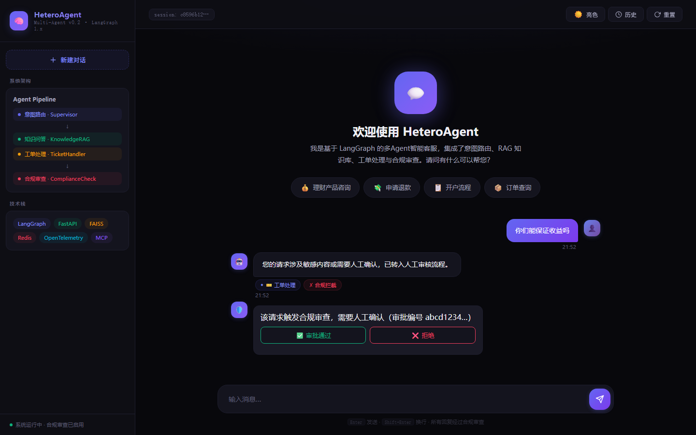
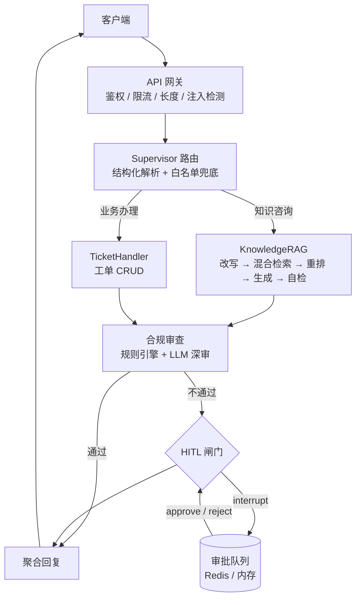
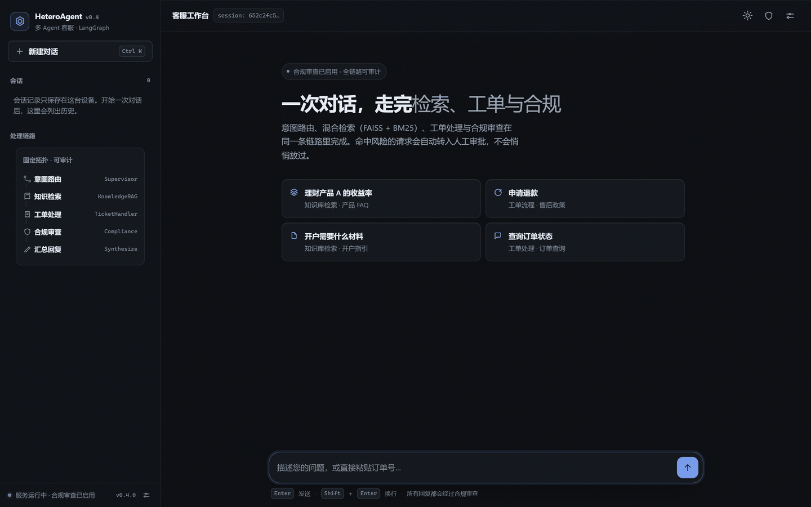

# HeteroAgent · 智能客服多 Agent 系统

基于 **LangGraph 1.x + FastAPI** 的 Supervisor 编排式客服系统：确定性路由 → 业务 Agent（RAG 问答 / 工单）→ **强制合规审查** → 聚合回复。内置提示注入前置拦截、PII 识别与脱敏、图内中断式人工审批（HITL）与哈希链审计。


**在线演示**：[lc-di-yan.github.io/HeteroAgent](https://lc-di-yan.github.io/HeteroAgent/) · 静态脚本化后端，不调用真实模型、不含密钥。


<details>
<summary>合规拦截 → 聊天流内直接审批（HITL）</summary>



</details>

<details>
<summary>API 文档截图（Swagger UI）</summary>


</details>

---

## 目录

- [能力概览](#能力概览)
- [架构](#架构)
- [前端工作台](#前端工作台)
- [快速开始](#快速开始)
- [API](#api)
- [配置](#配置)
- [项目结构](#项目结构)
- [质量保障](#质量保障)
- [设计取舍](#设计取舍)
- [路线图](#路线图)

---

## 能力概览

| 域 | 能力 |
| --- | --- |
| 编排 | LangGraph 固定拓扑（可预测/可审计），路由/工单由 Pydantic schema 约束，异常类型化重试 |
| 工具 | 官方 MCP SDK（`tooling/`）+ `create_agent` 工具循环；工单与知识检索都经工具调用，每次调用产生 `execute_tool` span |
| 检索 | FAISS 向量 + BM25（单字+双字混合分词）混合检索 + RRF 融合；分数归一化到 [0,1]；支持 Contextual Retrieval 入库 |
| 合规 | 规则引擎（违规用语 + PII）→ LLM 深审；**解析失败 fail-closed**；逐条结果分别脱敏 |
| 安全 | 注入检测前置（NFKC/零宽对抗归一化）+ 可选模型护栏链、API Key 鉴权、全端点限流（含管理端点）、长度上限 |
| 人工 | 合规不通过 → 图内 `interrupt()` 暂停，审批后 `Command(resume=...)` 恢复；聊天界面内可直接通过/拒绝；哈希链审计 |
| 前端 | 原生 ES 模块（零构建、零外链、离线可用）；SSE 阶段进度 + token 增量渲染；会话内与抽屉内审批、服务端历史、运行指标、设置（API Key / user_id / AG-UI）；明暗双主题与移动端抽屉 |
| 记忆 | Redis 短期记忆 + 跨会话用户事实（LangGraph Store，org/user 隔离）+ 有界 LRU embedding 缓存；可选语义缓存 |
| 成本 | 主/轻模型分级、每用户自然日预算硬上限（requests/tokens）、用量响应头 |
| 观测 | OTel GenAI 语义约定（`gen_ai.*`）、P50/P95/P99、成本累计、Prometheus 导出、JSON 结构化日志（request_id 贯穿）、评估结果回挂 trace |
| 评估 | 263 条检索用例（120 篇语料）+ 20 条合规 + 30 条路由 + 执行轨迹；`make kb-bench` 出 Recall@K/MRR/nDCG/重排 A/B；`make eval` 统一门禁 |

## 架构



请求链路上的关键约束：

1. **注入检测先于一切 LLM 调用**（命中即 400，不进入图）。
2. **合规审查不可跳过**：所有子 Agent 产出都必须经过合规节点。
3. **失败语义显式**：embedding 不可用直接抛错（`EmbeddingUnavailableError`），不生成伪向量；合规解析失败一律拦截。

## 前端工作台

工作台把链路状态放进同一条对话流：阶段进度、合规拦截、人工审批、服务端历史与运行指标。零构建（原生 ES 模块）、零外链，断网也能渲染。

在线演示：[https://lc-di-yan.github.io/HeteroAgent/](https://lc-di-yan.github.io/HeteroAgent/)（静态脚本化后端；真实链路见下方快速开始）。

[](docs/FRONTEND.md)

| 能力 | 说明 |
| --- | --- |
| 双流渲染 | 节点级 stage 进度 + token 级增量；停止、重试、吸底跟随 |
| 审批台 | 会话内审批卡 + 抽屉审批队列 + 哈希链校验 |
| 可观测 | 服务端历史（STM）、节点 P95 / token / 成本、MCP 熔断状态 |
| 零依赖 | 系统字体栈 + 内联 SVG 图标；首屏 0 个外部请求，DOMContentLoaded ≈ 164ms |

完整说明（截图、状态机、SSE / AG-UI 契约、无障碍与验证）见 [docs/FRONTEND.md](docs/FRONTEND.md)。

## 快速开始

```bash
# 1. 安装依赖（Python 3.12）
pip install -r requirements.txt        # 运行时依赖（pyproject.toml 为区间真源）
pip install pytest pytest-asyncio ruff fakeredis   # 开发依赖

# 2. 配置
cp .env.example .env
#   填入 OPENAI_API_KEY / OPENAI_BASE_URL / MODEL_NAME

# 3. 启动
python -m uvicorn api.main:app --host 127.0.0.1 --port 8000
#   开发时可加 --reload；生产请用 Dockerfile（多阶段、非 root、无 reload）

# 4. 验证
curl http://127.0.0.1:8000/health/live      # {"status":"live"}
curl -X POST http://127.0.0.1:8000/api/chat ^
  -H "Content-Type: application/json" ^
  -d "{\"message\":\"理财产品A的收益率是多少？\",\"user_id\":\"u1\"}"
```

> **想立刻看到效果？** 无需 API Key：
> ```bash
> DEMO_MODE=true python -m uvicorn api.main:app --host 127.0.0.1 --port 8000
> ```
> 演示模式用脚本化假模型 + 关键字知识库跑通「路由 → 检索 → 合规 → 聚合 → 人工审批」全链路，
> 启动日志会打警告；生产必须保持 `DEMO_MODE=false`。
>
> 未开启演示且无 API Key 时，服务仍可启动（`/health/live` 200），但 `/health/ready` 返回 503、`/api/chat` 明确报错——**不会**伪装成可用。

浏览器打开 <http://127.0.0.1:8000/> 使用聊天界面，<http://127.0.0.1:8000/docs> 查看 OpenAPI。

## API

| 方法 | 路径 | 说明 |
| --- | --- | --- |
| POST | `/api/chat` | 主聊天接口；合规不通过时返回 `approval_id` |
| POST | `/api/chat/stream` | SSE 流式：节点进度 `stage` + token 级 `token`（仅最终答案）+ `response` + 审批中断；`?protocol=agui` 输出 AG-UI 事件 |
| GET | `/api/chat/stream` | 兼容旧调用，已标记 deprecated |
| GET | `/api/history/{session_id}` | 会话历史 |
| GET | `/api/approvals` | 待审批列表 |
| GET | `/api/approvals/{id}` | 审批详情 |
| POST | `/api/approvals/{id}/approve` | 审批通过 → **恢复图执行**，返回清洗后的最终回复 |
| POST | `/api/approvals/{id}/reject` | 审批拒绝 |
| GET | `/api/approvals/audit/chain` | 审计链（含完整性校验结果） |
| GET | `/api/metrics` | Agent 指标（P50/P95/错误率）+ 工具调用日志 |
| POST | `/api/evaluations` | 运行 Golden Set 评估（鉴权 + 并发保护） |
| GET | `/metrics` | Prometheus 文本指标（默认识别 `X-API-Key`；`METRICS_PUBLIC=true` 可放开） |
| GET | `/health/live` · `/health/ready` | 存活 / 就绪探针 |
| GET/POST | `/api/tools` · `/api/tools/call` | 调试端点，需 `ENABLE_DEBUG_TOOL_ENDPOINTS=true` |

鉴权：配置 `API_KEYS` 或 `REQUIRE_AUTH=true` 后，请求需带 `X-API-Key`。

## 配置

全部环境变量收敛在 [`config.py`](config.py)（46 项），常用项：

| 变量 | 默认值 | 说明 |
| --- | --- | --- |
| `OPENAI_API_KEY` / `OPENAI_BASE_URL` | — / 官方地址 | 模型凭据，支持兼容网关 |
| `MODEL_NAME` / `LIGHT_MODEL_NAME` | `gpt-5.1` / 空 | 主模型用于生成与合规；轻模型仅用于路由（空=复用主模型） |
| `USE_RESPONSES_API` / `STREAM_USAGE` | `false` / `true` | Responses API 与流式 usage 回传（供应商不支持时参数自动忽略） |
| `STRUCTURED_OUTPUT_ENABLED` | `true` | 代理不支持 `response_format` 时设 `false`，避免每次决策多一次失败请求 |
| `PROMPT_CACHE_KEY` / `REASONING_EFFORT` | 空 / 空 | 提示词缓存槽位、推理强度（可选） |
| `EMBEDDING_MODEL` / `EMBEDDING_DIM` | `text-embedding-3-small` / 1536 | 向量模型与维度 |
| `ALLOW_EMBEDDING_FALLBACK` | `false` | 关闭时 embedding 不可用即报错（禁止伪向量） |
| `RAG_CONFIDENCE_THRESHOLD` | `0.30` | 低于阈值转人工；**务必用 `make calibrate` 按自己的 embedding 模型校准**（实测某模型最优值为 0.53） |
| `RERANK_ENABLED` / `RERANK_MODEL` | `false` / bge-reranker-v2-m3 | 本地交叉编码器重排 |
| `RERANK_API_BASE_URL` / `RERANK_API_KEY` | 空 / 空 | API 重排（`/rerank`），配置后优先于本地模型 |
| `EMBEDDING_API_KEY` / `EMBEDDING_BASE_URL` | 空 / 空 | Embedding 独立供应商（留空复用 LLM 凭据） |
| `API_KEYS` / `REQUIRE_AUTH` | 空 / `false` | 接口鉴权 |
| `RATE_LIMIT_PER_MINUTE` / `RATE_LIMIT_BACKEND` | 60 / `memory` | 每主体每分钟上限；`redis` 时多副本共享配额 |
| `TENANT_DAILY_REQUESTS` / `TENANT_DAILY_TOKENS` | 0 / 0 | 每用户自然日预算（0=不限），超出返回 429 |
| `SEMANTIC_CACHE_ENABLED` | `false` | 语义缓存（仅非个性化知识问答，阈值 0.95） |
| `APPROVAL_STORE` | `memory` | 审批存储：`redis` 支持多副本 |
| `CHECKPOINT_BACKEND` | `sqlite` | 图检查点：`sqlite` 单副本；`postgres` 多副本共享（需 `POSTGRES_DSN`） |
| `OTEL_EXPORTER_OTLP_ENDPOINT` | 空 | 设置后导出 OTLP，否则仅进程内 span |
| `LOG_FORMAT` / `LOG_LEVEL` | `text` / `INFO` | `json` 输出单行结构化日志，含 `request_id` |
| `OTEL_METRICS_ENABLED` | `false` | 开启后指标经 OTLP 上报，多副本可在 collector 侧聚合 |

完整清单见 [`.env.example`](.env.example)。

## 项目结构

```
.
├── api/main.py              # 应用工厂：鉴权、限流、审批、SSE、健康检查
├── agents/
│   ├── supervisor.py        # 路由 + HITL 闸门 + 聚合 + 图构建
│   ├── knowledge_rag.py     # 改写 → 检索 → 重排 → 生成 → 自检
│   ├── ticket_handler.py    # 工单（解析失败不产生副作用）
│   ├── compliance_checker.py# 规则 + LLM 两阶段审查（fail-closed）
│   ├── provider.py          # 模型接入层（Responses API / 参数签名过滤 / stream_usage）
│   ├── llm_factory.py       # 主/轻模型分级（路由走轻模型）
│   ├── react_agent.py       # create_agent 工具调用工厂
│   └── demo_mode.py         # 离线演示：脚本化模型 + 关键字知识库
├── security/
│   ├── injection.py         # 注入检测（归一化对抗绕过）
│   ├── guardrail.py         # 护栏链（规则 + 可插拔模型分类器）
│   ├── approvals.py         # 审批存储 + 哈希链审计
│   └── limits.py            # 滑动窗口限流
├── memory/                  # FAISS + BM25 混合检索、Contextual Retrieval、用户事实存储；Redis 短期记忆
├── tracing/                 # OTel GenAI 语义约定、指标导出、评估回挂
├── events/                  # 流式事件编码（legacy / AG-UI）
├── evaluation/              # 评估器、路由/合规评估、阈值校准、38 条数据集
├── tooling/                 # MCP 官方 SDK 工具服务（P1）
├── knowledge_base/          # 120 篇合成演示语料（产品/账户/售后各 40）
├── persistence/             # 统一工单仓储（MCP 工具 + 降级路径共用）
├── static/                  # 前端工作台（语义化 HTML + 设计令牌 + 原生 ES 模块）
│   ├── index.html           # 骨架：会话侧栏 / 对话流 / 历史·审批·指标·设置抽屉
│   ├── css/app.css          # 设计系统：明暗双主题、单一强调色、响应式
│   └── js/                  # app.js 编排 · api.js SSE 客户端 · markdown.js 安全渲染
│                            # · store.js 本地持久化 · icons.js 图标集
├── scripts/check.py         # 提交前检查（ruff + pytest），pre-commit 钩子调用
├── tests/                   # 394 项离线测试（含前端契约测试）
└── docs/                    # 升级方案、评估报告、截图
```

## 质量保障

```bash
python -m pytest -q          # 394 passed（全部离线，无需 API Key）
python -m ruff check .       # All checks passed
make hooks                   # 启用本地 pre-commit（GitHub CI 未启用时的兜底）
python -m pytest -q --cov    # 覆盖率约 82%（口径见 pyproject.toml）
```

- 测试覆盖缺陷回归（G1–G14）、安全用例（注入变体、越权、限流）、HITL 中断/恢复、检索契约（分数归一化）、评估指标手算校验。
- CI 门禁建议：`ruff → pytest → 评估回归（阈值来自基线）`，见 [docs/UPGRADE-PLAN-v2.md](docs/UPGRADE-PLAN-v2.md) T-P2-05。

## 设计取舍

| 决策 | 理由 |
| --- | --- |
| 保留固定状态图而非自主 Agent 循环 | 金融客服优先可预测、可审计；重试交给框架的有界策略 |
| 合规 fail-closed | 解析失败时放行等于没有合规；宁可转人工 |
| 删除 hash 伪向量降级 | 静默降级会把"随机检索"伪装成可用 |
| 审批通过前清洗违规用语 | 人工放行不等于原文可外发 |
| 不引入向量库/图记忆（暂） | 当前瓶颈是数据正确性，不是存储 |

## 路线图

- [x] **P0** 正确性与安全加固（G1–G14，135 项测试）
- [x] **P1** LangChain 1.x / 图内 HITL + 检查点 / MCP 官方 SDK / GenAI 语义约定
- [ ] **P2** 检索质量（contextual retrieval、中文重排）、评估入 CI、AG-UI 流式、多副本
- [ ] **P3** 按需：A2A、多模态、语义缓存、模型分级路由

详细方案与验收标准：[docs/UPGRADE-PLAN-v2.md](docs/UPGRADE-PLAN-v2.md)；关键决策记录见 [docs/adr/](docs/adr/README.md)（固定拓扑、fail-closed、禁用伪向量、MCP 迁移、HITL、布局策略、工单双实现过渡、跨会话事实）。

变更历史见 [CHANGELOG.md](CHANGELOG.md)，参与开发见 [CONTRIBUTING.md](CONTRIBUTING.md)，
逐任务完成情况见 [docs/STATUS.md](docs/STATUS.md)（对照方案 T-P0-01…T-P3-06）；
真实模型验证结论见 [docs/REAL-MODEL-VALIDATION.md](docs/REAL-MODEL-VALIDATION.md)；
大规模检索基准见 [docs/RETRIEVAL-BENCHMARK.md](docs/RETRIEVAL-BENCHMARK.md) 与 [归因分析](docs/RETRIEVAL-ANALYSIS.md)。

## 许可

MIT
