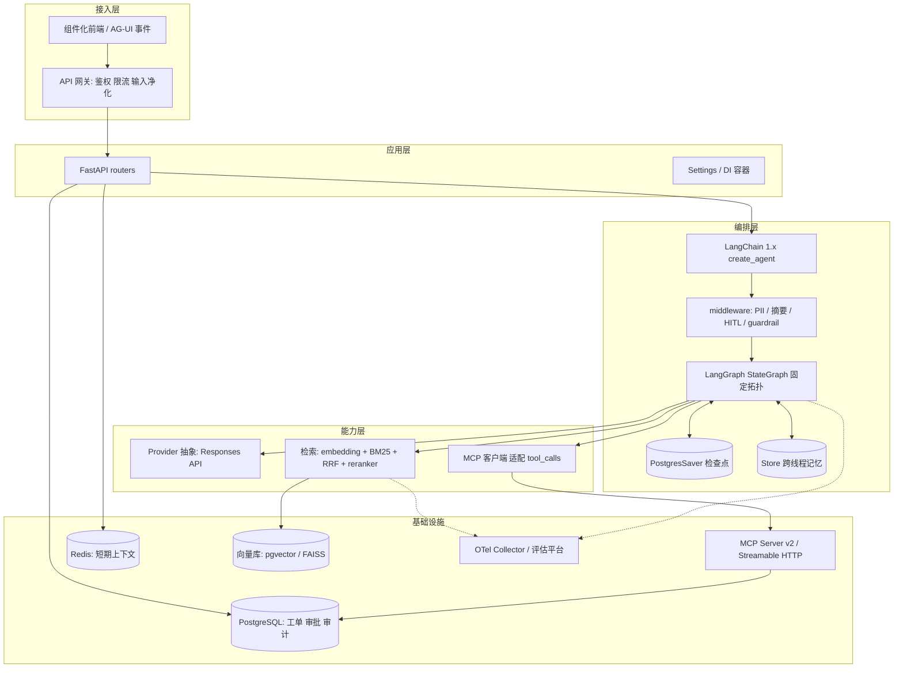
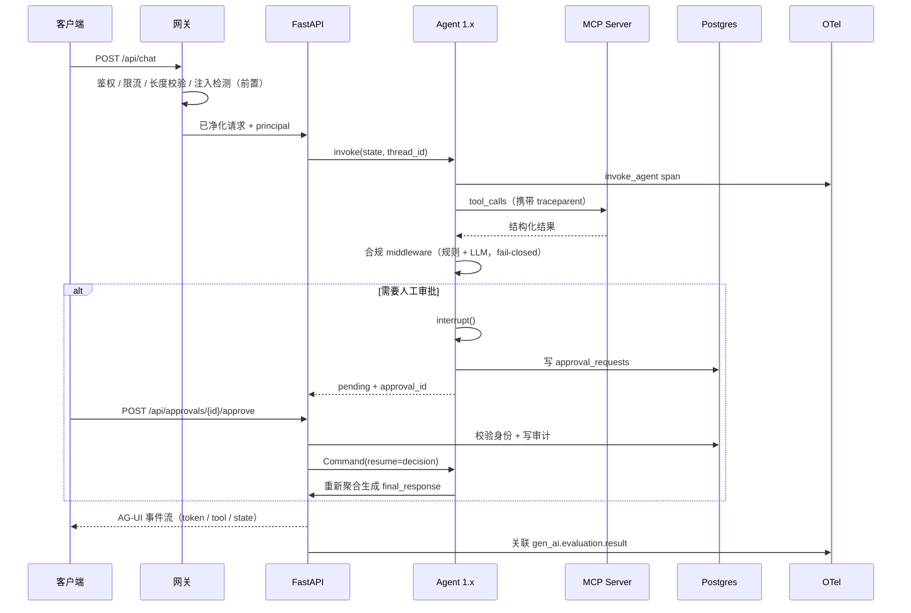
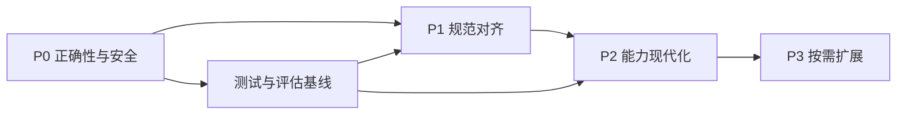

# HeteroAgent 全面升级开发方案

| 项目 | 内容 |
| --- | --- |
| 版本 | **v2.0（合并版）** |
| 日期 | 2026-11-06 |
| 取代 | `UPGRADE-PLAN.md`（v1.0，保留作历史参考） |
| 来源 A | `UPGRADE-PLAN.md` v1.0：目标架构、任务表（T-P0/P1/P2/P3）、契约、DB 设计、风险登记 |
| 来源 B | 2026-11-06 会话全面分析：版本实测事实（PyPI / 官方站点）、缺陷补充 G10–G14、异步边界 / 包名阴影 / 模型化护栏 / 选型清单 |
| 基线 | 当前工作区快照；静态审阅结论见 `tech-assessment-2026-11.html`（00–10 章，缺陷编号 A1–G9） |
| 适用范围 | 架构、编排、模型接入、工具协议、记忆检索、可观测与评估、工程交付、安全合规 |
| 交付形态 | 开发方案，不含已实现代码；文中代码块为改造示例，落地时按锁定版本文档核对 API 名称 |

---

## 0. v2.0 合并说明

### 0.1 两方差异总表（本次合并的依据）

**来源 B（会话分析）有、v1.0 缺失，本版已并入：**

| # | 补充项 | 去向 |
| --- | --- | --- |
| B1 | 依赖版本**实测锁定表**（2026-11-06 PyPI JSON API 实测：langgraph 1.2.20 / langchain 1.4.9 / mcp 2.3.0 / redis 8.1.0 等；Azure 目录确认 GPT-5.6 系列为主力线） | 8.3 + T-P1-01 / T-P1-04 |
| B2 | 缺陷 **G10**：合规失败文案谎报「工单编号已自动生成」（未建工单）；审批「队列编号」实为 session_id[:8] | 1.3 + T-P0-03 |
| B3 | 缺陷 **G11**：同步调用阻塞事件循环（同步 embed_query、同步 CrossEncoder.predict、启动期同步探测卡 lifespan） | 1.3 + T-P0-10 |
| B4 | 缺陷 **G12**：本地 `mcp/` 目录与 PyPI `mcp` 包同名，迁移官方 SDK 时存在 import 阴影风险 | 1.3 + T-P1-01 / 4.3 |
| B5 | 缺陷 **G13**：`httpx` 声明未用；`OTEL_TRACES_SAMPLER` 配置未读取；README「最近 20 轮」实为 20 条消息 | 1.4 + T-P0-08 / T-P1-09 |
| B6 | 缺陷 **G14**：`/api/evaluate` 为 GET、无鉴权、无并发保护，可无限触发计费 LLM 调用 | 1.3 + T-P2-04 |
| B7 | 任务 **T-P0-10** 异步边界修复（embedding 异步化、启动探测移出关键路径） | 3.2 |
| B8 | 任务 **T-P0-11** 容器快修（`reload=True` 进生产镜像、root、无 HEALTHCHECK——安全项提前，完整多阶段仍留 T-P2-07） | 3.2 |
| B9 | 任务 **T-P2-08** 模型化安全护栏试点（正则可被拆字/拼音/繁体/多轮诱导绕过） | 3.4 / 4.6 |
| B10 | 任务 **T-P3-06** 多模态扩展（语音 / 图片工单），按需触发 | 3.5 |
| B11 | 具体选型清单：embedding / reranker / 前端栈 / 评估工具备选 / Redis 8 向量后端 / `stream_options.include_usage` | 4.2 / 4.5 / 4.6 |
| B12 | 风险 **R10–R12**（包名阴影、事件循环阻塞、模型代际快速迭代） | 7 |
| B13 | 未决事项 +3（评估工具选型、多模态立项、Redis 8 后端评估） | 8.5 |

**v1.0 有、来源 B 原分析未覆盖，本版以 v1.0 为主干保留：**

G1–G9 形式化缺陷登记与回归用例映射（含 G2 合规整体覆盖 `sub_results`、G5 FAQ 早退写错 intent、工单号正则与生成器格式不一致、否定词窗口仅 6 字符）；目标目录结构与 `src/` 布局；AgentState v2 与 API 兼容矩阵；Pydantic 输出 schema 全集；DB schema（审批哈希链审计）；MCP 2026-07-28 规范细节（`server/discover`、`Mcp-Method`/`Mcp-Name` 头、`ttlMs`/`cacheScope`、`ping` 移除、OAuth 2.1 + CIMD、Tasks 扩展）；多租户 `tenant_id` 全链路；内网离线约束与 Provider 抽象；分支/灰度/双写策略；检查点治理；LLM-as-judge 校准集。

### 0.2 分歧裁决（两方立场冲突时的决定）

| 分歧 | 来源 B 原立场 | v1.0 立场 | **裁决** |
| --- | --- | --- | --- |
| 图执行回环 | 建议给图加回环（工具失败→反思→重试） | 拒绝自由回环，金融客服可预测性优先 | **采纳 v1**：用框架级 bounded retry / timeout policy（T-P1-02）实现有界重试，不加自由循环；`retry_count` 保留作观测字段 |
| Dockerfile 修复时点 | P0 | P2 | **折中**：安全相关快修提前为 T-P0-11（reload、root、HEALTHCHECK），完整多阶段 + DI 留 T-P2-07 |
| mem0 / 图记忆流水线 | 列为现代选型 | 明确不引入（对照研究：原始证据+强重排常更优） | **采纳 v1**：P3 条件触发，须用本项目数据集证明收益 |
| A2A | 列为 2026 生态方向 | 无跨组织互调需求不引入 | **采纳 v1**：T-P3-01 条件触发 |
| 向量库替换时点 | P1 换 Qdrant/Milvus | P0 前不换（瓶颈在伪向量与污染，不在存储） | **采纳 v1**：P2 按数据量决策（T-P2-03），候选增补 Redis 8 |
| PII / 注入检测手段 | 换成模型（Llama Guard 等） | P0 先收紧正则 | **分阶段**：P0 收紧正则（T-P0-02），P2 模型化护栏试点（T-P2-08） |

### 0.3 目标与非目标

目标：把「可运行原型」升级为**可复现、可水平扩展、可审计、协议兼容**的生产级多 Agent 客服系统：① 消除 14 处缺陷（G1–G14）；② 对齐 4 项现行规范（MCP 2026-07-28、LangChain/LangGraph 1.x、OpenAI Responses API + Structured Outputs、OTel GenAI semconv）；③ 修复语义检索实质失效并建立可度量基线；④ 建立依赖锁定、测试、评估回归、CI、容器与多副本能力；⑤ 保留固定 Supervisor 拓扑与两阶段合规。

非目标：不重写业务语义（意图口径/工单状态机/合规词表含义不变）；不引入图记忆 / mem0 流水线（P3 按需）；不在 P0 前换向量库；不引入 A2A（除非跨组织互调需求）；不改造成完全自主 Agent 循环。

约束：渐进式、每阶段可独立上线回滚；`/api/chat` 等响应结构尽量向后兼容，破坏性变更走版本化；**内网/离线假设**——外部模型调用全部经 Provider 抽象隔离，可切内网网关或本地模型，前端不依赖外链资源；`pyproject.toml` + `Settings` 为唯一配置真相源。

---

## 1. 现状基线与改造地图

### 1.1 目录职责与目标（摘要）

| 路径 | 关键问题 | 目标状态 |
| --- | --- | --- |
| `api/main.py`（396 行） | 全局单例、进程内 HITL 队列、对话原文写知识库、GET 评估端点 | 拆 `routers/*` + `deps.py` DI；审批外置 |
| `agents/supervisor.py` | 自由文本路由、FAQ 早退写错 intent、跨用户路由缓存、手写重试 | 1.x `create_agent` + middleware，结构化路由 |
| `agents/intent_router.py` | **死代码**（实例化未 add_node） | 并入 RouteDecision schema，文件删除 |
| `agents/knowledge_rag.py` | reranker 依赖未声明永远降级、LLM 逗号索引重排、同步 predict | 真 reranker 异步执行、结构化输出 |
| `agents/ticket_handler.py` | 内存 TicketStore、json.loads 驱动副作用 | DB 工具化 + TicketAction schema |
| `agents/compliance_checker.py` | 注入检测时序过晚、解析失败 fail-open、整体覆盖 sub_results、PII 正则误判 | 输入净化前置、fail-closed、逐项脱敏 |
| `memory/working_memory.py` | 进程内可变状态 | 图状态 + Store 取代，整文件下线 |
| `memory/short_term.py` | `len//2` 估 token | 统一 tiktoken / usage |
| `memory/long_term.py`（705 行） | hash 伪向量、O(N) BM25、工厂未接线、Milvus 二实现 250 行复制、索引-元数据错位 | embedding 强制真实、接口抽取、工厂生效 |
| `mcp/mcp_server.py` | 自造 JSON-RPC（假 MCP）、4 个 mock 工具、目录名与官方包冲突 | 官方 SDK v2 + 真实数据源 + 目录改名 |
| `tracing/otel_config.py` | 自定义 `agent.*` span、进程内计数器、无 gen_ai.* | GenAI semconv + 自动插桩 + OTel metrics |
| `evaluation/evaluator.py` | 4 条用例、GET 触发、judge 取 `[:4]` | 版本化数据集 + trajectory 评估 + CI 门禁 |
| `static/index.html`（670 行） | Google Fonts 外链、手写 SSE、仅阶段标签 | AG-UI 事件 + 组件化（P3） |
| `requirements.txt` / `Dockerfile` | 无锁、reload=True 进镜像、root、单阶段 | `pyproject.toml` + `uv.lock` + 多阶段非 root |

### 1.2 请求链路关键观察

`MCPToolServer` 不在主链路上；`IntentRouterAgent` 不在图中；`MemorySaver` 只存 RAM；`create_vector_store` 工厂从未被调用（`api/main.py:122`、`evaluation/evaluator.py:200` 均直接 `LongTermMemory(...)`，`VECTOR_STORE_TYPE` 配置不生效）。

### 1.3 缺陷登记（G1–G14）

| ID | 缺陷 | 证据 | 对应任务 |
| --- | --- | --- | --- |
| G1 | Prompt 注入检测在合规节点，晚于所有 LLM 调用（注入 payload 已被业务 Agent 处理完，工单甚至已创建） | `agents/compliance_checker.py:244-261` | T-P0-01 |
| G2 | 合规失败把所有字符串 `sub_results` 覆盖成同一段 `sanitized_content` | `agents/compliance_checker.py:276-279` | T-P0-02 |
| G3 | `approve` 端点无身份校验、无留痕，直接返回 Agent 原始回复 | `api/main.py:445-471` | T-P0-03 |
| G4 | `IntentRouterAgent` 实例化但从未 `add_node` | `agents/supervisor.py:344` | T-P0-08 / T-P1-02 |
| G5 | FAQ 早退把 `intent` 写成 `compliance_checker` | `agents/supervisor.py:207-218` | T-P0-04 |
| G6 | 路由缓存按文本前 50 字符全局跨用户共享、无上限淘汰（内存泄漏面） | `agents/supervisor.py:34,220-257` | T-P0-04 |
| G7 | hash 伪向量 + 阈值 0.05 + 只看关键词命中的评估，API 抖动时静默退化成随机检索 | `memory/long_term.py:136-149`、`agents/knowledge_rag.py:24` | T-P0-05 / T-P0-06 |
| G8 | 每轮对话原文写入知识库（含 PII 泄露面）；`save()` 从未被调用 | `api/main.py:97-117,270-274` | T-P0-06 |
| G9 | 无认证/限流/长度上限；CORS `*` + credentials；PII 正则 `\d{16,19}` 误判长数字 | `api/main.py:169-175`、`agents/compliance_checker.py:32-37,100-136` | T-P0-07 / T-P0-02 |
| ✚G10 | 谎报文案：合规失败回复「工单编号已自动生成」但未创建任何工单；审批「队列编号」实为 `session_id[:8]` | `agents/supervisor.py:274-277`、`api/main.py:253` | T-P0-03 |
| ✚G11 | 同步调用阻塞事件循环：同步 `embed_query` 在 async 检索路径上；同步 `CrossEncoder.predict`（数百 ms~秒级）；启动期同步探测 embedding 卡 lifespan | `memory/long_term.py:124-134,77`、`agents/knowledge_rag.py:107` | T-P0-10 |
| ✚G12 | 本地 `mcp/` 目录与 PyPI `mcp` 包同名：当前 `from mcp.mcp_server import ...` 命中本地包；迁移官方 SDK（`from mcp.server...`）时将被本地目录遮蔽而炸 | 目录 `mcp/`、`api/main.py:24` | T-P1-01 / 4.3 |
| ✚G13 | 未用依赖与未生效配置：`httpx` 零引用；`tiktoken` 声明但 `api/main.py:48`、`memory/short_term.py:111` 各自手写估算；`OTEL_TRACES_SAMPLER` 声明未读取；README「最近 20 轮」实为 20 条消息 | `requirements.txt`、`.env.example`、`memory/short_term.py:70` | T-P0-08 / T-P1-09 |
| ✚G14 | `GET /api/evaluate`：GET 带副作用、无鉴权、无并发保护、同步跑多次计费 LLM 调用（烧钱按钮） | `api/main.py:394-408` | T-P2-04 |

边界条件补充（纳入测试用例）：否定词判断只回看违规词前 6 个字符；`llm_check` 解析失败默认 `passed=True`（fail-open）；工单号正则只接受大写十六进制或 6 位数字，与 `TK-YYYYMMDD-XXXXXX` 生成器格式不完全一致；`compliance_checker` 意图分支不执行任何业务 Agent，用户问合规政策会得到空回复。

### 1.4 依赖与配置现状

`requirements.txt` 逐行问题：`langgraph/langchain/langchain-openai >=0.3`（0.x 无上界，1.x 破坏升级会被静默拉入）；`langchain-community`、`langsmith`、`httpx`、`mcp`、`tiktoken` 声明与实际使用脱节；`sentence-transformers`、`pymilvus` 代码 import 了但未声明，靠 try/except 静默降级；全部无锁。

`.env.example` 问题：`VECTOR_STORE_TYPE`/`MILVUS_*` 配置未生效（工厂未接线）；`OTEL_EXPORTER_OTLP_ENDPOINT` 默认值与 README 行为描述不一致；`OTEL_TRACES_SAMPLER` 未读取；`MODEL_NAME=gpt-4o` 为旧代默认；缺 embedding/reranker/审批存储/鉴权/限流配置。

死代码 / 未生效清单（P0 清理或接线）：`IntentRouterAgent`、`create_vector_store`、`ToolDefinition.requires_auth`、`FAQ_KNOWLEDGE`、`_ROUTE_CACHE`、`get_context_window`、`export_for_persistence`、`MilvusLongTermMemory`（未接线）、`mcp/tools/__init__.py`（空）、`should_check_compliance`（恒值函数）、`import operator`（未使用）。

---

## 2. 目标架构

### 2.1 设计原则

1. **拓扑不变，实现替换**：保持 `路由 → 业务 Agent → 强制合规 → 聚合` 固定图。
2. **状态外置**：跨请求/跨副本数据不进进程内存。
3. **协议优先**：工具走 MCP 现行规范，前端事件走 AG-UI，遥测走 GenAI semconv。
4. **结构化优先**：模型输出一律 schema 约束，禁止 `json.loads` 驱动有副作用的动作。
5. **失败要显式**：外部依赖不可用时快速失败或明确降级，禁止静默伪降级。
6. **可度量才升级**：每阶段完成定义含可复现评估/回归结果。
7. ✚**异步边界**：async 路径内禁止同步网络/推理调用；阻塞操作必须走线程池或异步客户端。

### 2.2 目标分层



### 2.3 目标请求链路



### 2.4 目标目录结构

```
HeteroAgent-main/
├── pyproject.toml              # 唯一依赖与工具配置真相源
├── uv.lock                     # 提交 Git，CI 用 --locked
├── .python-version
├── Dockerfile                  # 多阶段、非 root
├── .dockerignore
├── src/heteroagent/
│   ├── config.py               # Pydantic Settings
│   ├── app/                    # main / deps / middleware / routers/{chat,approvals,admin,tools}
│   ├── agents/                 # state / graph / supervisor / knowledge_rag / ticket_handler
│   │                           #   / compliance / schemas / middleware
│   ├── model/                  # provider.py（Provider 抽象）+ prompts/（版本化提示词）
│   ├── tools/                  # mcp_server.py（官方 SDK v2）/ definitions/ / client.py
│   ├── memory/                 # checkpointer.py / store.py / short_term.py
│   ├── retrieval/              # embeddings / chunking / index / bm25 / rerank / hybrid
│   ├── persistence/            # db / models / migrations(Alembic)
│   ├── observability/          # tracing（GenAI semconv）/ metrics（OTel + 成本）
│   └── events/                 # AG-UI 事件定义与 SSE 编码
├── evaluation/                 # datasets/v1(jsonl) / metrics / run.py（CI 可调用）
├── tests/{unit,integration,eval,security}/
├── static/                     # P3 组件化前端
└── docs/                       # 本方案 + ADR
```

**目录迁移注意（G12）**：`src/` 布局天然解决本地 `mcp/` 目录遮蔽 PyPI `mcp` 包的问题；迁移完成前，禁止在旧布局中直接 `import mcp.server`。

### 2.5 关键契约（编码前冻结）

```python
from typing import Annotated, Any, TypedDict
from langchain.agents import AgentState
from langgraph.graph.message import add_messages

class HAAgentState(AgentState):
    messages: Annotated[list, add_messages]
    user_id: str
    session_id: str
    tenant_id: str            # 新增：跨域隔离
    trace_id: str             # 新增：审计关联
    intent: str | None
    intent_confidence: float  # 新增
    sub_results: dict[str, Any]
    compliance_passed: bool
    compliance_violations: list[str]
    final_response: str
    approval_id: str | None   # 新增
    retry_count: int          # 仅观测用（重试由框架策略承担）
```

`sub_results` 值改为 Pydantic 模型序列化结果，不再直接拼接字符串。移除 `current_agent`（框架运行时承担）。

**API 契约变更表**：

| 现有端点 | 目标 | 兼容性 |
| --- | --- | --- |
| `POST /api/chat` | 保留，响应增 `approval_id?`、`trace_id` | 向后兼容 |
| `GET /api/chat/stream` | 改 POST + AG-UI 事件流；旧 GET 保留废弃期 | 破坏性，双写过渡 |
| `GET /api/history/{session_id}` | 保留，改从 checkpointer/Redis 读 | 兼容 |
| `GET /api/tools`、`POST /api/tools/call` | 默认关闭仅调试，正式走 MCP 端点 | 破坏性，需公告 |
| `GET /api/metrics` | 保留，改 OTel 后端查询代理 + 鉴权 | 兼容 |
| `GET /api/evaluate` | 改 `POST /api/evaluations`，异步任务 + 鉴权 | 破坏性 |
| `/api/review/*` | 改 `/api/approvals/{approval_id}`，带身份与审计 | 破坏性，旧端点 301 过渡 |
| `GET /health` | 拆 `/health/live` 与 `/health/ready` | 兼容保留别名 |

---

## 3. 分阶段路线图

### 3.1 阶段依赖



原则：P0 不引入新框架只修行为；P1 一次做透规范对齐（避免 0.x/1.x 混跑）；P2 在可度量后投入；P3 由真实需求触发。

### 3.2 P0 — 正确性与安全加固（不换框架，11 项）

| 任务 ID | 任务 | 关键改动 | 验收标准 | 回滚点 |
| --- | --- | --- | --- | --- |
| T-P0-01 | 输入净化前置 | `_detect_injection` 从合规节点移到 API 入口；`/api/chat`、`/api/chat/stream` 在写 Redis、构图之前调用；命中即 4xx + 审计事件，不进入图 | 注入样例在任一 LLM 调用之前被拦截；单测覆盖 12 条 `INJECTION_PATTERNS` | 单函数移动，旧调用加开关 |
| T-P0-02 | 修复合规处理 | 按 key 分别脱敏不整体覆盖（G2）；`llm_check` 解析失败改 `passed=False` 转人工（fail-closed）；PII 正则收紧（`\d{16,19}` 加边界 + Luhn）；否定词窗口改可配置分句判断 | 多 Agent 结果各自保留；解析失败不放行；长订单号不误判银行卡 | 保留 `_legacy_mask` 一个版本周期 |
| T-P0-03 | 审批可审计 | `pending_reviews` 先迁 Redis Hash（TTL），P1 进 Postgres；approve/reject 增加调用者身份、理由、时间戳、结果哈希，写 `approval_audit`；**不把被拦截原文直接返回**；删除「工单编号已自动生成」「审批队列编号」等谎报文案（G10），改为返回重跑标记与真实 approval_id | 未授权 401/403；每次审批有不可篡改记录 | 队列结构不变仅加字段 |
| T-P0-04 | 删除脆弱缓存与早退 | 删 `FAQ_KNOWLEDGE`、`_check_faq`、FAQ 分支（G5）、`_ROUTE_CACHE` 及缓存分支（G6）；知识一致性由检索层保证 | FAQ 问题经正常链路答案一致；不存在跨用户模块级 dict | 特性开关保留一个版本周期 |
| T-P0-05 | embedding 快速失败 | 删 hash 伪向量分支（G7）；初始化失败抛 `EmbeddingUnavailableError`，lifespan 决定拒启或只读降级；阈值从 0.05 按真实分数分布校准 | 无凭据时明确报错而非随机检索；近义句相似度显著高于无关句 | `ALLOW_EMBEDDING_FALLBACK` 临时开关 |
| T-P0-06 | 知识库写入治理 | 删 `_write_conversation_summary` 及调用（G8）；改显式记忆写入入口（结构化事实 + PII 脱敏 + 作用域）；doc_id 去重；`save()` 纳入批量写入；修索引与 `_documents` 错位 | 100 轮对话后知识库文档数不增长；重启后检索结果一致 | 写入开关 |
| T-P0-07 | 接口设防 | CORS 白名单；API Key/JWT 中间件、每租户限流、请求体长度上限；`/api/tools/call`、`/api/metrics`、`/api/evaluate`、审批端点全部鉴权 | 未授权 401；超限 429；超长 413 | 中间件可整体禁用 |
| T-P0-08 | 死代码与配置接线 | 删未使用 `IntentRouterAgent` 实例；`api/main.py` 与 `evaluator.py` 改用 `create_vector_store()`（G7/G8 配套）或删 Milvus 分支并清 `MILVUS_*`；清理未用依赖（含 `httpx`）、补 `sentence-transformers` 声明或删降级分支（G13） | `VECTOR_STORE_TYPE` 生效；静态检查无未使用导入 | 配置回退 faiss |
| T-P0-09 | 测试与评估基线 | 新增 `tests/`：G1–G14 回归用例、检索基线（预置 3 条 + 扩 30 条）、合规词表用例；Golden Set 扩到 ≥30 条落盘 `datasets/v1.jsonl` | pytest 全绿；产出 P0 基线报告（Recall@5、MRR、Faithfulness、误杀率、p95 延迟） | 纯新增 |
| ✚T-P0-10 | 异步边界修复（G11） | embedding 改 `aembed_query`/`aembed_documents` 或 `asyncio.to_thread` + 并发信号量；启动探测改异步且移出关键路径（后台任务 + 就绪探针反映状态）；reranker 未接前明确禁用 | 压测下单用户检索不阻塞 `/health` 与其他请求；lifespan 启动时间不受 embedding API 可达性影响 | 保留同步路径开关 |
| ✚T-P0-11 | 容器与运行时快修 | `CMD` 移除 `reload=True`（开发热重载不得进生产镜像）；Dockerfile 非 root 用户 + `HEALTHCHECK` + `.dockerignore`；完整多阶段构建仍留 T-P2-07 | 镜像内无 reload；容器以非 root 运行；healthcheck 生效 | 单文件改动 |

**P0 完成定义**：14 个缺陷全部有回归用例；无 embedding 凭据不再静默随机检索；所有写操作有审计；阻塞调用不卡事件循环；存在可复现基线报告。

### 3.3 P1 — 规范级对齐（9 项）

| 任务 ID | 任务 | 关键改动 | 验收标准 | 回滚点 |
| --- | --- | --- | --- | --- |
| T-P1-01 | 依赖与结构迁移 | `pyproject.toml` + `uv.lock` + `.python-version`；`requirements.txt` 由 `uv export` 生成；**按 8.3 实测版本锁定具体次版本**；迁 `src/` 布局；**目录改名消解 `mcp/` 阴影（G12）** | `uv sync --locked` 干净环境可复现；`pip check` 无冲突；官方 SDK 导入成功 | 旧 tag 整仓回滚 |
| T-P1-02 | 编排框架 1.x | `create_agent` + middleware 重写 supervisor；保留 5 节点语义；`_wrap_with_timeout` → 框架 retry/timeout policy（**有界重试替代自由回环**）；`_TIMEOUT_FALLBACKS` → middleware 降级；聚合改结构化 | 拓扑与现状一致；超时/重试由测试覆盖；删约 200 行胶水 | `graph_legacy.py` 配置切换 |
| T-P1-03 | 结构化输出 | 新增 `agents/schemas.py`（RouteDecision / TicketAction / ComplianceVerdict / RerankDecision / CorrectionVerdict，见 4.2.2）；替换全部 6 处 `json.loads`（含 evaluator judge） | 解析失败由框架重试或显式报错；不再出现「解析失败→自动建单/合规放行」 | 双写比对一个月 |
| T-P1-04 | 模型接入 | 新增 `model/provider.py`；替换全部 `ChatOpenAI` 直连点（supervisor/api/evaluator/各 Agent）；默认模型升当前代（见 4.2.1 选型）；接 Responses API 推理项与提示词缓存；统一 token 计数（tiktoken 或 API usage，删 `len/1.8` 与 `len//2`） | 评估指标不低于 P0 基线；缓存命中率与 token 用量可见 | Provider 可切回 Chat Completions |
| T-P1-05 | 持久化检查点与 HITL | `MemorySaver` → `PostgresSaver`（开发 SqliteSaver）；`thread_id` 改 `{tenant_id}:{session_id}` ≤255 字符；审批队列 → `approval_requests` 表 + `interrupt()` / `Command(resume=...)` | 重启后待审批可恢复；两副本共享 DB 审批不丢；检查点有裁剪策略 | 旧审批端点重定向 |
| T-P1-06 | MCP 官方 SDK v2 | 删自造 `handle_jsonrpc`（含 `ping`）；官方 SDK v2 暴露 Streamable HTTP `/mcp`；实现 `server/discover`、协议版本与能力声明、`Mcp-Method`/`Mcp-Name` 头、`ttlMs`/`cacheScope`、OTel `traceparent` 传播；OAuth 2.1 / CIMD 边界 | 官方 Inspector 全流程通过；协议版本报告 2026-07-28 | 自造服务器留 `legacy/` 不注册路由 |
| T-P1-07 | 工具接入 Agent 链路 | 4 个工具迁 `tools/definitions/` 接真实数据源；`requires_auth` 真正校验 + `tool_audit_log`；MCP 客户端适配为 LangChain tools；`TicketStore` 删除，统一 DB 实现 | trace 出现 `execute_tool` span；工单由 tool_calls 创建；工具逐个灰度 | 工具开关逐个启用 |
| T-P1-08 | 可观测语义对齐 | `agent.*` → `gen_ai.*`；span 层级 invoke_agent / execute_tool / inference / retrieval；接自动插桩包（见 4.5.1）；`session.id`、`traceparent` 贯穿；`AgentMetrics` 改 OTel metrics 直方图 | 任意 OTel 后端可见模型、token、成本、工具耗时、会话树 | 旧装饰器双写一个周期 |
| T-P1-09 | 文档与契约同步 | 修订 README（MCP 方法、意图路由、HITL、20 轮偏差、「队列编号」等与实现不符处）；输出 ADR（为何保留固定 Supervisor、为何不引入 A2A/图记忆） | 文档端点、方法、依赖与代码一致 | — |

**P1 完成定义**：合规 MCP 客户端可发现并调用工具；图执行跨重启可恢复；模型输出全部 schema 约束；P0 基线指标不回退。

### 3.4 P2 — 能力现代化（8 项）

| 任务 ID | 任务 | 关键改动 | 验收标准 |
| --- | --- | --- | --- |
| T-P2-01 | 检索质量 | 分块改按 token 计 + 语义/结构感知 + contextual retrieval 前缀；BM25 换中文分词 + 增量 IDF（消除 O(N) 全量扫描）；reranker 换中文/多语模型（4.2.3）且 `predict` 放线程池；阈值按分数分布校准 | Recall@5、MRR 相对基线可量化提升；重排不阻塞事件循环 |
| T-P2-02 | 记忆分域 | LangGraph `Store` 四级作用域（user/agent/session/org）；`working_memory.py` 下线；token 计数统一 | 跨用户检索不串数据；两种估算一致 |
| T-P2-03 | 向量库与索引 | 视数据量迁 pgvector / Qdrant / Milvus / **Redis 8 query engine**（候选见 8.5）；元数据过滤、删除/更新、去重、批量持久化；工厂生效 | 异常重启后索引与元数据一致；save/load 往返测试通过 |
| T-P2-04 | 评估体系 | trajectory、tool-call 正确性、合规误杀率、延迟与成本；judge 加校准集与一致性检验；`gen_ai.evaluation.result` 回挂 span；`/api/evaluations` POST + 鉴权 + 异步（G14 闭环） | 每次提示词/模型/embedding 变更都有可对比回归报告 |
| T-P2-05 | CI 门禁 | `uv sync --locked` → Ruff → 类型检查 → pytest → 评估回归（阈值来自基线）→ 镜像构建 → 依赖审计 | 指标回退超阈值流水线失败 |
| T-P2-06 | 流式与前端协议 | token 级流 + AG-UI 事件（工具开始/结束、状态增量、审批请求）；`static/index.html` 去 Google Fonts 外链、修端口文案、替换手写 SSE；`stream_options={"include_usage": true}` 统计 usage | 首字延迟显著降低；审批可前端就地授权 |
| T-P2-07 | 工程与多副本 | Dockerfile 多阶段 + 非 root + `.dockerignore`（快修已在 T-P0-11）；受管 ASGI 多 worker；live/ready 拆分；全局单例改 DI 容器 | 两副本并行会话/审批/工单不丢；ready 覆盖 DB/Redis/embedding |
| ✚T-P2-08 | 模型化安全护栏试点 | 正则注入检测（12 条可被拆字/拼音/繁体/多轮诱导绕过）之上叠加：Llama Prompt Guard 2（注入）或 NeMo Guardrails 0.24 / Guardrails AI 0.11；PII 检测可评估 Presidio；与规则引擎并联（模型判违规即拦截，规则兜底低延迟） | 注入变体测试集拦截率显著高于纯正则；误杀率不升高；延迟预算内 |

**P2 完成定义**：评估回归成为合并前置条件；服务可水平扩展；检索与生成质量有版本化对比数据。

### 3.5 P3 — 按需扩展（6 项）

| 任务 ID | 触发条件 | 内容 |
| --- | --- | --- |
| T-P3-01 | 跨团队/跨组织 Agent 互调 | A2A 1.0：签名 Agent Card、任务委派、身份校验；同进程内协作不用 |
| T-P3-02 | 数据量/过滤需求超 FAISS | 迁 pgvector / Qdrant / Milvus / Redis 8，保留 `HybridSearch` 接口不变 |
| T-P3-03 | 审批台/轨迹回放/多端一致 | 组件化前端：AG-UI 事件契约 + Next.js + Vercel AI SDK（`useChat`）或 CopilotKit |
| T-P3-04 | 成本成为主要瓶颈 | 语义缓存（替代已删路由缓存，带 tenant 隔离）、模型分级路由、按租户预算硬上限 |
| T-P3-05 | 长任务与人工多轮介入 | MCP Tasks 扩展（`tasks/get` / `tasks/update`）与 `subscriptions/listen` |
| ✚T-P3-06 | 语音/图片客服需求 | 多模态扩展：语音工单（Realtime/ASR）与图片工单（视觉模型识别截图/凭证）；先在 ticket_handler 单 Agent 试点 |

### 3.6 分支与提交策略

- 每任务一分支（`p0/T-P0-01-input-guard`）一 MR；MR 描述固定三段：改动文件、验收命令、报告路径。
- P0 在 `release/p0` 集成分支验证后合主干；P1 目录大迁移单独 `release/p1` 长分支定期 rebase。
- 每次合入打 tag（`p0.1`、`p1.0`），tag 即回滚点；`graph_legacy.py`、`legacy/mcp_server.py` 稳定一个版本周期后删除。
- 破坏性 API 变更（`/api/chat/stream`、`/api/evaluate`、审批端点）先双写、再公告、最后移除。

---

## 4. 分域详细设计

### 4.1 编排层

#### 4.1.1 节点迁移映射

| 现有节点 | 目标 | 处理 |
| --- | --- | --- |
| `supervisor_route` | 保留 | `route_decision` 改结构化输出 `RouteDecision`；删 FAQ/缓存分支后只剩一次 LLM 调用 |
| `knowledge_rag` | 保留 | 内部改造（异步化、真 reranker、结构化），节点边界不变 |
| `ticket_handler` | 保留 | 动作改由 `tool_calls` + `TicketAction` schema 驱动 |
| `compliance_check` | 保留 | 只做输出审查；输入净化移出（T-P0-01） |
| `synthesize` | 保留 | 聚合改模板/结构化合并，不再 `"\n\n".join` |
| `compliance_checker` 意图直接跳合规 | 修正 | 该分支不执行业务 Agent 导致空回复；改走 `knowledge_rag` + 合规标签 |

#### 4.1.2 手写机制 → 内置能力

| 现有实现 | 目标 |
| --- | --- |
| `_wrap_with_timeout`（超时+指数退避+降级） | 框架 retry/timeout policy + middleware `wrap_model_call`（**有界重试；不加自由回环**，见 0.2 裁决） |
| `FAQ_KNOWLEDGE` 早退 | 删除；检索层 + 提示词缓存承担 |
| `_ROUTE_CACHE` | 删除；确需缓存用带 `tenant_id` 语义缓存（T-P3-04） |
| `_write_conversation_summary` | 删除；`SummarizationMiddleware` + 显式记忆写入 |
| PII 脱敏 | `PIIMiddleware` + 输出端 guardrail 双保险 |
| 进程内 HITL | `HumanInTheLoopMiddleware` / `interrupt()` + `Command(resume=...)` |
| `MemorySaver` | `PostgresSaver`（开发 SqliteSaver） |
| `WorkingMemory` | 图状态 + `Store` |

> `create_agent`、`PIIMiddleware`、`SummarizationMiddleware`、`HumanInTheLoopMiddleware`、`response_format` 均已见于 LangChain Python v1 官方发布说明；API 名称以落地时锁定版本文档为准。

#### 4.1.3 HITL 设计

```python
from langgraph.types import Command, interrupt

def compliance_gate(state):
    if state["compliance_passed"]:
        return state
    approval_id = persist_approval_request(
        tenant_id=state["tenant_id"], session_id=state["session_id"],
        trace_id=state["trace_id"], violations=state["compliance_violations"],
        proposed_content_hash=hash_content(state["final_response"]),
    )
    decision = interrupt({"approval_id": approval_id, "reason": "compliance"})
    return {**state, "compliance_passed": decision.approved, "approval_id": approval_id}
```

审批通过后**重新走聚合节点生成回复**，绝不把被拦截原文直接返回（修 G3/G10）。

#### 4.1.4 检查点治理

`thread_id = {tenant_id}:{session_id}`（<255）；按时间裁剪（`CHECKPOINT_RETENTION_DAYS`，定时任务）；`MemorySaver` 仅单元测试。

### 4.2 模型接入层

#### 4.2.1 ✚ 模型与版本选型（2026-11-06 实测基线）

| 用途 | 推荐选型 | 说明 |
| --- | --- | --- |
| 主模型（生成/合规判定） | GPT-5.x 系（Azure 目录已列 GPT-5.6 系列：`gpt-5.6-sol/terra/luna`） | GPT-4o 已列旧代；具体型号以采购/内网网关可用清单为准（未决事项 1） |
| 轻模型（路由/重排 judge/分类） | 同代 mini / 小模型 | 由 `LLM__LIGHT_MODEL` 配置，Provider 支持 fallback 链 |
| Embedding（云） | `text-embedding-3-large`（OpenAI 当前最新）或 voyage-3.5 | 维度变更需重建索引 |
| Embedding（内网/开源） | bge-m3、Qwen3-Embedding | 多语、可本地部署，适配内网约束 |
| Reranker | bge-reranker-v2-m3、Qwen3-Reranker；云上 Cohere Rerank 4 | 替换 2020 年英文 ms-marco-MiniLM-L-6-v2 |
| 嵌入/重排均须异步 | `aembed_query` / `aembed_documents` / 批量 | 见 T-P0-10 |

#### 4.2.2 结构化输出 schema（来自现有提示词字段）

```python
class RouteDecision(BaseModel):
    target: Literal["knowledge_rag", "ticket_handler", "compliance_checker"]
    intent_category: Literal["consultation", "complaint", "transaction",
                             "account", "compliance", "unknown"]
    secondary_intent: str
    confidence: float = Field(ge=0, le=1)
    entities: dict[str, str] = Field(default_factory=dict)

class TicketAction(BaseModel):
    action: Literal["create", "query", "update"]
    ticket_id: str | None = None
    ticket_type: Literal["refund", "claim", "account_open",
                         "account_change", "complaint", "general"]
    priority: Literal["low", "medium", "high", "urgent"]
    summary: str
    details: str

class ComplianceVerdict(BaseModel):
    passed: bool
    risk_level: Literal["low", "medium", "high", "critical"]
    violations: list[str]
    suggestions: list[str]

class RerankDecision(BaseModel):
    ranked_indices: list[int]

class CorrectionVerdict(BaseModel):
    passed: bool
    corrected_answer: str
```

调用点替换对照：`supervisor.py:249-257`（自由文本→RouteDecision）、`intent_router.py:78-98`（并入 RouteDecision，文件删除）、`ticket_handler.py:140-151`（失败即报错不建单）、`compliance_checker.py:188-194`（失败=不通过）、`knowledge_rag.py:153-159`（RerankDecision）、`knowledge_rag.py:234-243`（CorrectionVerdict 替代 "PASS" 字符串）、`evaluator.py:123-140`（结构化 judge + 校准集）。

#### 4.2.3 上下文与缓存

- 提示词抽到 `model/prompts/`，带版本号与变更记录；静态系统提示放最前命中前缀缓存。
- 统一 token 计数：tiktoken 或直接用 API 返回 usage（流式 `stream_options={"include_usage": true}`）；删 `len/1.8` 与 `len//2`。
- 上下文压缩交 `SummarizationMiddleware`，按 token 阈值触发。
- 模型分级：路由/重排用轻模型，合规与生成用主模型。

### 4.3 工具协议层

#### 4.3.1 迁移到 MCP 2026-07-28

现行规范要点：无状态核心、移除 `initialize` 握手与 `Mcp-Session-Id`、强制 `server/discover` 声明协议版本与能力、每次请求 `_meta` 携带版本与客户端能力、列表结果带 `ttlMs`/`cacheScope`、Streamable HTTP 需 `Mcp-Method`/`Mcp-Name` 头、OAuth 2.1 + CIMD 与发行方校验、OTel `traceparent` 传播；`ping`、`logging/setLevel` 已移除，旧 HTTP+SSE 传输与 Roots/Sampling/Logging 进入 12 个月弃用期；Tasks / MCP Apps / EMA 为扩展。

**✚ 包名阴影处理（G12）**：三步——① 先把本地 `mcp/` 目录改名为 `tooling/`（P0 或 P1 初期即可做，改 import 一处）；② 再引入官方 `mcp` SDK v2；③ `src/heteroagent/tools/mcp_server.py` 作为最终落点。顺序颠倒会导致 `from mcp.server...` 导入本地目录而失败。

#### 4.3.2 工具迁移表

| 工具 | 现状 | 目标实现 | 授权 |
| --- | --- | --- | --- |
| `order_query` | 硬编码假订单 | 查 orders 表/订单服务，按 `tenant_id`+`user_id` 过滤 | 用户身份 |
| `knowledge_search` | 拼接假片段 | 调 `retrieval/hybrid.py` 返回真实文档与分数 | 只读按租户 |
| `ticket_create` | 随机工单号，与 TicketStore 两套实现 | 统一 `tickets` 表，复用 `TK-YYYYMMDD-XXXXXX` | 用户身份 + 幂等键 |
| `risk_check` | 金额阈值硬编码 | 接风控规则服务，共用 `risk_level` 枚举 | 服务身份 |

`requires_auth` 统一在工具调用入口做 principal 校验并记 `tool_audit_log`；熔断器可保留为客户端策略，状态外置或无状态计数。

#### 4.3.3 与 Agent 图集成

MCP 客户端把 `tools/list` 适配为 LangChain tools 绑定子 Agent；模型输出 `tool_calls` → 宿主执行 → 结果回填，取代「LLM 写文本→正则/JSON 猜动作」；`execute_tool` span 记 `gen_ai.tool.name`，`traceparent` 经 `_meta` 传入。

### 4.4 记忆与检索层

#### 4.4.1 embedding 强制策略

```python
class EmbeddingUnavailableError(RuntimeError): ...

def embed(self, text: str) -> np.ndarray:
    if self._client is None:
        raise EmbeddingUnavailableError("embedding provider unavailable; refusing random-vector fallback")
    vec = await self._client.aembed_query(text)   # 异步入口，禁止在事件循环内同步调用（G11）
    vec = np.asarray(vec, dtype=np.float32)
    if vec.shape[0] != self.embedding_dim:
        raise EmbeddingUnavailableError("dimension mismatch")
    return vec / np.linalg.norm(vec)
```

失败语义由 `Settings.allow_embedding_fallback` 决定：默认拒绝启动；只读降级须在响应中明确标注「检索不可用」。内网场景部署本地 embedding 模型作为 Provider 实现，**不恢复伪向量**。

#### 4.4.2 索引与元数据一致性

doc_id 内容 hash 查重后写；index 与 `_documents` 同事务/原子落盘；加载失败**同时清空**两数组防错位；`save()` 纳入批量写入流程 + `load()` 往返测试；元数据含 `tenant_id`/`source`/`doc_type`/`content_hash`（唯一约束去重），检索按租户过滤；`MilvusLongTermMemory` 与工厂二选一，消除 250 行复制粘贴的第二实现。

#### 4.4.3 分块、分词、重排

| 现状 | 目标 |
| --- | --- |
| 512 **字符**硬切 + 128 重叠（注释误写 tokens） | 按 token 计；段落/句子边界；contextual retrieval 前缀 |
| 逐字中文正则分词；BM25 每次查询全量重算 IDF（O(N)） | 中文分词器 + bigram 兜底；IDF 增量维护 |
| 英文 ms-marco-MiniLM-L-6-v2（依赖未声明永远降级） | 4.2.1 选型；`predict` 放线程池 + 超时显式降级 |
| LLM 逗号索引重排、越界吞异常 | `RerankDecision` 或直接按分数排序 |
| 置信度阈值 0.05 | 真实分数分布校准并在评估集验证 |

保留 BM25 + 向量 + RRF（`k=60`）融合结构，仍是 2026 主流做法。

#### 4.4.4 记忆分域与写入治理

停止每轮对话原文入库；显式记忆写入只写结构化事实，先经 PII 脱敏，带 `tenant_id/user_id/session_id/agent_id` 作用域；作用域回退顺序 session → user → org 公共知识；跨会话事实放 `Store`，线程内状态放 checkpointer，Redis 只留近期上下文缓存。不引入事实抽取流水线/图记忆，除非数据集验证收益。

### 4.5 可观测性与评估

#### 4.5.1 遥测改造

| Span | 关键属性 |
| --- | --- |
| `invoke_agent` | `gen_ai.agent.name`、`session.id`、`tenant_id`、`trace_id`、聚合 token 与成本 |
| inference | `gen_ai.request.model`、`gen_ai.usage.input_tokens`、`gen_ai.usage.output_tokens`、缓存读 token、finish_reasons |
| `execute_tool` | `gen_ai.tool.name`、参数大小（不记原文）、结果状态、耗时 |
| `agent.retrieval` | `retrieval.store`、`top_k`、结果数、延迟、最高分 |

✚ 具体插桩包（锁定版本）：`opentelemetry-instrumentation-openai`（0.63.x）或 `openinference-instrumentation-openai`；LangChain 官方 instrumentation；后端可选 Langfuse 5.x / Arize Phoenix / LangSmith（须显式接线，当前 `LANGSMITH_API_KEY` 未读取）。默认不采集提示词/回复全文；如需采集按租户开关 + 脱敏 + 更短留存。`AgentMetrics` 进程内累加器改 OTel metrics（直方图 + P50/P95/P99），或明确降级为开发态调试视图。GenAI semconv 部分属性仍 experimental，锁定约定版本，升级时查 changelog。

#### 4.5.2 评估体系

| 维度 | 指标 | 数据来源 |
| --- | --- | --- |
| 检索 | Recall@K、MRR、nDCG | `datasets/v1.jsonl` |
| 生成 | Faithfulness、Answer Relevance | 校准过的结构化 judge |
| Agent 轨迹 | 路由正确率、工具调用正确率、多余调用数 | `invoke_agent` trace |
| 合规 | 违规漏放率、误杀率、脱敏正确率 | 词表 + 人工标注集 |
| 工程 | p50/p95 延迟、每请求 token 与成本、重试率 | OTel metrics |
| 安全 | 注入拦截率、越权工具调用次数 | 安全测试集 + 审计日志 |

数据集版本化落盘（禁止写代码里）；结果写报告文件由 CI 比对阈值（来自 P0 基线）；`/api/evaluations` 改 POST + 鉴权 + 异步；分数经 `gen_ai.evaluation.result` 回挂 span 形成闭环。✚ 工具备选：Ragas 0.4 / DeepEval 4.x（含 trajectory）+ promptfoo（提示词回归对比），见未决事项 8。

### 4.6 工程与交付

#### 4.6.1 依赖与配置

```toml
[project]
name = "heteroagent"
version = "0.2.0"
requires-python = ">=3.12,<3.14"
dependencies = [
  "fastapi>=0.162,<1", "pydantic>=2.14,<3",
  "langchain>=1.4,<2", "langgraph>=1.2,<2", "langchain-openai>=1.7,<2",
  "mcp>=2.3,<3", "redis>=8.1,<9",
  "opentelemetry-sdk>=1.45,<2", "tiktoken>=0.14,<1",
]

[project.optional-dependencies]
vector = ["faiss-cpu>=1.15,<2", "pgvector>=0.3"]
rerank = ["sentence-transformers>=6,<7"]

[dependency-groups]
dev = ["pytest", "pytest-asyncio", "ruff", "mypy", "pip-audit"]
eval = ["ragas>=0.4", "deepeval>=4"]
```

> 版本下界为 2026-11-06 PyPI 实测（见 8.3）；上界按「同大版本」策略保守锁定，落地时按团队策略调整。

`Settings` 覆盖：LLM provider/主模型/轻模型/embedding/reranker、Redis DSN、Postgres DSN、向量后端、MCP 端点与授权、OTLP 端点与**采样（读取 `OTEL_TRACES_SAMPLER`，G13）**、`session_ttl`、`checkpoint_retention_days`、`max_context_tokens`、限流阈值、`allow_embedding_fallback`、`enable_debug_tool_endpoints`。所有 `os.getenv` 统一收口。

#### 4.6.2 测试分层

| 层 | 内容 | 关键用例 |
| --- | --- | --- |
| unit | schema、规则引擎、分块、RRF、token 计数、脱敏、异步边界（G11：检索中不阻塞） | G1–G14 纯函数回归 |
| integration | 图执行、checkpointer 往返、MCP 客户端、Redis/DB | 重启恢复审批、两副本共享状态、Inspector 发现工具 |
| eval | 检索/生成/轨迹/合规/成本 | CI 回归门禁 |
| security | 注入变体（拆字/拼音/繁体/多轮）、越权工具调用、审批审计链 | T-P2-08 试点验收 |

---

## 5. 数据与接口契约

### 5.1 核心表结构

```sql
CREATE TABLE tickets (
  ticket_id      text PRIMARY KEY,          -- TK-YYYYMMDD-XXXXXX
  tenant_id      text NOT NULL,
  user_id        text NOT NULL,
  type           text NOT NULL,
  priority       text NOT NULL,
  status         text NOT NULL,
  summary        text NOT NULL,
  details        text NOT NULL,
  idempotency_key text UNIQUE,
  created_at     timestamptz NOT NULL DEFAULT now(),
  updated_at     timestamptz NOT NULL DEFAULT now()
);

CREATE TABLE approval_requests (
  approval_id    uuid PRIMARY KEY,
  tenant_id      text NOT NULL,
  session_id     text NOT NULL,
  trace_id       text NOT NULL,
  risk_level     text NOT NULL,
  violations     jsonb NOT NULL,
  content_hash   text NOT NULL,
  state          text NOT NULL,             -- pending / approved / rejected / expired
  created_at     timestamptz NOT NULL DEFAULT now(),
  expires_at     timestamptz NOT NULL
);

CREATE TABLE approval_audit (
  id             bigserial PRIMARY KEY,
  approval_id    uuid NOT NULL REFERENCES approval_requests,
  actor_id       text NOT NULL,
  actor_role     text NOT NULL,
  decision       text NOT NULL,
  reason         text,
  prev_hash      text NOT NULL,
  row_hash       text NOT NULL,             -- 链式哈希，防篡改
  created_at     timestamptz NOT NULL DEFAULT now()
);

CREATE TABLE tool_audit_log (
  id             bigserial PRIMARY KEY,
  trace_id       text NOT NULL,
  tenant_id      text NOT NULL,
  actor_id       text,
  tool_name      text NOT NULL,
  args_hash      text NOT NULL,
  success        boolean NOT NULL,
  duration_ms    double precision NOT NULL,
  created_at     timestamptz NOT NULL DEFAULT now()
);
```

检查点表由 `PostgresSaver` 管理；向量元数据表按所选后端定义，至少含 `tenant_id`、`source`、`doc_type`、`content_hash`（唯一约束去重）。

### 5.2 环境变量清单

| 变量 | 状态 | 说明 |
| --- | --- | --- |
| `OPENAI_API_KEY`、`OPENAI_BASE_URL` | 保留改名 `LLM__*` | Provider 读取，支持内网网关 |
| `MODEL_NAME=gpt-4o` | 废弃 | 拆 `LLM__MAIN_MODEL`、`LLM__LIGHT_MODEL`、`LLM__EMBEDDING_MODEL`（+ `LLM__RERANKER`） |
| `REDIS_URL`、`FAISS_INDEX_PATH` | 保留 | 归入 `STORAGE__*` |
| `VECTOR_STORE_TYPE`、`MILVUS_*` | 修复接线或删除 | 经 `create_vector_store()` 生效 |
| `OTEL_*` | 保留补齐 | **读取 `OTEL_TRACES_SAMPLER`**（G13）；增采样策略、内容采集开关、约定版本 |
| `HOST`、`PORT` | 保留 | 由进程管理器读取 |
| 新增 | — | `DB__DSN`、`AUTH__*`、`RATE_LIMIT__*`、`SESSION_TTL`、`CHECKPOINT_RETENTION_DAYS`、`MAX_CONTEXT_TOKENS`、`ALLOW_EMBEDDING_FALLBACK`、`ENABLE_DEBUG_TOOL_ENDPOINTS` |

### 5.3 兼容性与过渡

`/api/chat` 响应新增可选字段；`GET /api/chat/stream` 保留到 P2 结束（内部改新事件编码器），P3 移除；`/api/review/*` P1 期间 301 到 `/api/approvals/*` 并标注废弃时间；`/api/tools/*` 默认关闭仅 `ENABLE_DEBUG_TOOL_ENDPOINTS=true` 时注册。

---

## 6. 测试与验收

### 6.1 回归用例（对应缺陷）

| 用例 | 断言 |
| --- | --- |
| G1 | 12 条注入样例，LLM 调用计数为 0，审计有拦截记录 |
| G2 | 两个子 Agent 同时产出，合规失败后各自内容可区分且均已脱敏 |
| G3 | 未带凭证 approve 返回 401；带凭证不返回被拦截原文；审计链哈希连续 |
| G4 | 路由结果与 `RouteDecision` 一致；代码中不存在未注册节点 |
| G5 | 输入「理财产品A的收益率」intent 为 `knowledge_rag` |
| G6 | 不同租户相同文本不互相命中（模块级缓存已删除） |
| G7 | 无 embedding 凭据启动失败/明确降级；近义句相似度高于无关句；阈值非 0.05 |
| G8 | 100 轮对话后知识库文档数不变；重启前后检索 Top-3 一致 |
| G9 | 未授权 401、超限 429、超长 413；`TK-20261106-ABC123` 不被判为银行卡 |
| ✚G10 | 合规失败响应不含「工单编号已自动生成」等未经动作的承诺；审批返回真实 `approval_id` |
| ✚G11 | 检索调用进行中，`/health` 与其他请求 P95 不受影响（事件循环未被阻塞） |
| ✚G12 | 干净环境 `uv sync` 后 `from mcp.server...` 导入官方 SDK 成功，无本地目录遮蔽 |
| ✚G13 | 静态扫描无未使用依赖引用；`OTEL_TRACES_SAMPLER` 设置后生效；README 无「20 轮」类与实现不符描述 |
| ✚G14 | `GET /api/evaluate` 返回 405/404；`POST /api/evaluations` 未授权 401，并发触发被限流 |

### 6.2 评估门禁

P0 产出基线报告后，将 Recall@5、MRR、Faithfulness、合规误杀率、p95 延迟、每请求成本写入 `evaluation/baseline.json`；CI 按「相对基线不退步超阈值」判定，阈值团队确认后写入配置。任何提示词、模型、embedding、reranker、分块参数变更必须附带评估运行。

### 6.3 灰度与回滚

每阶段打 tag 回滚以 tag 为单位；P1 编排与 MCP 迁移风险最高，保留 legacy 双实现观察一个版本周期；DB 迁移只做 additive；工具逐个启用（先 `knowledge_search` 只读，再 `order_query`，最后 `ticket_create` 有副作用）。

---

## 7. 风险登记册

| ID | 风险 | 影响 | 概率 | 缓解 | 阶段 |
| --- | --- | --- | --- | --- | --- |
| R1 | LangChain/LangGraph 1.x 破坏升级导致图语义漂移 | 高 | 中 | legacy 图 + 轨迹对比测试；锁定次版本；先跑 P0 基线 | P1 |
| R2 | MCP SDK v2 API 演进（v1 FastMCP → v2 MCPServer） | 中 | 中 | 锁定版本；以官方迁移指南为准；抽象 `MCPClient` 接口 | P1 |
| R3 | 内网无法访问 OpenAI/模型仓库 | 高 | 中 | Provider 抽象 + 兼容网关 + 本地 embedding/reranker | P0/P1 |
| R4 | 真实 embedding 后分数分布变化，阈值与评估失效 | 中 | 高 | P0 基线，P2 重新校准；评估集版本化 | P0/P2 |
| R5 | 删 FAQ 早退与路由缓存后延迟上升 | 中 | 高 | 提示词缓存、轻模型路由、摘要中间件补偿；p95 验证 | P0/P1 |
| R6 | 审批状态外置后旧客户端兼容 | 中 | 中 | 旧端点 301 + 双写 | P1 |
| R7 | GenAI semconv 属性重命名 | 低 | 中 | 锁定插桩包与约定版本；升级查 changelog | P1 |
| R8 | 全局单例改造遗漏导致多副本数据丢失 | 高 | 中 | 两副本集成测试为 P2 完成定义；静态扫描禁模块级可变状态 | P2 |
| R9 | 破坏性 API 变更影响调用方 | 中 | 中 | 版本化路径 + 公告 + 废弃期 | P1/P2 |
| ✚R10 | `mcp/` 目录遮蔽官方包导致迁移失败或构建异常 | 中 | 高 | T-P1-01 先改名再引入；CI 干净环境导入测试（G12） | P1 |
| ✚R11 | 同步调用阻塞事件循环在压测中才暴露 | 高 | 中 | T-P0-10 异步边界修复 + G11 集成用例；代码评审检查 async 内同步 I/O | P0 |
| ✚R12 | 模型代际迭代快，默认模型很快过时 | 中 | 高 | 模型名全部走 `Settings` 不硬编码；评估门禁使换模型有据可依；季度复核 8.3 选型 | 持续 |

---

## 8. 附录

### 8.1 问题 → 任务索引

| 来源 | 编号 | 任务 |
| --- | --- | --- |
| 评估报告 | A1 编排框架 0.x | T-P1-01、T-P1-02 |
| 评估报告 | A2 伪 HITL | T-P0-03、T-P1-05 |
| 评估报告 | A3 无工具调用 | T-P1-07、T-P1-03 |
| 评估报告 | A4 缺协议层 | T-P2-06、T-P3-01 |
| 评估报告 | A5 死代码 | T-P0-08、T-P1-02 |
| 评估报告 | B1 模型代际 | T-P1-04 |
| 评估报告 | B2/B3 结构化输出与工具调用 | T-P1-03、T-P1-07 |
| 评估报告 | B4 缓存策略 | T-P0-04、T-P3-04 |
| 评估报告 | B5 流式 | T-P2-06 |
| 评估报告 | C1–C3 工具协议 | T-P1-06、T-P1-07、T-P0-07 |
| 评估报告 | D1/D2 检索实现 | T-P0-05、T-P0-06、T-P2-01、T-P2-03 |
| 评估报告 | D3 记忆语义 | T-P2-02 |
| 评估报告 | D4 分块/重排 | T-P2-01 |
| 评估报告 | E1/E2 遥测与评估 | T-P1-08、T-P2-04 |
| 评估报告 | F1–F4 工程交付 | T-P1-01、T-P2-05、T-P2-07、T-P2-06 |
| 会话分析 | G10 谎报文案 | T-P0-03 |
| 会话分析 | G11 事件循环阻塞 | T-P0-10 |
| 会话分析 | G12 包名阴影 | T-P1-01 / 4.3.1 |
| 会话分析 | G13 未用依赖与配置 | T-P0-08、T-P1-09 |
| 会话分析 | G14 评估端点 | T-P2-04 |
| 会话分析 | 模型化护栏 | T-P2-08 |
| 会话分析 | 多模态 | T-P3-06 |

### 8.2 代码级删除清单（P0/P1 完成后应不存在）

`FAQ_KNOWLEDGE`、`_ROUTE_CACHE`、`_check_faq`、`_normalize_for_cache`、`_wrap_with_timeout`、`_is_retryable`、`_TIMEOUT_FALLBACKS`、`should_check_compliance`、`pending_reviews`、`_write_conversation_summary`、`_estimate_tokens`、`MCPToolServer.handle_jsonrpc`（含 `ping` 分支）、hash 随机向量、LLM 逗号索引重排、`memory/working_memory.py` 整文件、`TicketStore` 内存实现、`agents/intent_router.py`、Google Fonts 外链、`reload=True`。

### 8.3 ✚ 版本实测记录（2026-11-06，PyPI JSON API + 官方站点）

| 组件 | 项目声明 | 2026-11 实测最新 | 备注 |
| --- | --- | --- | --- |
| langgraph | >=0.3.0 | **1.2.20** | 跨 2 个大版本 |
| langchain | >=0.3.0 | **1.4.9** | 1.x 稳定线 |
| langchain-openai | >=0.3.0 | **1.7.4** | |
| mcp | >=1.0.0（未使用） | **2.3.0**（规范修订 2026-07-28） | 3 代协议演进 |
| fastapi / uvicorn | >=0.115 / >=0.32 | **0.162.0 / 0.54.0** | |
| redis | >=5.2.0 | **8.1.0**（含 query engine / 向量能力） | P2/P3 后端候选 |
| faiss-cpu | >=1.9.0 | **1.15.1** | |
| pymilvus | 未声明（代码 import） | **3.0.2** | 工厂未接线 |
| sentence-transformers | 未声明（代码 import） | **6.2.0** | reranker 永远降级的根因 |
| opentelemetry-sdk | >=1.29.0 | **1.45.2** | |
| tiktoken | >=0.8.0 | **0.14.0**（项目零使用） | 统一或删除 |
| openai (SDK) | — | **3.46.0** | |
| langgraph-checkpoint-postgres | — | **3.2.0** | T-P1-05 |
| langgraph-checkpoint-redis | — | **0.6.0** | 备选 |
| ragas / deepeval | — | **0.4.3 / 4.3.3** | 评估 |
| langfuse | — | **5.2.0** | LLM 观测后端 |
| instructor | — | **1.17.0** | 结构化输出备选 |
| nemoguardrails / guardrails-ai | — | **0.24.1 / 0.11.0** | T-P2-08 候选 |
| a2a-sdk | — | **1.3.0** | T-P3-01 条件触发 |
| mem0ai | — | **2.2.1** | 非目标，P3 条件触发 |
| qdrant-client | — | **1.20.0** | P2 向量库候选 |
| 默认模型 | gpt-4o | Azure 目录主力为 **GPT-5.6 系列**（gpt-5.6-sol/terra/luna） | 具体型号见未决事项 1 |

### 8.4 来源与置信度

一手（规范/官方文档/实测 API）：MCP 2026-07-28 规范与 changelog；LangChain 官方 Python v1 发布说明；LangGraph 官方持久化文档；OpenAI GPT-5 构建指南与 GPT-4o 退役公告；OpenTelemetry GenAI 可观测博客；Linux Foundation A2A 1.0 新闻稿；**PyPI JSON API 实测版本（2026-11-06）**；Azure OpenAI 模型目录实测。

二手（落地前需复核）：MCP Python SDK v2 具体 API 名称与迁移细节、GPT-5 世代具体型号与定价、GenAI semconv 稳定状态、AG-UI 采纳范围、记忆/RAG 对照研究结论、uv/pyproject 工程惯例细节。

### 8.5 未决事项（需团队拍板）

1. 部署环境是否内网、允许外部模型 API？（决定 Provider 与 embedding/reranker 本地化）
2. 向量后端最终选 FAISS、pgvector、Milvus 还是 Qdrant/**Redis 8**？（决定 Milvus 分支去留）
3. 认证体系：复用企业身份还是独立 API Key/JWT？（决定 principal 结构与 MCP 授权边界）
4. 评估门禁可接受回退阈值。
5. `/api/tools/*` 调试端点是否保留及废弃期长度。
6. 前端是否重做为组件化审批台（决定 T-P3-03 立项）。
7. 检查点与审批数据保留天数（合规要求）。
8. ✚ 评估工具链：Ragas/DeepEval 自研 harness 还是引入 promptfoo 做提示词回归。
9. ✚ 多模态（T-P3-06）是否立项及优先级。
10. ✚ 主模型具体型号与采购渠道（GPT-5.x 系列 / 内网兼容网关），影响 T-P1-04 的 Provider 实现。

---

**文档结束。** 本文件为唯一现行开发方案（取代 v1.0）。`tech-assessment-2026-11.html` 回答「为什么落后」，本文件回答「具体怎么改、改哪里、怎么验收」。