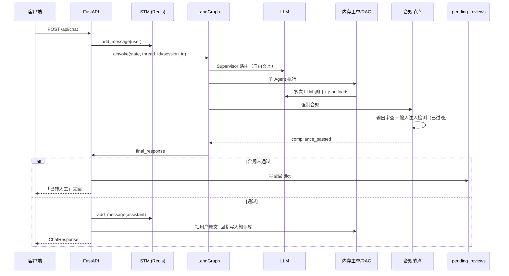
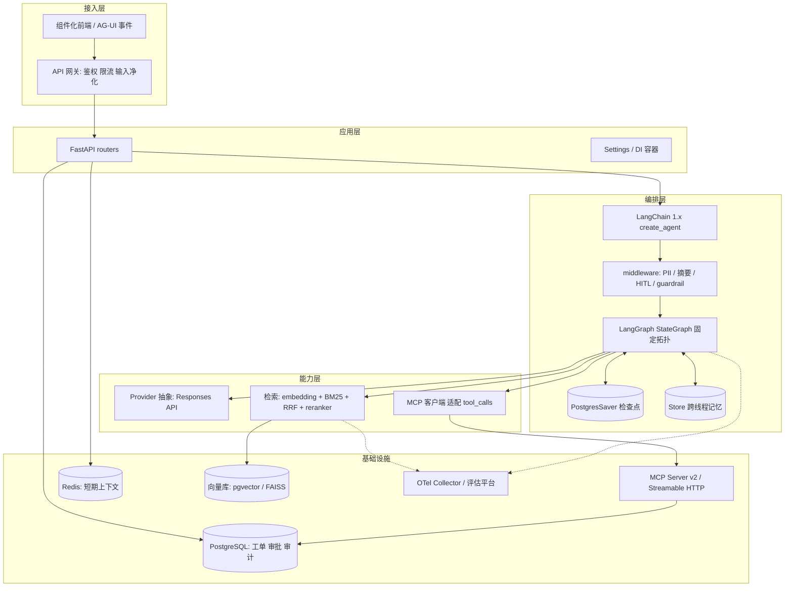
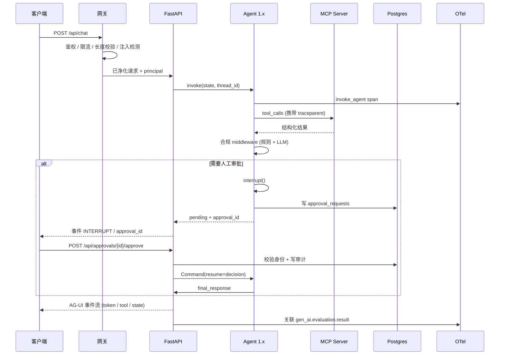
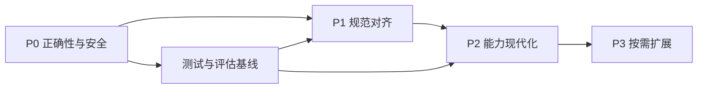

# HeteroAgent 架构与技术升级开发方案

| 项目 | 内容 |
| --- | --- |
| 版本 | v1.0（初始方案） |
| 日期 | 2026-11-06 |
| 基线 | 当前工作区快照，26 个文件，约 4.3k 行；静态代码审阅结论见 `tech-assessment-2026-11.html` |
| 适用范围 | 架构、编排、模型接入、工具协议、记忆检索、可观测与评估、工程交付、安全合规 |
| 交付形态 | 本文件为开发方案，不含已实现代码；文中代码块为改造示例，需按落地时 SDK 版本核对 API 名称 |

---

## 0. 文档说明

### 0.1 目标

把现有「可运行原型」升级为**可复现、可水平扩展、可审计、协议兼容**的生产级多 Agent 客服系统，同时保留业务语义与已验证的设计判断。

具体目标：

1. 消除 9 处已确认的实现缺陷（G1–G9，见 1.3），使合规、审批、路由行为正确。
2. 对齐 4 项现行规范：MCP 2026-07-28、LangChain / LangGraph 1.x、OpenAI Responses API + Structured Outputs、OpenTelemetry GenAI 语义约定。
3. 修复语义检索实质失效问题，建立可度量的检索与生成质量基线。
4. 建立依赖锁定、测试、评估回归、CI、容器与多副本能力。
5. 保留固定 Supervisor 拓扑与两阶段合规，不改为完全自主多 Agent。

### 0.2 非目标（明确不做）

- 不重写业务领域逻辑：意图分类口径、工单状态机、合规词表的**业务含义**保持不变，只改实现方式。
- 不引入图数据库 / 图记忆 / mem0 类复杂记忆流水线。2026 年多项对照研究显示，保留原始证据 + 强重排的朴素检索常优于复杂记忆流水线，且在上下文预算宽裕时重排收益趋近于零（二手结论，需用本项目数据集复核）。
- 不在 P0 之前替换向量数据库。当前瓶颈是 embedding 为随机向量与知识库污染，换存储不改善任何指标。
- 不引入 A2A，除非出现跨团队 / 跨组织的 Agent 互调需求。同进程内协作用函数调用更简单。
- 不把系统改造成完全自主 Agent 循环。金融客服的可预测性与可审计性优先级高于自治度。

### 0.3 约束与假设

- **渐进式、每阶段可独立上线与回滚**：不允许「大爆炸式」一次替换全部层。
- **保留 API 语义**：`/api/chat`、`/api/history/{session_id}` 的响应结构尽量保持兼容，破坏性变更需走版本化路径。
- **内网 / 离线假设**：若部署环境无法访问 OpenAI 或公共模型仓库，所有外部模型调用必须通过 Provider 抽象隔离，可替换为内网兼容网关或本地 embedding / reranker 模型；前端不得依赖外链字体。方案中所有外部依赖都按此原则设计。
- **配置单一真相源**：改造完成后 `pyproject.toml` + `Settings` 类是唯一配置入口，`requirements.txt`、`.env.example` 降级为生成物 / 示例。
- 本方案基于静态审阅，未运行服务。所有「实际效果」判断需在 P0 阶段用真实数据集基线与回归测试确认。

### 0.4 阅读指引

- 第 1 章是现状基线，所有改造任务都引用其中的文件与行号。
- 第 2 章是目标架构与契约，编码前先冻结。
- 第 3 章是可排期的任务表（ID 形如 `T-P0-01`），含验收与回滚。
- 第 4 章是分域详细设计，是第 3 章任务的技术展开。
- 第 5–6 章是数据 / 接口契约与测试验收，第 7 章是风险，第 8 章是索引与未决事项。

---

## 1. 现状基线与改造地图

### 1.1 现有目录与职责

| 路径 | 关键符号 | 现状职责 | 目标状态 |
| --- | --- | --- | --- |
| `api/main.py` | `app`、`lifespan`、`chat`、`chat_stream`、`pending_reviews`、审批端点 | REST + SSE、全局单例、进程内 HITL 队列 | 拆为 `app/routers/*` + `app/deps.py`；审批外置到数据库；移除全局可变状态 |
| `agents/supervisor.py` | `AgentState`、`SupervisorNode`、`create_supervisor_graph`、`FAQ_KNOWLEDGE`、`_ROUTE_CACHE`、`_wrap_with_timeout` | 构图、LLM 路由、手写重试 / 缓存 / 聚合 | 保留拓扑，改用 1.x `create_agent` + middleware；删除手写胶水 |
| `agents/intent_router.py` | `IntentRouterAgent`、`IntentResult` | 多级意图识别（**死代码，未被 add_node**） | 转为结构化输出 schema + 路由函数，或删除并合并到 Supervisor |
| `agents/knowledge_rag.py` | `KnowledgeRAGAgent`、`rewrite_query`、`rerank_documents`、`self_correct` | 改写、检索、重排、生成、自我纠正 | 保留流程，替换 embedding 来源、中文 reranker、异步执行与结构化输出 |
| `agents/ticket_handler.py` | `TicketStore`、`analyze_request`、`create_ticket` | 内存工单 CRUD | `TicketStore` 换数据库实现；动作由结构化输出 / tool_calls 驱动 |
| `agents/compliance_checker.py` | `ComplianceResult`、`full_check`、`process`、`_detect_injection` | 规则 + LLM 两阶段审查、输入净化 | 输入净化前置到 API 入口；修复脱敏覆盖；规则迁移为 middleware / guardrail |
| `memory/working_memory.py` | `WorkingMemory` | 进程内请求级状态 | 由 LangGraph 图状态 + `Store` 取代 |
| `memory/short_term.py` | `ShortTermMemory` | Redis list，TTL 30min，`get_context_window` 用 `len//2` 估 token | 保留 Redis，但统一 token 计数；由 checkpointer 承担线程状态 |
| `memory/long_term.py` | `LongTermMemory`、`MilvusLongTermMemory`、`create_vector_store` | FAISS + BM25 + RRF；hash 伪向量；工厂**未被调用** | embedding 强制真实；索引去重 / 持久化；启用工厂或删除 Milvus 分支 |
| `mcp/mcp_server.py` | `MCPToolServer`、`handle_jsonrpc`、`create_default_tools` | 自造 JSON-RPC、4 个假数据工具、熔断器 | 换官方 MCP SDK v2；工具接真实数据源；接入 Agent 图 |
| `tracing/otel_config.py` | `init_tracer`、`trace_agent_call`、`AgentMetrics` | 自定义 `agent.*` span + 进程内计数器 | 换 GenAI semconv + 自动插桩；指标换 OTel metrics |
| `evaluation/evaluator.py` | `GoldenSet`、`Evaluator` | 4 条硬编码用例，Recall@K / MRR / Faithfulness | 版本化数据集、trajectory 评估、CI 门禁 |
| `static/index.html` | 内联 CSS/JS、手写 SSE 解析 | 单文件演示页 | 组件化前端 + AG-UI 事件（P3） |
| `requirements.txt` / `.env.example` / `Dockerfile` | — | 无锁依赖、散落配置、单阶段 root 镜像 | `pyproject.toml` + `uv.lock` + `Settings` + 多阶段镜像 |
| `README.md` | — | 描述与实现存在偏差 | 随 P1 同步修订 |

### 1.2 当前请求链路



关键观察：`MCPToolServer` 不在这条链路上；`IntentRouterAgent` 不在图中；`MemorySaver` 只存 RAM。

### 1.3 已确认缺陷与任务映射

| ID | 缺陷 | 证据 | 对应任务 |
| --- | --- | --- | --- |
| G1 | Prompt 注入检测在合规节点，晚于所有 LLM 调用 | `agents/compliance_checker.py:244-261` | T-P0-01 |
| G2 | 合规失败时把所有字符串 `sub_results` 覆盖成同一段 `sanitized_content` | `agents/compliance_checker.py:276-279` | T-P0-02 |
| G3 | `approve` 端点无身份校验、无留痕，直接返回 Agent 原始回复 | `api/main.py:445-471` | T-P0-03 |
| G4 | `IntentRouterAgent` 实例化但从未 `add_node` | `agents/supervisor.py:344` | T-P0-08 / T-P1-02 |
| G5 | FAQ 早退把 `intent` 写成 `compliance_checker` | `agents/supervisor.py:207-218` | T-P0-04 |
| G6 | 路由缓存按文本前 50 字符全局跨用户共享、无淘汰 | `agents/supervisor.py:34,220-257` | T-P0-04 |
| G7 | hash 伪向量 + 阈值 0.05 + 只看关键词命中的评估 | `memory/long_term.py:136-149`、`agents/knowledge_rag.py:24` | T-P0-05 / T-P0-06 |
| G8 | 每轮对话原文写入知识库；`save()` 从未被调用 | `api/main.py:97-117,270-274` | T-P0-06 |
| G9 | 无认证 / 限流 / 输入长度上限；CORS `*` + credentials；PII 正则 `\d{16,19}` 误判长数字 | `api/main.py:169-175`、`agents/compliance_checker.py:32-37,100-136` | T-P0-07 / T-P0-02 |

边界条件补充（纳入测试用例）：否定词判断只回看违规词前 6 个字符；`llm_check` 解析失败默认 `passed=True`；工单号正则只接受大写十六进制或 6 位数字，与 `TK-YYYYMMDD-XXXXXX` 生成器格式不完全一致。

### 1.4 配置与依赖现状

`requirements.txt` 逐行问题：

| 依赖 | 问题 | 处置 |
| --- | --- | --- |
| `langgraph>=0.3.0`、`langchain>=0.3.0`、`langchain-openai>=0.3.0` | 0.x 且无上界，1.x 破坏性升级会被静默拉入 | P1 锁定 1.x 具体次版本 |
| `langchain-community>=0.3.0` | 代码零引用 | 删除 |
| `langsmith>=0.2.0` | 代码零引用；`.env.example` 有注释但未接线 | 若使用平台则显式配置，否则删除 |
| `mcp>=1.0.0` | 声明了官方 SDK 却自造协议 | P1 升 v2 并真正使用 |
| `tiktoken>=0.8.0` | 声明但 `api/main.py:48`、`memory/short_term.py:111` 各自手写估算 | 统一使用或删除 |
| `redis`、`faiss-cpu`、`opentelemetry-*`、`fastapi`、`uvicorn` 等 | 无锁、无上界 | 全部进 `pyproject.toml` + `uv.lock` |
| `sentence-transformers`、`pymilvus` | 代码 `import` 了但未声明，靠 `try/except` 静默降级 | 显式声明为可选依赖组，或删除对应分支 |

`.env.example` 问题：

- `VECTOR_STORE_TYPE=faiss` / `MILVUS_HOST` / `MILVUS_PORT`：**配置未生效**。`api/main.py:122` 与 `evaluation/evaluator.py:200` 都直接 `LongTermMemory(...)`，从未调用 `memory/long_term.py:690` 的 `create_vector_store` 工厂。
- `OTEL_EXPORTER_OTLP_ENDPOINT` 默认有值，而 `README.md` 描述为「None 则控制台输出」，行为不一致。
- `MODEL_NAME=gpt-4o` 为旧代默认；缺少 embedding 模型、reranker、审批存储、鉴权、限流等配置项。

死代码 / 未生效清单（P0 清理或接线）：`IntentRouterAgent`、`create_vector_store`、`ToolDefinition.requires_auth`、`ToolCallResult.timestamp` 的审计用途、`FAQ_KNOWLEDGE`、`_ROUTE_CACHE`、`get_context_window`、`export_for_persistence`、`MilvusLongTermMemory`（未接线）、`mcp/tools/__init__.py`（空）。

---

## 2. 目标架构

### 2.1 设计原则

1. **拓扑不变，实现替换**：保持 `路由 → 业务 Agent → 强制合规 → 聚合` 的固定图，业务可预测性不受框架升级影响。
2. **状态外置**：任何需要跨请求 / 跨副本存活的数据都不放进程内存。
3. **协议优先**：工具走 MCP 现行规范，前端事件走 AG-UI，遥测走 GenAI semconv，避免私有约定。
4. **结构化优先**：模型输出一律 schema 约束，禁止用 `json.loads` 驱动有副作用的动作。
5. **失败要显式**：外部依赖（embedding、LLM、Redis）不可用时快速失败或明确降级，禁止静默伪降级。
6. **可度量才升级**：每个阶段的完成定义包含可复现的评估 / 回归结果。

### 2.2 目标分层



### 2.3 目标请求链路



### 2.4 目标目录结构

```
HeteroAgent-main/
├── pyproject.toml              # 唯一依赖与工具配置真相源
├── uv.lock                     # 提交到 Git，CI 用 --locked
├── .python-version
├── Dockerfile                  # 多阶段、非 root
├── .dockerignore
├── src/heteroagent/
│   ├── config.py               # Pydantic Settings
│   ├── app/
│   │   ├── main.py             # create_app / lifespan（无全局可变单例）
│   │   ├── deps.py             # 依赖注入：graph / llm / stores / mcp client
│   │   ├── middleware.py       # 鉴权、限流、输入净化、请求 ID
│   │   └── routers/
│   │       ├── chat.py         # /api/chat, /api/chat/stream
│   │       ├── approvals.py    # /api/approvals/*
│   │       ├── admin.py        # /api/metrics, /api/evaluate, /health
│   │       └── tools.py        # 调试用工具端点（默认关闭）
│   ├── agents/
│   │   ├── state.py            # AgentState v2
│   │   ├── graph.py            # 拓扑定义（5 节点语义保留）
│   │   ├── supervisor.py       # 路由 + 聚合（结构化输出）
│   │   ├── knowledge_rag.py
│   │   ├── ticket_handler.py
│   │   ├── compliance.py
│   │   ├── schemas.py          # 所有 Pydantic 输出 schema
│   │   └── middleware.py       # 自定义 middleware（合规、审计、成本）
│   ├── model/
│   │   ├── provider.py         # Provider 抽象、Responses API 实现、fallback
│   │   └── prompts/            # 版本化提示词（文件而非散落字符串）
│   ├── tools/
│   │   ├── mcp_server.py       # 官方 SDK v2 MCPServer
│   │   ├── definitions/        # 4 个工具的 schema + handler
│   │   └── client.py           # MCP 客户端适配为 LangChain tools
│   ├── memory/
│   │   ├── checkpointer.py     # PostgresSaver / SqliteSaver
│   │   ├── store.py            # Store + 四级作用域
│   │   └── short_term.py       # Redis（统一 token 计数）
│   ├── retrieval/
│   │   ├── embeddings.py       # 真实 embedding，强制失败策略
│   │   ├── chunking.py         # 语义分块 / contextual retrieval
│   │   ├── index.py            # 索引与元数据一致性、去重、持久化
│   │   ├── bm25.py             # 中文分词 + 增量 IDF
│   │   ├── rerank.py           # 中文 / 多语 reranker，异步执行
│   │   └── hybrid.py           # RRF 融合
│   ├── persistence/
│   │   ├── db.py               # 连接池、事务
│   │   ├── models.py           # tickets / approval_requests / tool_audit_log
│   │   └── migrations/         # Alembic
│   ├── observability/
│   │   ├── tracing.py          # GenAI semconv、session.id、traceparent
│   │   └── metrics.py          # OTel metrics、成本聚合
│   └── events/                 # AG-UI 事件定义与 SSE 编码
├── evaluation/
│   ├── datasets/v1/            # 版本化 Golden Set（jsonl）
│   ├── metrics/                # 检索、trajectory、合规、成本
│   └── run.py                  # CI 可调用
├── tests/{unit,integration,eval,security}/
├── static/                     # P3 组件化前端
└── docs/                       # 本方案、架构决策记录 ADR
```

### 2.5 关键契约（编码前冻结）

**AgentState v2**（替换 `agents/supervisor.py:151-161`）：

```python
from typing import Annotated, Any, TypedDict
from langchain.agents import AgentState
from langgraph.graph.message import add_messages

class HAAgentState(AgentState):
    messages: Annotated[list, add_messages]
    user_id: str
    session_id: str
    tenant_id: str
    trace_id: str
    intent: str | None
    intent_confidence: float
    sub_results: dict[str, Any]
    compliance_passed: bool
    compliance_violations: list[str]
    final_response: str
    approval_id: str | None
    retry_count: int
```

变更点：新增 `tenant_id`（跨域隔离）、`trace_id`（审计关联）、`intent_confidence`、`approval_id`；移除 `current_agent`（由框架运行时承担）。`sub_results` 保持 dict 以兼容现有节点语义，但值改为 Pydantic 模型序列化结果，不再直接拼接字符串。

**API 契约变更表**：

| 现有端点 | 目标 | 兼容性 |
| --- | --- | --- |
| `POST /api/chat` | 保留，响应增加 `approval_id?`、`trace_id` | 向后兼容（新增可选字段） |
| `GET /api/chat/stream` | 改为 `POST` + AG-UI 事件流；旧 GET 保留一个废弃期 | 破坏性，需版本化或双写 |
| `GET /api/history/{session_id}` | 保留，改从 checkpointer / Redis 读 | 兼容 |
| `GET /api/tools`、`POST /api/tools/call` | 默认关闭，仅调试；正式调用走 MCP 端点 | 破坏性，需公告 |
| `GET /api/metrics` | 保留但改为 OTel 后端查询代理 + 鉴权 | 兼容 |
| `GET /api/evaluate` | 改 `POST /api/evaluations`，异步任务 + 鉴权 | 破坏性 |
| `GET /api/review/*`、`POST /api/review/{id}/approve\|reject` | 改 `GET/POST /api/approvals/{approval_id}`，带身份与审计 | 破坏性，旧端点 301 过渡 |
| `GET /health` | 拆 `/health/live` 与 `/health/ready` | 兼容保留别名 |

---

## 3. 分阶段路线图

### 3.1 阶段依赖



原则：P0 不引入新框架，只修行为；P1 一次做透规范对齐（避免混跑 0.x / 1.x 两套编排）；P2 在可度量之后投入；P3 由真实需求触发。

### 3.2 P0 — 正确性与安全加固

目标：在不更换框架的前提下，让现有行为正确、数据干净、接口设防。

| 任务 ID | 任务 | 涉及文件与具体改动 | 验收标准 | 回滚点 |
| --- | --- | --- | --- | --- |
| T-P0-01 | 输入净化前置 | 从 `agents/compliance_checker.py:244-261` 抽出 `_detect_injection` 到 `api/main.py` 入口；`/api/chat`、`/api/chat/stream` 在写 Redis、构图之前调用；命中即 4xx + 审计事件，不进入图 | 注入样例在任一 LLM 调用之前被拦截；单测覆盖 12 条 `INJECTION_PATTERNS` | 单函数移动，保留旧调用并加开关 |
| T-P0-02 | 修复合规结果处理 | 改 `agents/compliance_checker.py:276-279`：按各 key 分别脱敏，不整体覆盖；`llm_check` 解析失败改为 `passed=False` + 转人工（`:192-194`）；PII 正则收紧（`\d{16,19}` 加边界与 Luhn 校验，`:32-37`）；否定词窗口从 6 字符改为可配置分句判断（`:100-126`） | 多 Agent 结果各自保留；解析失败不放行；长订单号不误判为银行卡 | 保留旧函数 `_legacy_mask` 一个版本周期 |
| T-P0-03 | 审批可审计 | `api/main.py:33` 的 `pending_reviews` 先迁到 Redis Hash（带 TTL），或 P1 直接进 Postgres；`approve` / `reject`（`:445-499`）增加调用者身份、审批理由、时间戳、结果哈希，写 `approval_audit`；移除「拼接 Agent 原始回复后直接返回」（`:458-462`），改为返回待重跑标记 | 未授权调用 401/403；每次审批有不可篡改记录；审批通过后不会把被拦截原文直接外发 | 队列结构保持不变，仅加字段 |
| T-P0-04 | 删除脆弱缓存与早退 | 删除 `agents/supervisor.py:39-44` `FAQ_KNOWLEDGE`、`:53-62` `_check_faq`、`:207-218` FAQ 分支、`:32-35` `_ROUTE_CACHE`、`:220-257` 缓存分支；知识一致性由检索层保证 | FAQ 问题经正常链路仍得到一致答案；不存在跨用户共享的模块级 dict | 用特性开关保留一个版本周期 |
| T-P0-05 | embedding 快速失败 | `memory/long_term.py:108-149` `_simple_embedding` 删除 hash 伪向量分支；`_init_embedding_model`（`:60-88`）失败时抛 `EmbeddingUnavailableError`，由 lifespan 决定「拒绝启动」或「只读降级」；`agents/knowledge_rag.py:24` 阈值从 `0.05` 提到按真实分数分布校准的值 | 无 API key 时服务明确报错而非返回随机检索；同一语义的近义句相似度显著高于无关句 | 环境变量 `ALLOW_EMBEDDING_FALLBACK` 临时开关 |
| T-P0-06 | 知识库写入治理 | 删除 `api/main.py:97-117` `_write_conversation_summary` 及 `:270-274` 调用；改为显式的「记忆写入」入口（仅结构化事实、经 PII 脱敏、带 user/tenant 作用域）；`memory/long_term.py:151-167` 增加 doc_id 去重；`:342-351` `save()` 在 `add_document` 后按批量策略调用；修复 `:97-106` 索引与 `_documents` 错位 | 连续 100 轮对话后知识库文档数不增长；重启后检索结果与重启前一致 | 关闭写入开关 |
| T-P0-07 | 接口设防 | `api/main.py:169-175` CORS 改白名单 + `allow_credentials` 按实际需要；新增 API Key / JWT 中间件、每租户限流、请求体长度上限；`/api/tools/call`（`:369-381`）、`/api/metrics`、`/api/evaluate`、审批端点全部鉴权 | 未授权 401；超限 429；超长 413；CORS 预检符合浏览器规范 | 中间件可整体禁用 |
| T-P0-08 | 死代码与配置接线 | 删除 `agents/supervisor.py:344` 未使用实例；`api/main.py:122` 与 `evaluation/evaluator.py:200` 改用 `create_vector_store()`（`memory/long_term.py:690`），或删除 Milvus 分支（`:414-683`）并移除 `.env.example` 中 `MILVUS_*`；清理 `requirements.txt` 未用项、补齐 `sentence-transformers` 声明 | 配置 `VECTOR_STORE_TYPE` 生效；静态检查无未使用导入 | 配置回退到 faiss |
| T-P0-09 | 建立测试与评估基线 | 新增 `tests/`：G1–G9 回归用例、检索基线（现有 3 条预置文档 + 扩展 30 条）、合规词表用例；`evaluation/evaluator.py` 的 4 条用例扩到 ≥30 条并落盘为 `datasets/v1.jsonl` | `pytest` 全绿；产出 P0 基线报告（Recall@5、MRR、Faithfulness、误杀率、p95 延迟） | 纯新增，无风险 |

**P0 完成定义**：9 个缺陷全部有回归用例；服务在无 embedding 凭据时不再静默产出随机检索；所有写操作有审计；存在一份可复现的基线报告。

### 3.3 P1 — 规范级对齐

| 任务 ID | 任务 | 涉及文件与具体改动 | 验收标准 | 回滚点 |
| --- | --- | --- | --- | --- |
| T-P1-01 | 依赖与项目结构迁移 | 新增 `pyproject.toml` + `uv.lock` + `.python-version`；`requirements.txt` 由 `uv export` 生成；锁定 LangChain / LangGraph 1.x、MCP SDK v2、FastAPI 具体次版本；按 2.4 迁移到 `src/` 布局 | `uv sync --locked` 在干净环境可复现；`pip check` 无冲突 | 保留旧 tag，整仓回滚 |
| T-P1-02 | 编排框架 1.x | 用 `create_agent` + middleware 重写 `agents/supervisor.py`；保留 5 节点语义：`supervisor_route` / `knowledge_rag` / `ticket_handler` / `compliance_check` / `synthesize`；`_wrap_with_timeout`（`:96-146`）→ 框架 retry / timeout policy；`_TIMEOUT_FALLBACKS`（`:72-76`）→ middleware 降级策略；`synthesize_response`（`:267-290`）→ 结构化聚合 | 拓扑可视化与现状一致；超时 / 重试行为由测试覆盖；删除约 200 行胶水代码 | 保留 `graph_legacy.py` 一个版本周期，用配置切换 |
| T-P1-03 | 结构化输出 | 新增 `agents/schemas.py`；替换 `agents/intent_router.py:78-98`、`agents/ticket_handler.py:140-151`、`agents/compliance_checker.py:188-194`、`agents/knowledge_rag.py:153-159` 的 `json.loads`；改用 `response_format` / `with_structured_output` | 解析失败由框架重试或显式报错；不再出现「解析失败 → 自动创建工单 / 合规放行」；单测注入畸形输出验证 | schema 与旧解析双写比对一个月 |
| T-P1-04 | 模型接入 | 新增 `model/provider.py`；`ChatOpenAI` 全部替换（出现位置：`agents/supervisor.py:335-338`、`api/main.py:404`、`evaluation/evaluator.py:199`、各 Agent 构造函数）；默认模型改为当前代；接入 Responses API 的推理项与提示词缓存；保留兼容 OpenAI 协议的网关开关 | 同一评估集指标不低于 P0 基线；缓存命中率与 token 用量可见 | Provider 接口支持切回 Chat Completions |
| T-P1-05 | 持久化检查点与 HITL | `agents/supervisor.py:374-375` 的 `MemorySaver` → `PostgresSaver`（开发用 `SqliteSaver`）；`api/main.py:222,319` 的 `thread_id=session_id` 改为带租户前缀且 ≤255 字符；`pending_reviews` 队列 → `approval_requests` 表 + `interrupt()` / `Command(resume=...)`；审批端点改造 | 进程重启后待审批请求仍可恢复；两副本指向同一 DB 时审批不丢；检查点有裁剪策略 | 保留旧审批端点重定向 |
| T-P1-06 | MCP 官方 SDK v2 | 删除 `mcp/mcp_server.py:205-242` `handle_jsonrpc` 与 `ping`；用官方 SDK v2 的 `MCPServer` 暴露 Streamable HTTP；实现 `server/discover`、协议版本与能力声明、`Mcp-Method` / `Mcp-Name` 头、`ttlMs` / `cacheScope`、OTel `traceparent` 传播；接入 OAuth 2.1 / CIMD 边界 | 官方 Inspector 可发现并调用；协议版本报告为 2026-07-28；合规网关可通过头路由 | 自造服务器保留在 `legacy/` 仅供内网调试，不注册路由 |
| T-P1-07 | 工具接入 Agent 链路 | 4 个预置工具（`mcp/mcp_server.py:258-352`）迁到 `tools/definitions/`，接真实数据源；`ToolDefinition.requires_auth`（`:30`）真正校验；通过 MCP 客户端适配为 LangChain tools 并绑定给子 Agent | Supervisor 链路的 trace 中出现 `execute_tool` span；工单由 `tool_calls` 创建而非解析文本 JSON；`TicketStore`（`agents/ticket_handler.py:69-103`）改数据库实现 | 工具开关逐个启用 |
| T-P1-08 | 可观测语义对齐 | 重写 `tracing/otel_config.py`：`agent.*` → `gen_ai.*`；span 层级 `invoke_agent` / `execute_tool` / inference / retrieval；接入官方自动插桩包；`session.id`、`traceparent` 贯穿 HTTP 与 MCP 调用 | 在任意 OTel 兼容后端可看到模型、token、成本、工具耗时与完整会话树 | 旧装饰器保留一个版本周期，双写 |
| T-P1-09 | 文档与契约同步 | 修订 `README.md`（当前声称的 MCP 方法、意图路由、MemorySaver HITL 与实现不符）；输出 ADR 记录「为何保留固定 Supervisor」「为何不引入 A2A / 图记忆」 | 文档中的端点、方法、依赖与代码一致 | — |

**P1 完成定义**：合规 MCP 客户端可发现并调用工具；图执行可跨重启恢复；模型输出全部 schema 约束；P0 基线指标不回退。

### 3.4 P2 — 能力现代化

| 任务 ID | 任务 | 涉及文件与具体改动 | 验收标准 |
| --- | --- | --- | --- |
| T-P2-01 | 检索质量 | `memory/long_term.py:373-411` 改语义 / 结构感知分块（按 token 而非字符）；`:181-239` BM25 换中文分词 + 增量 IDF；新增 contextual retrieval 前缀；`agents/knowledge_rag.py:55-76,93-161` 换中文 / 多语 reranker，`ce.predict` 放线程池；`:20-24` 阈值按分数分布重新校准 | Recall@5、MRR 相对 P0 基线可量化提升；重排不阻塞事件循环（并发压测验证） |
| T-P2-02 | 记忆分域 | 引入 LangGraph `Store`，实现 `user / agent / session / org` 四级作用域；`memory/working_memory.py` 下线；`memory/short_term.py:102-117` 统一用 `tiktoken` 计数（与 `api/main.py:48` 一致） | 跨用户检索不串数据；token 预算两种估算结果一致 |
| T-P2-03 | 向量库与索引 | 视数据量决定是否迁 pgvector / Qdrant；实现元数据过滤、删除 / 更新、去重、批量持久化；`create_vector_store` 工厂生效 | 索引与元数据在异常重启后一致；`save/load` 往返测试通过 |
| T-P2-04 | 评估体系 | `evaluation/evaluator.py` 扩展：trajectory、tool-call 正确性、合规误杀率、端到端延迟与成本；LLM-as-judge 加校准集与一致性检验；评估分数通过 `gen_ai.evaluation.result` 关联回 span；`/api/evaluations` 异步执行 | 每次提示词 / 模型 / embedding 变更都有可对比的回归报告 |
| T-P2-05 | CI 门禁 | 新增流水线：`uv sync --locked` → Ruff → 类型检查 → `pytest` → 评估回归（阈值来自基线，不硬编码）→ 镜像构建 → 依赖审计 | 指标回退超过阈值时流水线失败 |
| T-P2-06 | 流式与前端协议 | `api/main.py:286-353` 改 token 级流 + AG-UI 事件（工具开始 / 结束、状态增量、审批请求）；`static/index.html` 去掉 Google Fonts 外链（`:7-8`）、修正端口文案（`:517`）、替换手写 SSE 解析（`:651-697`） | 首字延迟显著低于现状；审批请求可在前端就地授权 |
| T-P2-07 | 工程与多副本 | `Dockerfile` 多阶段 + 非 root + `.dockerignore`；`api/main.py:515-522` 移除 `reload=True`、由受管 ASGI 进程与多 worker 启动；`:411-413` 拆 live / ready；全局单例改为 DI 容器 | 两副本并行时会话、审批、工单不丢；ready 检查覆盖 DB / Redis / embedding |

**P2 完成定义**：评估回归成为合并前置条件；服务可水平扩展；检索与生成质量有版本化对比数据。

### 3.5 P3 — 按需扩展

| 任务 ID | 触发条件 | 内容 |
| --- | --- | --- |
| T-P3-01 | 出现跨团队 / 跨组织 Agent 互调 | 引入 A2A 1.0：签名 Agent Card、任务委派、身份校验；不要用于同进程内协作 |
| T-P3-02 | 数据量或过滤需求超过 FAISS 能力 | 迁 pgvector / Qdrant / Milvus，保留 `HybridSearch` 接口不变 |
| T-P3-03 | 需要审批台 / 轨迹回放 / 多端一致 | 前端组件化，按 AG-UI 事件契约重写 |
| T-P3-04 | 成本成为主要瓶颈 | 语义缓存、模型分级路由、按租户预算与硬上限 |
| T-P3-05 | 合规要求长任务与人工多轮介入 | 采用 MCP Tasks 扩展（`tasks/get` / `tasks/update`）与 `subscriptions/listen` |

### 3.6 分支与提交策略

针对内网 GitLab 协作，建议：

- 每个任务一个分支（`p0/T-P0-01-input-guard`）与一个 MR，MR 描述固定三段：改动文件、验收命令、截图 / 报告路径。
- P0 全部任务在 `release/p0` 集成分支上验证后再合入主干；P1 因涉及目录大规模迁移，单独开 `release/p1` 长分支并定期 rebase 主干。
- 每次合入打 tag（`p0.1`、`p1.0`），tag 即回滚点；`graph_legacy.py`、`legacy/mcp_server.py` 在 P1 稳定一个版本周期后删除。
- 破坏性 API 变更（`/api/chat/stream`、`/api/evaluate`、审批端点）先双写、再公告、最后移除，不允许直接删除。

---

## 4. 分域详细设计

### 4.1 编排层

#### 4.1.1 节点迁移映射

| 现有节点（`agents/supervisor.py:349-372`） | 目标 | 具体处理 |
| --- | --- | --- |
| `supervisor_route` | 保留 | `SupervisorNode.route_decision`（`:193-265`）改为结构化输出 `RouteDecision`，删除 FAQ / 缓存分支后只剩一次 LLM 调用 |
| `knowledge_rag` | 保留 | `KnowledgeRAGAgent.process` 内部改造，节点边界不变 |
| `ticket_handler` | 保留 | 动作改由 `tool_calls` + `TicketAction` schema 驱动 |
| `compliance_check` | 保留 | `ComplianceCheckerAgent.process` 只做输出审查；输入净化移出 |
| `synthesize` | 保留 | 聚合改为模板 / 结构化合并，不再 `"\n\n".join` 所有字符串（`:279-284`） |
| `compliance_checker` 意图直接跳合规（`:301,365`） | 修正 | 该分支当前不执行任何业务 Agent，导致用户只问合规政策时得到空回复；改为走 `knowledge_rag` + 合规标签 |

#### 4.1.2 手写机制 → 内置能力映射

| 现有实现 | 位置 | 目标 |
| --- | --- | --- |
| `_wrap_with_timeout`（超时 + 指数退避 + 降级） | `:96-146` | 框架 retry / timeout policy + 自定义 middleware 的 `wrap_model_call` |
| `FAQ_KNOWLEDGE` 早退 | `:39-44,53-62,207-218` | 删除；由检索层与提示词缓存承担 |
| `_ROUTE_CACHE` | `:32-35,220-257` | 删除；如确需缓存，用带 `tenant_id` 的语义缓存并设 TTL / 上限 |
| `_write_conversation_summary` | `api/main.py:97-117` | 删除；改为 `SummarizationMiddleware` + 显式记忆写入 |
| PII 脱敏 | `agents/compliance_checker.py:138-148` | `PIIMiddleware` + 输出端 guardrail 双保险 |
| 进程内 HITL | `api/main.py:33,231-263,416-499` | `HumanInTheLoopMiddleware` / `interrupt()` + `Command(resume=...)` |
| `MemorySaver` | `:374-375` | `PostgresSaver` |
| `WorkingMemory` | `memory/working_memory.py` | 图状态 + `Store` |

> API 名称以落地时所用 LangChain / LangGraph 1.x 版本官方文档为准；`create_agent`、`PIIMiddleware`、`SummarizationMiddleware`、`HumanInTheLoopMiddleware`、`response_format` 均已见于官方 Python v1 发布说明。

#### 4.1.3 HITL 设计

```python
# 示意：合规未通过时在图内中断，而非在 API 层写全局 dict
from langgraph.types import Command, interrupt

def compliance_gate(state):
    if state["compliance_passed"]:
        return state
    approval_id = persist_approval_request(
        tenant_id=state["tenant_id"],
        session_id=state["session_id"],
        trace_id=state["trace_id"],
        violations=state["compliance_violations"],
        proposed_content_hash=hash_content(state["final_response"]),
    )
    decision = interrupt({"approval_id": approval_id, "reason": "compliance"})
    return {**state, "compliance_passed": decision.approved,
            "approval_id": approval_id}
```

审批表字段与审计要求见 5.1。审批通过后**重新走聚合节点生成回复**，绝不把被拦截的原始文本直接返回（修复 G3）。

#### 4.1.4 检查点治理

- `thread_id` 格式：`{tenant_id}:{session_id}`，长度 < 255（官方持久化文档对 `PostgresSaver` 的限制）。
- 检查点保留策略：按时间裁剪（如保留 N 天），由定时任务执行；官方文档明确长会话检查点会无界增长。
- 开发用 `SqliteSaver`，生产用 `PostgresSaver`；`MemorySaver` 仅在单元测试中出现。

#### 4.1.5 删除清单

`agents/supervisor.py`：`FAQ_KNOWLEDGE`、`_ROUTE_CACHE`、`_ROUTE_CACHE_TTL`、`_normalize_for_cache`、`_check_faq`、`_is_retryable`、`_wrap_with_timeout`、`_TIMEOUT_FALLBACKS`、`should_check_compliance`（恒返回恒值的函数）、`import operator`（未使用）。

### 4.2 模型接入层

#### 4.2.1 Provider 抽象

```python
# src/heteroagent/model/provider.py（骨架）
class LLMProvider(Protocol):
    async def invoke(self, messages, *, schema=None, tools=None,
                     cache_key=None, trace_id=None) -> ModelResult: ...

class ResponsesProvider:
    """OpenAI Responses API：保留推理项、结构化输出、提示词缓存。"""
    ...

class CompatibleChatProvider:
    """内网兼容网关 / 旧接口回退实现。"""
    ...
```

所有 Agent 构造函数改为接收 `LLMProvider`，不再直接 `ChatOpenAI(...)`。这样在内网无法访问 OpenAI 时可整体切换，且便于按任务分级选择模型。

#### 4.2.2 结构化输出 schema（来自现有提示词字段）

```python
class RouteDecision(BaseModel):
    target: Literal["knowledge_rag", "ticket_handler", "compliance_checker"]
    intent_category: Literal["consultation", "complaint", "transaction",
                             "account", "compliance", "unknown"]
    secondary_intent: str
    confidence: float = Field(ge=0, le=1)
    entities: dict[str, str] = Field(default_factory=dict)

class TicketAction(BaseModel):
    action: Literal["create", "query", "update"]
    ticket_id: str | None = None
    ticket_type: Literal["refund", "claim", "account_open",
                         "account_change", "complaint", "general"]
    priority: Literal["low", "medium", "high", "urgent"]
    summary: str
    details: str

class ComplianceVerdict(BaseModel):
    passed: bool
    risk_level: Literal["low", "medium", "high", "critical"]
    violations: list[str]
    suggestions: list[str]

class RerankDecision(BaseModel):
    ranked_indices: list[int]
```

字段来源：`agents/intent_router.py:39-61`、`agents/ticket_handler.py:36-66`、`agents/compliance_checker.py:63-79`。`RerankDecision` 取代 `agents/knowledge_rag.py:153-159` 的「逗号分隔索引」解析。

#### 4.2.3 调用点替换对照

| 位置 | 现状 | 目标 |
| --- | --- | --- |
| `agents/supervisor.py:249-257` | `await llm.ainvoke(prompt)` → `.content.strip().lower()` + 白名单兜底 | `RouteDecision`，非法值由框架重试 |
| `agents/intent_router.py:78-98` | `json.loads(response.content)` | 合并进 `RouteDecision`，文件可删除 |
| `agents/ticket_handler.py:140-151` | `json.loads` 失败默认 `action="create"` | `TicketAction`；失败即报错，不产生副作用 |
| `agents/compliance_checker.py:188-194` | 解析失败 `passed=True` | `ComplianceVerdict`；失败按不通过处理 |
| `agents/knowledge_rag.py:153-159` | 解析「0,2,4」 | `RerankDecision` 或直接由 reranker 分数排序 |
| `agents/knowledge_rag.py:234-243` | `self_correct` 用字符串 `"PASS"` 判定 | 改为 `CorrectionVerdict(passed, corrected_answer)` |
| `evaluation/evaluator.py:123-140` | judge 返回字符串数字 `float(...[:4])` | 结构化 judge schema + 校准集 |

#### 4.2.4 上下文与缓存

- 提示词从散落字符串（`SUPERVISOR_SYSTEM_PROMPT`、`RAG_SYSTEM_PROMPT`、`TICKET_SYSTEM_PROMPT`、`COMPLIANCE_SYSTEM_PROMPT`、`QUERY_REWRITE_PROMPT`）抽到 `model/prompts/`，带版本号与变更记录，便于评估回归。
- 静态系统提示放最前以命中前缀缓存；动态上下文放后。
- 统一 token 计数：删除 `api/main.py:48` 的 `len/1.8` 与 `memory/short_term.py:111` 的 `len//2`，统一用已声明的 `tiktoken`（若走 Responses API 也可直接用返回的 usage）。
- 上下文压缩交 `SummarizationMiddleware`，按 token 阈值触发，而非固定「最近 20 轮」。
- 模型分级：路由 / 重排等轻任务用小模型，合规与生成用主模型；由 `Settings` 配置，Provider 支持 fallback 链。

### 4.3 工具协议层

#### 4.3.1 迁移到 MCP 2026-07-28

现行规范要点（一手资料）：无状态核心、移除 `initialize` 握手与 `Mcp-Session-Id`、强制 `server/discover` 声明协议版本与能力、每次请求在 `_meta` 携带版本与客户端能力、列表结果带 `ttlMs` / `cacheScope`、Streamable HTTP 需 `Mcp-Method` / `Mcp-Name` 头、OAuth 2.1 + CIMD 与发行方校验、OTel `traceparent` 传播约定；**`ping`、`logging/setLevel` 已移除**，旧 HTTP+SSE 传输与 Roots / Sampling / Logging 进入 12 个月弃用期；Tasks / MCP Apps / EMA 成为扩展。

因此：

- 删除 `mcp/mcp_server.py:205-242` 的 `handle_jsonrpc`（含 `ping` 分支）与 README 中对应描述。
- 用官方 Python SDK v2 的 `MCPServer`（v1 中名为 `FastMCP`，来自二手资料，落地前以官方迁移指南核对）暴露 Streamable HTTP 端点，例如 `/mcp`。
- 不依赖会话粘性：跨调用状态用显式句柄（如 `approval_id`、`job_id`）作为工具参数传递，与 2.3 的审批设计一致。
- `tools/list` 返回确定性顺序，配合提示词缓存；附带 `ttlMs` / `cacheScope`。
- 工具 schema 使用完整 JSON Schema（现有 4 个工具的 `input_schema` 可直接迁移）。

#### 4.3.2 现有工具迁移表

| 工具（`mcp/mcp_server.py`） | 现状 | 目标实现 | 授权 |
| --- | --- | --- | --- |
| `order_query`（`:261-280`） | 返回硬编码假订单 | 查 `orders` 表 / 订单服务，按 `tenant_id` + `user_id` 过滤 | 需用户身份 |
| `knowledge_search`（`:282-298`） | 返回拼接假片段 | 调 `retrieval/hybrid.py`，返回真实文档与分数 | 只读，可匿名按租户 |
| `ticket_create`（`:300-322`） | 返回随机工单号，与 `TicketStore` 两套实现 | 统一到 `persistence/models.py` 的 `tickets` 表，复用 `TK-YYYYMMDD-XXXXXX` 格式 | 需用户身份 + 幂等键 |
| `risk_check`（`:324-350`） | 按金额阈值硬编码 | 接风控规则服务，结果与合规节点共用 `risk_level` 枚举 | 需服务身份 |

`TicketStore`（`agents/ticket_handler.py:69-103`）删除，改为通过 `ticket_create` 工具访问数据库；避免两套工单实现分叉。

`requires_auth`（`mcp/mcp_server.py:30`）此前声明但从未校验：迁移后在工具调用入口统一做 principal 校验，并记录 `tool_audit_log`（调用者、工具、参数哈希、结果状态、耗时、trace_id）。熔断器（`CIRCUIT_*`，`:17-20,94-126`）可保留为客户端侧策略，但状态也需外置或改为无状态计数。

#### 4.3.3 与 Agent 图集成

- 用 MCP 客户端把 `tools/list` 结果适配为 LangChain tools，绑定给 `knowledge_rag` / `ticket_handler` 子 Agent。
- 模型输出 `tool_calls` → 宿主执行 → 结果回填，取代「LLM 写文本 → 正则 / JSON 猜动作」。
- 在 `execute_tool` span 上记录 `gen_ai.tool.name`、耗时与结果状态；`traceparent` 通过 `_meta` 传入 MCP 请求。

#### 4.3.4 验收

- 官方 MCP Inspector 能完成 `server/discover` → `tools/list` → `tools/call` 全流程。
- 网关可按 `Mcp-Method` / `Mcp-Name` 路由与限流；无 `Mcp-Session-Id` 也能在多副本后正常工作。
- 未授权调用工具返回明确错误并写审计日志。

### 4.4 记忆与检索层

#### 4.4.1 embedding 强制策略

```python
class EmbeddingUnavailableError(RuntimeError): ...

def embed(self, text: str) -> np.ndarray:
    if self._client is None:
        raise EmbeddingUnavailableError(
            "embedding provider unavailable; refusing random-vector fallback"
        )
    vec = np.asarray(self._client.embed_query(text), dtype=np.float32)
    if vec.shape[0] != self.embedding_dim:
        raise EmbeddingUnavailableError("dimension mismatch")
    return vec / np.linalg.norm(vec)
```

删除 `memory/long_term.py:136-140` 的 `sha256` 播种随机向量。失败语义由 `Settings.allow_embedding_fallback` 决定：默认拒绝启动；只读降级时明确在响应中标注「检索不可用」，不得伪装成正常结果。

> 内网约束：若外部 embedding API 不可达，应部署本地多语 embedding 模型并作为 Provider 实现，而不是恢复伪向量。

#### 4.4.2 索引与元数据一致性

- `add_document`（`:151-167`）：以内容 hash 作 doc_id，先查重再写；index 与 `_documents` 在同一事务 / 原子落盘中更新。
- `_init_index`（`:90-106`）：加载失败时**同时清空** `_documents`，避免两数组错位。
- `save()`（`:342-351`）纳入写入流程（批量 flush 或显式调用），并增加 `load()` 往返测试。
- 元数据至少含 `tenant_id`、`source`、`doc_type`、`created_at`；检索时按租户过滤。
- `MilvusLongTermMemory`（`:432-683`）与 `create_vector_store`（`:690-705`）二选一：要么通过工厂接线的正式后端，要么删除以减少维护面。当前两者都「存在但不生效」。

#### 4.4.3 分块、分词、重排

| 现状 | 位置 | 目标 |
| --- | --- | --- |
| 512 **字符**硬切 + 128 重叠，注释却写 512 tokens | `:373-411` | 按 token 计；优先段落 / 句子边界；可选 contextual retrieval（为块预置 LLM 生成背景前缀） |
| 逐字中文 + 英文串正则分词 | `:183-188` | 中文分词器 + bigram 兜底；IDF 增量维护，避免每次全量扫描 |
| 英文 `cross-encoder/ms-marco-MiniLM-L-6-v2` | `agents/knowledge_rag.py:70-73` | 中文 / 多语 reranker；模型本地化以适配内网 |
| 同步 `ce.predict()` 在 async 函数内 | `:93-117` | `asyncio.to_thread` 或独立推理进程；超时与降级显式化 |
| LLM 重排解析逗号索引、越界即吞 | `:138-161` | 结构化 `RerankDecision` 或直接按分数排序 |
| 置信度阈值 0.05 | `:24` | 用真实分数分布重新校准，并在评估集中验证 |

保留 BM25 + 向量 + RRF 的融合结构（`memory/long_term.py:260-292`），它仍是 2026 年主流做法；RRF `k=60` 无需改。

#### 4.4.4 知识库写入治理与记忆分域

- 停止 `api/main.py:97-117` 的每轮对话原文写入。改为：显式「记忆写入」入口，只写结构化事实，先经 PII 脱敏，带 `tenant_id / user_id / session_id / agent_id` 作用域。
- 作用域优先级：本次 session → 该 user → 该 org 的公共知识；检索时按此顺序回退。避免「一个扁平 store」导致的跨用户泄露。
- 跨会话事实与长时记忆放 LangGraph `Store`；线程内状态放 checkpointer；Redis 只保留近期上下文缓存。
- 反向约束：不引入事实抽取流水线 / 图记忆，除非用本项目数据集验证其收益超过「原始证据 + 强重排」基线。

### 4.5 可观测性与评估

#### 4.5.1 遥测改造

`tracing/otel_config.py` 当前只记录 `agent.name / duration_ms / success / error / result_keys`（`:116-145`）。目标 span 层级与属性：

| Span | 关键属性 |
| --- | --- |
| `invoke_agent` | `gen_ai.agent.name`、`agent.id`、`session.id`、`tenant_id`、`trace_id`、聚合 token 与成本 |
| inference / `gen_ai.client.operation` | `gen_ai.request.model`、`gen_ai.response.model`、`gen_ai.usage.input_tokens`、`gen_ai.usage.output_tokens`、缓存读 token、`gen_ai.response.finish_reasons` |
| `execute_tool` | `gen_ai.tool.name`、参数大小（不记原文）、结果状态、耗时 |
| `agent.retrieval` | `retrieval.store`、`top_k`、结果数、延迟、最高分 |
| `gen_ai.evaluation.result` 事件 | 关联到被评估输出的 span |

- 接入官方自动插桩包（OpenAI / LangChain）而非手写装饰器；自定义 span 只补业务语义。
- 默认不采集提示词 / 回复全文；如需采集，按租户开关 + 脱敏 + 更短留存期。
- `traceparent` / `tracestate` 贯穿 FastAPI → MCP → 下游 HTTP；MCP 规范已给出 `_meta` 传播约定。
- `AgentMetrics`（`:152-177`）进程内累加器改为 OTel metrics（直方图 + 分位数），或保留为开发态调试视图但明确不用于生产。
- GenAI 语义约定在 2026 年仍有部分属性处于 experimental，固定插桩包与约定版本，并在升级时检查属性重命名。

#### 4.5.2 评估体系

现状（`evaluation/evaluator.py`）问题：4 条硬编码用例（`:42-66`）、GET 触发（`api/main.py:394-408`）、只测 Recall@K / MRR / Faithfulness、judge 用 `float(response.content.strip()[:4])`（`:137`）、失败取中性分 0.5（`:140`）。

目标：

| 维度 | 指标 | 数据来源 |
| --- | --- | --- |
| 检索 | Recall@K、MRR、nDCG | `datasets/v1.jsonl` 标注文档 |
| 生成 | Faithfulness、Answer Relevance | 校准过的结构化 judge |
| Agent 轨迹 | 路由正确率、工具调用正确率、多余调用数 | `invoke_agent` trace |
| 合规 | 违规漏放率、合规误杀率、脱敏正确率 | 合规词表 + 人工标注集 |
| 工程 | p50 / p95 延迟、每请求 token 与成本、重试率 | OTel metrics |
| 安全 | 注入拦截率、越权工具调用次数 | 安全测试集 + 审计日志 |

- 数据集版本化落盘，禁止写在代码里；评估结果写入报告文件并由 CI 比对阈值（阈值由 P0 基线确定，不硬编码）。
- `/api/evaluations` 改 POST + 鉴权 + 异步任务，避免 GET 触发 LLM 计费调用。
- 评估分数通过 `gen_ai.evaluation.result` 回挂到产生该输出的 span，形成 trace → eval 闭环。

### 4.6 工程与交付

#### 4.6.1 依赖与配置

`pyproject.toml` 骨架：

```toml
[project]
name = "heteroagent"
version = "0.2.0"
requires-python = ">=3.12,<3.14"
dependencies = [
  "fastapi>=0.115,<1",
  "pydantic>=2.10,<3",
  "langchain>=1,<2",
  "langgraph>=1,<2",
  "langchain-openai>=1,<2",
  "mcp>=2,<3",
  "redis>=5,<6",
  "opentelemetry-sdk>=1.29,<2",
  "tiktoken>=0.8,<1",
]

[project.optional-dependencies]
vector = ["faiss-cpu>=1.9,<2", "pgvector>=0.3"]
rerank = ["sentence-transformers>=3,<6"]

[dependency-groups]
dev = ["pytest", "pytest-asyncio", "ruff", "mypy", "pip-audit"]
eval = ["ragas"]

[tool.ruff]
line-length = 100
```

`Settings`（`src/heteroagent/config.py`）需覆盖：模型 provider / 主模型 / 轻模型 / embedding 模型 / reranker、Redis DSN、Postgres DSN、向量后端与路径、MCP 端点与授权配置、OTLP 端点与采样、`session_ttl`、`checkpoint_retention_days`、`max_context_tokens`、限流阈值、`allow_embedding_fallback`、`enable_debug_tool_endpoints`。所有 `os.getenv` 调用（散落在 `api/main.py`、`agents/supervisor.py`、`memory/long_term.py`、`evaluation/evaluator.py`、`.env.example`）统一收口。

#### 4.6.2 测试分层

| 层 | 内容 | 关键用例 |
| --- | --- | --- |
| unit | schema、规则引擎、分块、RRF、token 计数、脱敏 | G1–G9 的纯函数回归 |
| integration | 图执行、checkpointer 往返、MCP 客户端、Redis / DB | 重启恢复审批、两副本共享状态、Inspector 发现工具 |
| eval | 检索 / 生成 / 轨迹 / 合规 / 成本 | CI 回归门禁 |
| security | 注入、越权、限流、CORS、PII 误判 | 12 条注入模式、长数字误判、未授权审批 |

#### 4.6.3 CI 与容器

流水线阶段：`uv sync --locked` → `ruff check` / `ruff format --check` → `mypy` → `pytest` → 评估回归 → `pip-audit` → 镜像构建。`--locked` 保证锁文件与声明不一致即失败。

`Dockerfile` 目标形态：多阶段（builder 用 `uv sync --frozen --no-dev`，runtime 用精简基础镜像并只拷 venv 与源码）、非 root 用户、`HEALTHCHECK` 指向 `/health/ready`、`.dockerignore` 排除 `.git` / `vector_store` / `tests` / `.env`。启动入口移除 `api/main.py:521` 的 `reload=True`，由外部 ASGI 进程管理 worker 数。

#### 4.6.4 前端与事件契约（P2/P3）

- AG-UI 事件类型：`TEXT_MESSAGE_CONTENT`（token）、`TOOL_CALL_START` / `TOOL_CALL_END`、`STATE_DELTA`、`INTERRUPT`（审批）、`RUN_ERROR`、`RUN_FINISHED`。
- 现有 `_STAGE_LABELS`（`api/main.py:286-292`）逐步废弃；前端不再手写 `buffer.split('\n')` 解析（`:651-697`），改用标准事件消费。
- `static/index.html` 去掉 Google Fonts 外链、修正「Port 8001」文案、移除 emoji 图标（改用矢量形状），并按主题变量组织样式。

### 4.7 安全与合规横切

| 主题 | 现状问题 | 目标设计 |
| --- | --- | --- |
| 注入防护 | 检测发生在 `compliance_check` 节点，晚于所有 LLM 调用 | 网关层前置；`_detect_injection` 保留为纯函数，规则版本化并加测试 |
| 输出脱敏 | 所有 `sub_results` 被同一段文本覆盖 | 逐字段脱敏；保留结构；脱敏前后哈希入审计 |
| 审批 | 全局 dict、无身份、无留痕、放行原文 | DB + `interrupt` + 身份校验 + 不可篡改审计 + 审批后重跑聚合 |
| 认证授权 | 全部端点匿名 | API Key / JWT + 租户隔离；MCP 侧 OAuth 2.1 / CIMD |
| 限流与输入 | 无 | 每租户限流、请求体长度上限、工具调用频率上限 |
| CORS | `*` + credentials（浏览器会拒绝该组合） | 显式白名单；按实际是否需要 credentials 决定 |
| PII 规则 | `\d{16,19}` 误判长数字；否定词只看前 6 字符 | 银行卡加边界 + Luhn；否定判断按分句；词表版本化 |
| 失败默认 | `llm_check` 解析失败 → `passed=True` | 一律 fail-closed，转人工 |
| 工单号 | 查询正则与生成格式不完全一致 | 统一正则常量，集中定义 |

---

## 5. 数据与接口契约

### 5.1 数据表（DDL 示意）

```sql
CREATE TABLE tickets (
  ticket_id      text PRIMARY KEY,
  tenant_id      text NOT NULL,
  user_id        text NOT NULL,
  type           text NOT NULL,
  priority       text NOT NULL,
  status         text NOT NULL,
  summary        text NOT NULL,
  details        text NOT NULL,
  idempotency_key text UNIQUE,
  created_at     timestamptz NOT NULL DEFAULT now(),
  updated_at     timestamptz NOT NULL DEFAULT now()
);

CREATE TABLE approval_requests (
  approval_id    uuid PRIMARY KEY,
  tenant_id      text NOT NULL,
  session_id     text NOT NULL,
  trace_id       text NOT NULL,
  risk_level     text NOT NULL,
  violations     jsonb NOT NULL,
  content_hash   text NOT NULL,
  state          text NOT NULL,          -- pending / approved / rejected / expired
  created_at     timestamptz NOT NULL DEFAULT now(),
  expires_at     timestamptz NOT NULL
);

CREATE TABLE approval_audit (
  id             bigserial PRIMARY KEY,
  approval_id    uuid NOT NULL REFERENCES approval_requests,
  actor_id       text NOT NULL,
  actor_role     text NOT NULL,
  decision       text NOT NULL,
  reason         text,
  prev_hash      text NOT NULL,
  row_hash       text NOT NULL,          -- 链式哈希，防篡改
  created_at     timestamptz NOT NULL DEFAULT now()
);

CREATE TABLE tool_audit_log (
  id             bigserial PRIMARY KEY,
  trace_id       text NOT NULL,
  tenant_id      text NOT NULL,
  actor_id       text,
  tool_name      text NOT NULL,
  args_hash      text NOT NULL,
  success        boolean NOT NULL,
  duration_ms    double precision NOT NULL,
  created_at     timestamptz NOT NULL DEFAULT now()
);
```

检查点表由 `PostgresSaver` 管理，不手工建表；文档与向量元数据表按所选向量后端定义，至少含 `tenant_id`、`source`、`doc_type`、`content_hash`（唯一约束用于去重）。

### 5.2 环境变量清单

| 变量 | 状态 | 说明 |
| --- | --- | --- |
| `OPENAI_API_KEY`、`OPENAI_BASE_URL` | 保留但改名 `LLM__*` | 由 Provider 读取，支持内网网关 |
| `MODEL_NAME=gpt-4o` | 废弃 | 拆为 `LLM__MAIN_MODEL`、`LLM__LIGHT_MODEL`、`LLM__EMBEDDING_MODEL` |
| `REDIS_URL`、`FAISS_INDEX_PATH` | 保留 | 归入 `STORAGE__*` |
| `VECTOR_STORE_TYPE`、`MILVUS_*` | 修复接线 | 通过 `create_vector_store()` 生效，或整体删除 |
| `OTEL_*` | 保留并补齐 | 增加采样策略、内容采集开关、约定版本 |
| `HOST`、`PORT` | 保留 | 由进程管理器读取 |
| 新增 | — | `DB__DSN`、`AUTH__*`、`RATE_LIMIT__*`、`SESSION_TTL`、`CHECKPOINT_RETENTION_DAYS`、`MAX_CONTEXT_TOKENS`、`ALLOW_EMBEDDING_FALLBACK`、`ENABLE_DEBUG_TOOL_ENDPOINTS` |

### 5.3 兼容性与过渡

- `/api/chat` 响应新增可选字段，老客户端不受影响。
- `GET /api/chat/stream` 保留到 P2 结束，返回同一 SSE 格式但内部改用新事件编码器；P3 移除。
- `/api/review/*` 在 P1 期间 301 到 `/api/approvals/*`，并在响应头标注废弃时间。
- `/api/tools/*` 默认关闭，仅 `ENABLE_DEBUG_TOOL_ENDPOINTS=true` 时注册。

---

## 6. 测试与验收

### 6.1 回归用例（对应缺陷）

| 用例 | 断言 |
| --- | --- |
| G1 | 提交 12 条注入样例，LLM 调用计数为 0，审计日志有拦截记录 |
| G2 | 两个子 Agent 同时产出时，合规失败后各自内容仍可区分且均已脱敏 |
| G3 | 未带凭证调用 approve 返回 401；带凭证调用后不返回被拦截原文；审计链哈希连续 |
| G4 | 路由结果与 `RouteDecision` 一致；代码中不存在未注册节点 |
| G5 | 输入「理财产品A的收益率」得到的 intent 为 `knowledge_rag` |
| G6 | 两个不同租户的相同文本不会互相命中缓存（模块级缓存已删除） |
| G7 | 无 embedding 凭据时启动失败 / 明确降级；近义句相似度高于无关句；阈值非 0.05 |
| G8 | 100 轮对话后知识库文档数不变；重启前后检索 Top-3 一致 |
| G9 | 未授权 401、超限 429、超长 413；`TK-20261106-ABC123` 不被判为银行卡 |

### 6.2 评估门禁

P0 产出基线报告后，把 Recall@5、MRR、Faithfulness、合规误杀率、p95 延迟、每请求成本写入 `evaluation/baseline.json`；CI 中按「相对基线不退步超过阈值」判定，阈值由团队确认后写入配置，不在代码里硬编码。任何提示词、模型、embedding、reranker、分块参数变更都必须附带一次评估运行。

### 6.3 灰度与回滚

- 每个阶段打 tag；回滚以 tag 为单位，不做逐文件回退。
- P1 的编排与 MCP 迁移风险最高：保留 `graph_legacy.py` 与 `legacy/mcp_server.py`，通过配置切换，观察一个版本周期后再删除。
- 数据库迁移只做 additive（加列 / 加表），禁止在同一阶段做破坏性列删除，保证回滚时旧代码仍可读。
- 工具逐个启用：先 `knowledge_search`（只读），再 `order_query`，最后 `ticket_create`（有副作用），每个工具单独灰度。

---

## 7. 风险登记册

| ID | 风险 | 影响 | 概率 | 缓解 | 阶段 |
| --- | --- | --- | --- | --- | --- |
| R1 | LangChain / LangGraph 1.x 破坏性升级导致现有图语义漂移 | 高 | 中 | 保留 legacy 图并做轨迹对比测试；固定 1.x 次版本；先跑 P0 基线 | P1 |
| R2 | MCP SDK v2 API 仍在演进（v1 `FastMCP` → v2 `MCPServer` 等） | 中 | 中 | 锁定版本；以官方迁移指南为准；抽象 `MCPClient` 接口隔离 SDK | P1 |
| R3 | 内网无法访问 OpenAI / 模型仓库 | 高 | 中 | Provider 抽象 + 兼容网关 + 本地 embedding / reranker；不写死厂商 | P0/P1 |
| R4 | 真实 embedding 接入后检索分数分布变化，阈值与评估失效 | 中 | 高 | P0 先建基线，P2 重新校准阈值；评估集版本化 | P0/P2 |
| R5 | 去掉 FAQ 早退与路由缓存后延迟上升 | 中 | 高 | 用提示词缓存、轻模型路由与摘要中间件补偿；用 p95 指标验证 | P0/P1 |
| R6 | 审批状态外置后旧客户端兼容 | 中 | 中 | 旧端点 301 过渡 + 双写一段时间 | P1 |
| R7 | GenAI 语义约定属性重命名 | 低 | 中 | 固定插桩包与约定版本；升级时查 changelog | P1 |
| R8 | 全局单例改造涉及面广，遗漏导致多副本数据丢失 | 高 | 中 | 两副本集成测试作为 P2 完成定义；静态扫描禁止模块级可变状态 | P2 |
| R9 | 破坏性 API 变更影响调用方 | 中 | 中 | 版本化路径 + 公告 + 废弃期 | P1/P2 |

---

## 8. 附录

### 8.1 问题 → 任务索引

| 来源 | 编号 | 任务 |
| --- | --- | --- |
| 评估报告 | A1 编排框架 0.x | T-P1-01、T-P1-02 |
| 评估报告 | A2 伪 HITL | T-P0-03、T-P1-05 |
| 评估报告 | A3 无工具调用 | T-P1-07、T-P1-03 |
| 评估报告 | A4 缺协议层 | T-P2-06、T-P3-01 |
| 评估报告 | A5 死代码 | T-P0-08、T-P1-02 |
| 评估报告 | B1 模型代际 | T-P1-04 |
| 评估报告 | B2 / B3 结构化输出与工具调用 | T-P1-03、T-P1-07 |
| 评估报告 | B4 缓存策略 | T-P0-04、T-P2-04（模型层） |
| 评估报告 | B5 流式 | T-P2-06 |
| 评估报告 | C1 / C2 / C3 工具协议 | T-P1-06、T-P1-07、T-P0-07 |
| 评估报告 | D1 / D2 检索实现 | T-P0-05、T-P0-06、T-P2-01、T-P2-03 |
| 评估报告 | D3 记忆语义 | T-P2-02 |
| 评估报告 | D4 分块 / 重排 | T-P2-01 |
| 评估报告 | E1 / E2 遥测与评估 | T-P1-08、T-P2-04 |
| 评估报告 | F1–F4 工程交付 | T-P1-01、T-P2-05、T-P2-07、T-P2-06 |
| 评估报告 | G1–G9 缺陷 | T-P0-01 … T-P0-07 |

### 8.2 代码级删除清单（P0/P1 完成后应不存在）

`FAQ_KNOWLEDGE`、`_ROUTE_CACHE`、`_check_faq`、`_normalize_for_cache`、`_wrap_with_timeout`、`_is_retryable`、`_TIMEOUT_FALLBACKS`、`should_check_compliance`、`pending_reviews`、`_write_conversation_summary`、`_estimate_tokens`、`MCPToolServer.handle_jsonrpc` 中的 `ping` 分支、`memory/long_term.py` 的 hash 随机向量、`agents/knowledge_rag.py` 的 LLM 逗号索引重排、`memory/working_memory.py` 整文件（由 Store 取代）、`TicketStore` 内存实现、`static/index.html` 的 Google Fonts 外链。

### 8.3 来源与置信度

一手（规范 / 官方文档 / 官方公告）：MCP 2026-07-28 规范与 changelog、LangChain 官方 Python v1 发布说明、LangGraph 官方持久化文档、OpenAI GPT-5 构建指南与 GPT-4o 退役公告、OpenTelemetry 官方 GenAI 可观测博客、Linux Foundation A2A 1.0 新闻稿。

二手（落地前需复核）：MCP Python SDK v2 具体 API 名称与迁移细节、GPT-5 世代具体型号与定价、GenAI semconv 稳定状态、AG-UI 采纳范围、2026 年记忆 / RAG 对照研究结论、uv / pyproject 工程惯例细节。

外部链接与逐项引用见 `tech-assessment-2026-11.html` 第 10 章。

### 8.4 未决事项（需团队拍板）

1. 部署环境是否为内网、是否允许外部模型 API？决定 Provider 与 embedding / reranker 的本地化方案。
2. 向量后端最终选 FAISS、pgvector 还是 Milvus？决定 `MilvusLongTermMemory` 保留或删除。
3. 认证体系：复用现有企业身份还是独立 API Key / JWT？决定 `principal` 结构与 MCP 授权边界。
4. 评估门禁的可接受回退阈值。
5. 是否保留 `/api/tools/*` 调试端点，以及废弃期长度。
6. 前端是否重做为组件化审批台（决定 P3 是否立项）。
7. 检查点与审批数据的保留天数（合规要求）。

---

**文档结束。** 本方案与 `tech-assessment-2026-11.html` 配套使用：前者回答「为什么落后」，本文件回答「具体怎么改、改哪里、怎么验收」。
