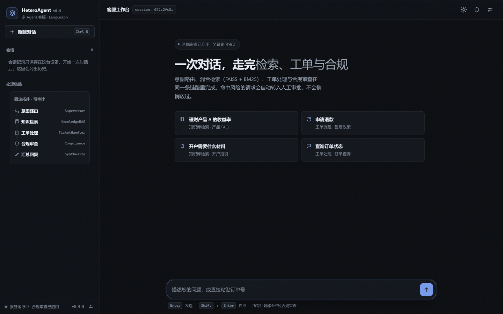
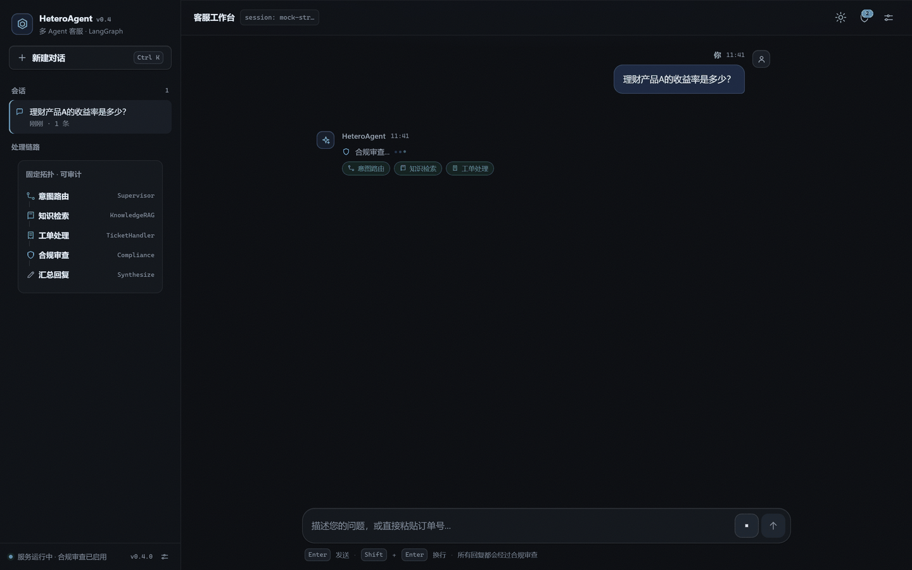
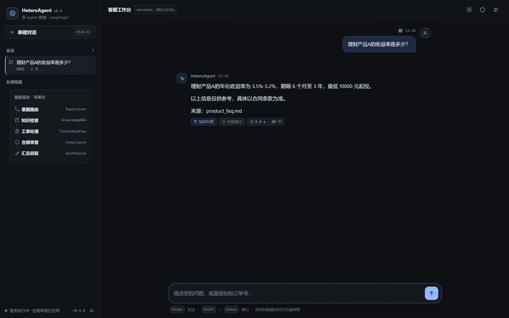
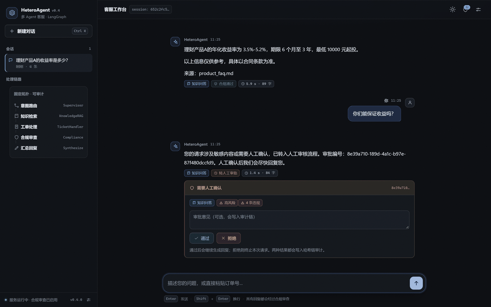
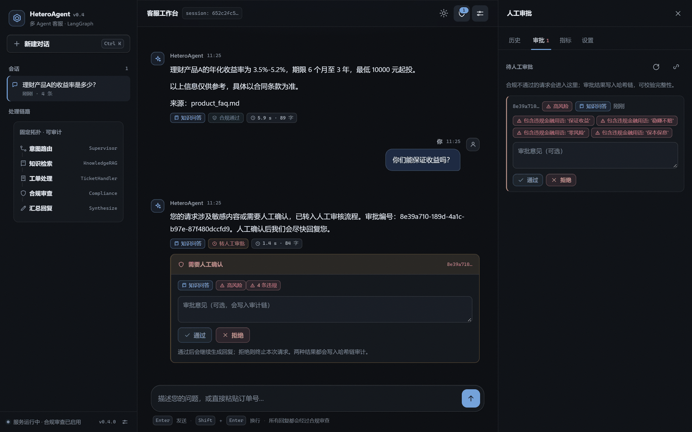
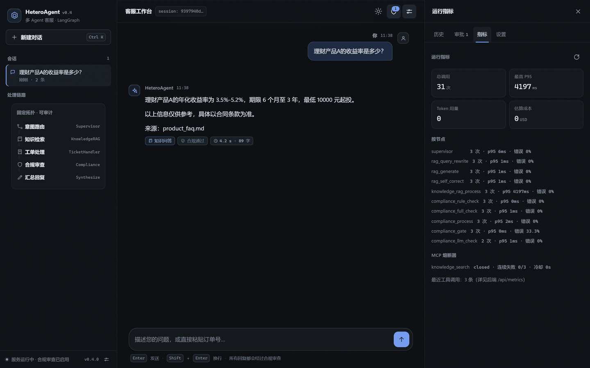
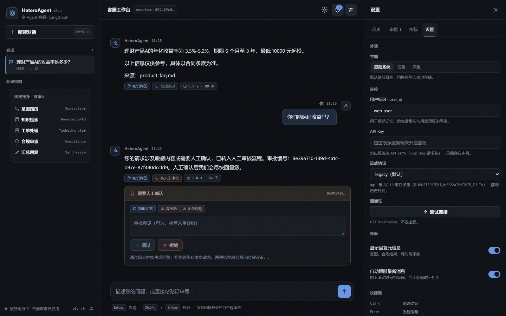
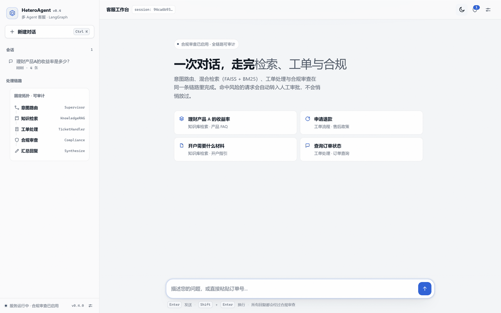
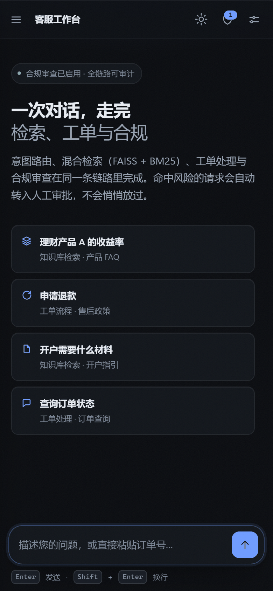

# 前端工作台（`static/`）

把「意图路由 → 知识检索 / 工单处理 → 合规审查 → 人工审批」的链路状态收进同一条对话流。

**零构建、零外链**：原生 ES 模块 + 设计令牌 CSS，不需要打包器，不请求任何 CDN；断网环境下页面照常渲染（旧的单文件版本曾因 Google Fonts 阻塞而白屏）。



**在线演示（静态）**：[https://lc-di-yan.github.io/HeteroAgent/](https://lc-di-yan.github.io/HeteroAgent/)
同一套界面，后端替换为浏览器内的脚本化实现（`docs/demo/mock-backend.js`）：不调用真实模型、不含密钥，适合对外展示。

## 快速体验

```bash
# 无 API Key 也能跑通整条链路（脚本化模型 + 关键词知识库）
DEMO_MODE=true python -m uvicorn api.main:app --host 127.0.0.1 --port 8000
# 打开 http://127.0.0.1:8000/ → 自动跳转 /static/index.html
```

想看到「合规拦截 + 人工审批」：发送 **「你们能保证收益吗？」**，回复会带 `转人工审批` 标签与审批卡片，右上角盾牌出现待处理数量。

## 截图

### 流式阶段

已完成节点落成左侧 pill，当前节点留在状态行；token 到达后逐字渲染，最终结果再用 Markdown 渲染一次。



### 回答与元信息

每条回复带意图、合规结果、耗时与字数；命中语义缓存时额外标记。



### 人工审批（HITL）

合规不通过 → 图内 `interrupt()` → 聊天流里直接审批；也可以从抽屉的审批队列处理，并校验哈希审计链。





### 运行指标 / 设置

指标来自 `GET /api/metrics`（节点 P95、错误率、token、成本、MCP 熔断状态）；设置里可切换主题、填写 `x-api-key`、修改 `user_id`、切换 legacy / AG-UI 流式协议。





### 浅色与移动端





## 设计原则

| 原则 | 落地方式 |
| --- | --- |
| 零构建 | 只用 `<script type="module">`，五个 ES 模块互相 `import`，浏览器直接执行 |
| 零外链 | 系统字体栈（Segoe UI Variable / PingFang SC / Microsoft YaHei）+ 内联 SVG 图标，无字体/CDN 请求 |
| 单一强调色 | 石墨中性色基底 + 冷蓝 `--accent`；绿/琥珀/红只用于状态语义（合规通过、风险、拦截） |
| 无 emoji 图标 | 统一 1.75 描边、24px 网格的内联 SVG（`icons.js`），小尺寸自动加粗到 1.95 |
| 克制动效 | 只动画 `transform`/`opacity`；尊重 `prefers-reduced-motion` |
| 状态完整 | 每个异步动作都有 loading / empty / error / 成功态；错误可重试，不做 `alert()` |

## 目录与模块

| 文件 | 行数 | 职责 |
| --- | --- | --- |
| `index.html` | 225 | 语义化骨架：侧栏、对话流、抽屉（历史/审批/指标/设置）、离线横幅 |
| `css/app.css` | 1444 | 设计令牌（明/暗双主题）、组件样式、响应式断点 1180 / 960 / 560 |
| `js/app.js` | 1523 | 编排：会话、流式状态机、消息渲染、抽屉面板、快捷键、健康检查 |
| `js/api.js` | 270 | SSE 客户端（CRLF/多行 data/尾包），JSON 端点封装，typed `ApiError`，AG-UI 翻译 |
| `js/markdown.js` | 304 | Markdown → DOM；全部 `createElement`/`textContent`，链接白名单 http(s)/mailto |
| `js/store.js` | 177 | `localStorage` 持久化：设置 + 会话；容量降级、版本化键名 |
| `js/icons.js` | 162 | SVG 图标注册表 + 阶段元数据（节点名 → 中文标签/图标） |

## 交互状态

### 流式状态机

1. 提交 → 用户消息落库/渲染 → 插入「处理中」行（阶段轨 + 状态行 + 停止按钮）；
2. `stage` 事件 → 状态行切到当前节点，上一个节点落成已完成 pill，左侧「处理链路」同步高亮；
3. `token` 事件 → 累积文本，按 `requestAnimationFrame` 合并写入（避免逐字重排）；
4. `response` 事件 → 用 Markdown 渲染权威结果替换占位行，写入本地会话，附意图/合规/耗时标签；
5. `error` / 中止 → 内联错误行（可重试）；429 进入冷却倒计时并禁用发送。

停止生成使用 `AbortController`；中断后保留已生成文本并标记「已停止」。

### 错误矩阵

| 情形 | 界面表现 | 可执行动作 |
| --- | --- | --- |
| 400 注入/护栏 | 「请求被安全护栏拦截」+ 服务端原因 | 改写后重试 |
| 401 | 「缺少或无效的 API Key」 | 打开设置填写 |
| 413 | 「消息过长」 | 精简后重试 |
| 429 | 「触发限流」+ 冷却读秒 | 等待自动恢复 |
| 503 | 「服务未就绪」提示配置模型/演示模式 | 重试 |
| 断网 / 后端不可达 | 顶部横幅 + 内联错误 | 自动 30s 轮询恢复 |

### 审批

- 聊天内卡片：风险等级、违规条目（按 `GET /api/approvals/{id}` 补齐）、审批意见；
- 抽屉队列：`GET /api/approvals`，逐条通过/拒绝，`POST /api/approvals/{id}/{approve|reject}`；
- 审计链：`GET /api/approvals/audit/chain` → 「审计链完整 · N 条记录」。

## 与服务端的契约

### SSE（默认 legacy）

`POST /api/chat/stream?protocol=legacy`，响应为 `text/event-stream`：

| 事件 | 关键字段 | 前端行为 |
| --- | --- | --- |
| `session` | `session_id` | 更新会话；若服务端换发 id，本地会话自动迁移 |
| `stage` | `node`、`label` | 更新阶段轨与侧栏链路 |
| `token` | `text` | 增量渲染 |
| `response` | `response`、`intent`、`compliance_passed`、`approval_id`、`cache_hit` | 最终渲染 + 元信息；有审批则插入审批卡 |
| `error` | `status`、`message` | 内联错误 |
| `done` | — | 结束一次生成 |

### AG-UI（`?protocol=agui`）

前端把 AG-UI 子集翻译回内部事件：`RUN_STARTED → session`、`STEP_STARTED → stage`、`TEXT_MESSAGE_CONTENT → token`、`STATE_DELTA → intent/compliance`、`CUSTOM(approval_required) → approval`、`RUN_FINISHED → response`、`RUN_ERROR → error`。设置里可切换协议。

### 其它端点

- `GET /api/history/{session_id}` — 服务端短期记忆（抽屉「历史」）
- `GET /api/metrics` — 节点指标 / 熔断状态（抽屉「指标」，需鉴权时带 `x-api-key`）
- `GET /health/live` — 页脚健康状态、30s 轮询、离线横幅

鉴权为可选：设置里的 API Key 会作为 `x-api-key` 发送，**只保存在本机 localStorage**。

## 静态演示（GitHub Pages）

Pages 只发布 `/docs`，所以演示页需要把前端资源复制进去：

```bash
python scripts/build_demo.py          # 重新生成 docs/demo/
python scripts/build_demo.py --check  # 校验与 static/ 是否同步（CI / 测试会跑）
```

- `docs/index.html`：演示门户（链接演示、仓库与本文档）
- `docs/demo/index.html`：由 `static/index.html` 改写资源路径生成，模块脚本前注入 `mock-backend.js`
- `docs/demo/mock-backend.js`：拦截 `fetch`，模拟 SSE 阶段/token、合规拦截、审批、历史与指标
- `tests/test_static_ui.py::test_demo_assets_in_sync` 防止演示资源与 `static/` 漂移

## 本地存储

| 键 | 内容 | 约束 |
| --- | --- | --- |
| `ha.settings.v2` | 主题、API Key、user_id、协议、元信息开关 | 页面启动前读取，避免闪白 |
| `ha.conversations.v2` | `order[]` + `items{sessionId: {title, messages[], updatedAt}}` | 24 个会话 / 每个 160 条；超配额自动裁剪最旧 |

写入去抖 120ms，`beforeunload` 兜底落盘。

## 无障碍与性能

- 语义地标（`aside/main/header/footer`）、skip link、`role="log"`、独立 `aria-live` 播报区（流式文本 `aria-live="off"`，避免逐字朗读）；
- 所有可点元素有名称，键盘 Tab 顺序可走通，`:focus-visible` 焦点环；移动端抽屉带焦点陷阱，Esc 关闭；
- 对比度：正文 16.5:1（暗）/ 16.6:1（亮），三级文本 ≥ 5:1；
- 首屏 `DOMContentLoaded` ≈ 164ms（本地 demo），一次页面加载 0 个外部请求；
- token 增量按帧合并，Markdown 只在最终结果解析一次；主题切换不再触发全站 `transition`。

## 验证

- `tests/test_static_ui.py`（10 项，无需浏览器）：DOM id、图标注册、本地资源、无外链、无 emoji、无 `alert`、主题令牌、Markdown 不使用 `innerHTML`；
- `python -m pytest -q` → **394 passed**；
- 浏览器矩阵（Playwright + Edge，临时脚本未入库）：1440×900 / 768×900 / 390×844 / 360×844，暗/亮、离线、SSE 错误、429、长会话 40 条、AG-UI；控制台零报错、无横向溢出。

## 已知限制

- 删除会话只清本地，不清理服务端短期记忆（没有对应端点）；
- AG-UI 的 `STATE_DELTA` 只消费 `/intent` 与 `/compliancePassed`，未实现完整 JSON Patch；
- 未注册 Service Worker（避免静态资源版本陈旧）；离线时只能浏览已缓存页面；
- 审批队列按 60s 轮询，决策后立即刷新，不做 WebSocket 推送。
